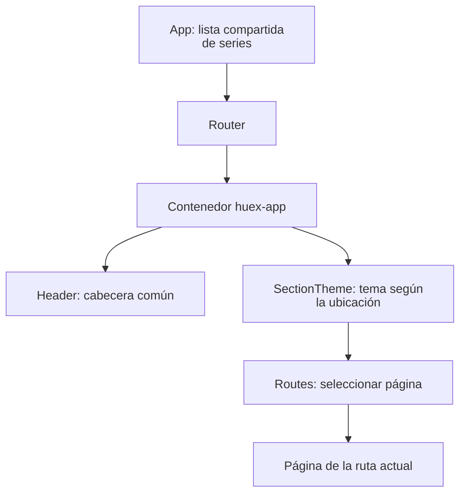

# App

[Frontend](README.md) · [Código TSX](../codigo/App.md)

`src/App.tsx` reúne la estructura general de la aplicación: el navegador de rutas, la cabecera común, el área de contenido y las páginas. Incluye dos funciones de componente: `SectionTheme` y `App`.

App mantiene también las preferencias visuales de Series y Películas mediante dos llamadas a `useLibraryDensity`. Header recibe esos estados para mostrar el slider de la biblioteca actual, y cada página recibe su `densityStyle`. De esta forma, el control del header y las carátulas utilizan el mismo estado. [Tamaño de carátulas](componentes/library-density.md).

## Organización

| Bloque | Responsabilidad |
| --- | --- |
| Tema de la sección | Aplicar al contenido la clase de tema correspondiente a la ruta. |
| Aplicación principal | Construir el componente raíz. |
| Estados | Conservar la lista compartida de series. |
| Estructura y navegación | Organizar la cabecera y las páginas dentro del enrutador. |

## SectionTheme({ children })

Recibe en `children` el contenido de las rutas. `useLocation()` obtiene la ubicación actual del enrutador y extrae `pathname`.

La expresión `pathname.split('/')[1]` toma el primer segmento de la URL. Por ejemplo, tanto `/series` como `/series/episodes` producen `series`. Ese segmento se utiliza para seleccionar el tema:

| Primer segmento | Tema | Clase añadida al contenido |
| --- | --- | --- |
| Cadena vacía, en `/` | `library` | `huex-theme-library` |
| `series` | `series` | `huex-theme-series` |
| `player` | `series` | `huex-theme-series` |
| `movies` | `movies` | `huex-theme-movies` |
| `music` | `music` | `huex-theme-music` |

Devuelve un `<main>` con la clase `huex-app-content`, la clase de tema cuando existe una asociación y el contenido recibido. En `/settings`, el contenedor utiliza la clase base.

Al navegar, `useLocation` proporciona la nueva ubicación y React vuelve a calcular el tema. Las clases de `HuexStyles.css` aportan las variables de color que heredan los elementos del contenido.

## App()

Construye el árbol principal dentro de `BrowserRouter`, importado con el nombre `Router`. Esto permite que la cabecera use enlaces y que `SectionTheme` consulte la ubicación.

`Header` permanece junto al área de contenido. Dentro de `SectionTheme`, `Routes` selecciona la página correspondiente a la URL mediante los elementos `Route`.

### Estado compartido

| Estado | Valor inicial | Uso |
| --- | --- | --- |
| `seriesList` | `[]` | Lista de series que App conserva en memoria. |

`App` pasa `seriesList` y `setSeriesList` a `Series`. Cuando esa página actualiza la lista mediante el setter, React guarda el nuevo valor en App y vuelve a renderizar. El estado permanece mientras App sigue montado, también al navegar entre páginas.

### Rutas

| Ruta | Contenido |
| --- | --- |
| `/` | `Home`, biblioteca principal. |
| `/movies` | Cabecera «Mis películas» y mensaje de próxima disponibilidad. |
| `/series` | `Series`, con la lista compartida y su setter. |
| `/series/episodes` | `SeriesDetail`, temporadas y episodios. |
| `/player` | `VideoPlayer`, reproductor. |
| `/music` | Cabecera «Mi música» y mensaje de próxima disponibilidad. |
| `/settings` | `Settings`, configuración. |

Los contenidos de películas y música se definen directamente en el JSX de sus rutas, con `HuexPageHeader` y el contenedor de estado vacío.

## Estructura visual

`huex-app` organiza la cabecera y el área principal. `huex-app-content` contiene la página y su desplazamiento. Las reglas compartidas se encuentran en `src/css/HuexStyles.css`.

## Referencias relacionadas

- [Header: navegación y pantalla completa](componentes/header.md).
- [Series: biblioteca, categorías y progreso](paginas/series.md).
- [SeriesDetail: temporadas y episodios](paginas/series-detail.md).
- [VideoPlayer: reproducción y eventos](paginas/video-player.md).

MkDocs genera la página de código desde `App.tsx` y observa ese archivo durante la consulta local para reflejar sus cambios.
