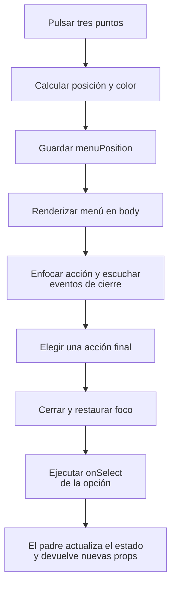

# HuexCardMenu

[Frontend](../README.md) · [Código JSX](../../codigo/HuexCardMenu.md) · [Tarjeta HuexCard](huex-card.md)

Muestra los tres puntos de una tarjeta y las acciones que proporciona su componente padre. `HuexCard` lo incorpora cuando recibe una lista `menuItems` con opciones. Los episodios de `SeriesDetail` proporcionan la acción de visto/no visto. `SeriesCategoryRow` proporciona mover a categoría y reiniciar serie.

## Propiedades

| Propiedad | Tipo | Uso |
| --- | --- | --- |
| `name` | Texto | Nombre de la tarjeta para los textos accesibles del botón y del menú. |
| `menuItems` | Lista de opciones | Acciones y submenús. Su valor predeterminado es una lista vacía. |
| `title` | Texto opcional | Encabezado del menú principal. Su valor predeterminado es una cadena vacía. |
| `disabled` | Booleano opcional | Deshabilita tanto el botón de opciones como la acción del menú. |

`HuexCardMenuProps` y `HuexCardMenuItem` declaran las propiedades con JSDoc. El componente recibe `props` y desestructura sus valores dentro de la función. `disabled` tiene como valor predeterminado `false`.

### Datos de cada opción

| Propiedad | Uso |
| --- | --- |
| `id` | Identificador estable y único dentro del nivel del menú. |
| `label` | Texto de la opción. |
| `onSelect` | Función ejecutada al seleccionar una acción final. |
| `children` | Lista de opciones del submenú. Al elegir esta opción se abre ese nivel. |
| `checked` | Un booleano convierte la opción en `menuitemradio`; `true` añade la marca de selección. |
| `disabled` | Deshabilita una opción concreta. |
| `restoreFocus` | Controla el retorno del foco al cerrar. `false` permite que una acción abra su propio diálogo de confirmación. |

## Estado, referencias e identificador

| Variable | Hook | Responsabilidad |
| --- | --- | --- |
| `menuPosition` | `useState(null)` | `null` representa el menú cerrado. El objeto de estilos incluye ancho, altura máxima, coordenadas y color. |
| `submenuPath` | `useState([])` | Identificadores de los submenús abiertos. La lista vacía representa el menú principal. |
| `buttonRef` | `useRef(null)` | Accede al botón de tres puntos para restaurar su foco y reconocer clics sobre él. |
| `menuRef` | `useRef(null)` | Accede al menú para enfocar su acción y reconocer clics interiores. |
| `menuId` | `useId()` | Identificador asociado al menú y a `aria-controls` del botón. |
| `returnFocusIdRef` | `useRef(null)` | Identificador de la opción que debe recuperar el foco al volver de un submenú. |

`isMenuOpen` convierte `menuPosition` a booleano. Cada botón muestra el `label` recibido en su opción.

## Flujo de una acción



## Funciones

Los separadores del código agrupan posicionamiento, apertura y cierre, navegación por submenús, eventos de teclado, eventos exteriores y foco, arrastre y renderizado. Cada función y el efecto de apertura incluyen una explicación breve de su propósito.

### handleToggleMenu

Recibe el evento del botón de tres puntos. `stopPropagation()` evita propagar ese clic a manejadores de elementos antecesores. Si el menú está abierto, llama a `closeMenu()`.

Para abrirlo, limpia la ruta de submenús y llama a `calculatePosition`.

### calculatePosition

Recibe las opciones del nivel, su encabezado y si corresponde a un submenú. Obtiene la posición del botón con `getBoundingClientRect()` y calcula:

- **Ancho:** el menor valor entre 260 px y el ancho de la ventana menos 24 px.
- **Posición horizontal:** intenta alinear el borde derecho con el botón, reservando 12 px en los extremos.
- **Altura estimada:** 40 px por opción más 18 px; añade 36 px si hay encabezado y 40 px si hay botón de vuelta.
- **Altura máxima:** hasta 340 px, limitada por el espacio disponible en el lado elegido. El CSS permite desplazar el interior del menú.
- **Posición vertical:** abre debajo si cabe la altura estimada o si hay más espacio debajo que encima. En otro caso abre arriba. Deja una separación de 8 px respecto al botón y un mínimo de 12 px desde el borde superior de la ventana.

También lee `--huex-accent` del botón y lo copia al objeto de estilos. El cálculo se repite al cambiar de nivel para adaptar el desplegable al número de opciones.

### closeMenu

Asigna `null` a `menuPosition`, limpia `submenuPath` y descarta el foco pendiente. Recibe `restoreFocus`, cuyo valor predeterminado es `true`. Cuando está activado, devuelve el foco al botón de tres puntos con `preventScroll: true` para conservar la posición de desplazamiento.

### goBack

Retira el último identificador de `submenuPath`, recupera las opciones y el título del nivel anterior y recalcula su posición. Guarda el identificador de la opción que abrió el submenú para devolverle el foco.

### handleMenuKeyDown

| Tecla | Acción |
| --- | --- |
| `Escape` o `Tab` | Cancela el comportamiento predeterminado, cierra el menú y devuelve el foco al botón. |
| `ArrowDown` o `ArrowUp` | Recorre las opciones habilitadas y vuelve al extremo opuesto al alcanzar el final. |
| `Home` o `End` | Enfoca la primera o última opción habilitada. |
| `ArrowRight` | Abre el submenú de la opción enfocada. |
| `ArrowLeft` | Vuelve al nivel anterior cuando está dentro de un submenú. |

### handleSelectItem

Si la opción tiene `children`, añade su identificador a `submenuPath` y muestra ese nivel. Si es una acción final, cierra el menú y llama a su `onSelect()`. Respeta `restoreFocus` para acciones que abren diálogos.

## Opciones de las series

[`SeriesCategoryRow.getSeriesMenuItems(serie)`](series-category-row.md#getseriesmenuitems) construye las opciones según los callbacks disponibles:

- **Mover a categoría:** contiene las categorías y «Sin categoría» como `children`. `checked` identifica el destino actual. Al elegir otro, llama a `onMoveSeries` con la ruta de la serie y el identificador de categoría.
- **Reiniciar serie:** llama a `onResetSeries(serie)` para abrir la confirmación. Utiliza `restoreFocus: false`.

El encabezado «Opciones de la serie» se pasa mediante `menuTitle` de `HuexCard`. El menú de eliminar categoría continúa en la cabecera de `SeriesCategoryRow` como una acción independiente de las tarjetas.

## Efecto de apertura y limpieza

El `useEffect` depende de `menuPosition`. Al abrir o cambiar de nivel, prioriza el foco pendiente de vuelta, después una opción marcada y por último la primera habilitada. Registra los eventos globales:

| Evento | Manejador | Resultado |
| --- | --- | --- |
| `pointerdown` en el documento | `handleOutsidePointerDown` | Cierra cuando el objetivo está fuera del menú y del botón de tres puntos. |
| `scroll` en el documento | `dismissMenu` | Cierra al desplazar la página o sus contenedores exteriores. Permite desplazar la lista dentro del menú. |
| `resize` en la ventana | `dismissMenu` | Cierra cuando cambia el tamaño de la ventana. |

Los dos eventos del documento se escuchan en fase de captura. Estos cierres asignan directamente `null` al estado, conservando el foco que corresponda a la interacción exterior.

La función de limpieza retira los tres manejadores al cerrar, antes de repetir el efecto y al desmontar el componente.

## Portal y estilos

`createPortal(..., document.body)` coloca el menú en el DOM fuera de los contenedores de la tarjeta, conservando su relación con React. Así puede mostrarse por encima de contenedores que recortan su contenido con `overflow`.

El menú utiliza `position: fixed`; sus coordenadas se calculan respecto a la ventana. Como se renderiza en `body`, el color de acento se transmite explícitamente mediante `menuPosition`.

Los estilos se reutilizan desde `HuexStyles.css`: `series-category-options` da forma al botón y `series-category-menu` al desplegable. Las reglas de [HuexCard.css](../../codigo/HuexCardStyles.md) controlan la aparición del botón sobre el episodio al pasar el cursor o entrar con el foco.

## Accesibilidad

El botón utiliza `aria-haspopup="menu"`, `aria-expanded` y `aria-controls`. El desplegable tiene `role="menu"` y un nombre basado en la tarjeta. Las acciones usan `menuitem`; las opciones con `checked` usan `menuitemradio` y `aria-checked`. Las opciones con hijos anuncian `aria-haspopup="menu"`. Los tres puntos impiden iniciar el arrastre de la tarjeta.

### handleButtonDragStart

Atiende `dragstart` del botón de tres puntos. Cancela el arrastre con `preventDefault()` y detiene su propagación con `stopPropagation()`, para que el contenedor de la tarjeta conserve su propio comportamiento de drag and drop.

## Ejemplo de uso

```jsx
<HuexCardMenu
    name={episode.nombre}
    menuItems={[{
        id: 'watched',
        label: episode.watched ? 'Marcar como no visto' : 'Marcar como visto',
        onSelect: () => updateEpisodeStatus(episode, !episode.watched)
    }]}
    disabled={isSaving}
/>
```

`updateEpisodeStatus` e `isSaving` los proporciona el componente padre.
