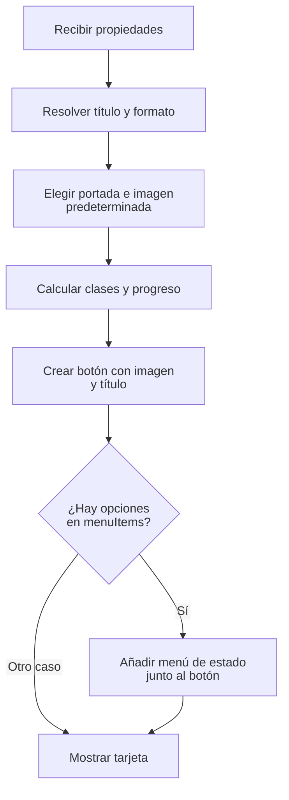

# HuexCard

[Frontend](../README.md) · [Código JSX](../../codigo/HuexCard.md) · [Estilos CSS](../../codigo/HuexCardStyles.md)

`HuexCard` representa un elemento de la biblioteca mediante un botón con imagen y título. Se utiliza en el inicio, las filas de categorías y los episodios de una temporada. El componente que la utiliza proporciona los datos y la acción del clic.

## Recorrido de renderizado



Cada renderizado obtiene estos valores a partir de las propiedades actuales. Las funciones auxiliares y los tipos JSDoc se encuentran en el mismo archivo JSX.

## Organización del código

Los separadores del archivo agrupan las imágenes predeterminadas, la preparación de los datos, el evento de carga de imagen y el renderizado. `getDefaultImage` elige la imagen genérica y `handleImageError` atiende el fallo de carga. El clic principal se entrega directamente a `onClick`, recibido del padre.

## Propiedades

| Propiedad | Tipo | Valor por defecto | Uso |
| --- | --- | --- | --- |
| `item` | Objeto | Lo proporciona el padre | Elemento representado. |
| `onClick` | Función | Lo proporciona el padre | Acción al pulsar el botón de la tarjeta. Recibe el evento del clic. |
| `showPlayButton` | Booleano | `false` | Muestra el icono de reproducción sobre la imagen. |
| `variant` | Texto | `vertical` | El valor `vertical` usa carátula vertical; cualquier otro valor utiliza el formato horizontal. En los consumidores se emplea `horizontal`. |
| `watched` | Booleano | `false` | Estado visto del episodio. Tiene prioridad sobre el progreso al elegir la imagen genérica y el valor de la barra. |
| `progress` | Objeto o `null` | `null` | Posición, duración y descripción accesible del progreso. |
| `menuItems` | Lista de opciones | `[]` | Acciones del menú. Cada una incluye `id`, `label`, `onSelect` y, opcionalmente, `disabled`. |
| `menuDisabled` | Booleano | `false` | Deshabilita el botón de opciones y sus acciones. |
| `menuTitle` | Texto opcional | `undefined` | Encabezado del menú principal, como «Opciones de la serie». |
| `theme` | Texto opcional | `undefined` | Añade la clase `huex-theme-{theme}` a la tarjeta. |

### Datos de item

El objeto puede incluir los datos completos de la serie, temporada o episodio. La tarjeta consulta estas propiedades:

| Propiedad | Uso |
| --- | --- |
| `nombre` | Primera opción para el título. |
| `nombreTemporada` | Alternativa cuando `nombre` está vacío o ausente. |
| `urlImagen` | Imagen recibida del componente padre. |

Si ambos nombres están vacíos o ausentes, el título es `Sin título`. Ese mismo título se utiliza como texto alternativo de la imagen y en el atributo `title` del texto.

### Datos de progress

| Propiedad | Tipo | Uso |
| --- | --- | --- |
| `positionSeconds` | Número | Posición guardada del episodio. |
| `durationSeconds` | Número | Duración usada como divisor al calcular el progreso. |
| `label` | Texto opcional | Descripción accesible de la barra. |

Los consumidores proporcionan una duración positiva para calcular la proporción. `EpisodeProgress` y `HuexCardProps` documentan estos datos mediante JSDoc y ayudan al editor a mostrar sus tipos.

## Selección de imagen

### getDefaultImage

Recibe `isVertical`, `watched` y `progress`. Devuelve la ruta de la imagen genérica siguiendo este orden:

| Condición | Imagen |
| --- | --- |
| Formato vertical | `/default-episode-vertical.png` |
| Horizontal y visto | `/default-episode-horizontal-viewed.png` |
| Horizontal con objeto de progreso | `/default-episode-horizontal-ongoing.png` |
| Horizontal pendiente | `/default-episode-horizontal.png` |

La presencia del objeto `progress` determina la imagen de episodio en curso, incluso si su posición es cero.

### defaultImages e imageUrl

`defaultImages` contiene las cuatro rutas genéricas reconocidas. Cuando `item.urlImagen` está vacío o coincide con una de ellas, `imageUrl` toma la imagen predeterminada que corresponde al formato y estado actuales. Una portada personalizada conserva su ruta.

El atributo `key={imageUrl}` permite a React recrear el elemento de imagen cuando cambia esa URL.

### handleImageError

Se ejecuta cuando falla la carga de la imagen. Registra el fallo en la consola y sustituye su ruta por `defaultImage`. Antes compara el atributo `src` para evitar volver a asignar la misma ruta si la propia imagen predeterminada falla.

## Clases y progreso

`cardClassName` combina `huex-card`, la variante `huex-card-vertical` o `huex-card-episode` y el tema visual opcional.

`progressValue` empieza en cero. Un episodio visto utiliza `1`; si hay progreso, utiliza `positionSeconds / durationSeconds`. El elemento HTML `progress` tiene un máximo de `1` y se muestra en tarjetas horizontales.

Por ejemplo, una posición de 300 segundos sobre una duración de 1200 produce `0.25`: un cuarto de la barra. Un episodio visto presenta la barra completa.

`progressLabel` utiliza `Visto` para los vistos. En los demás casos toma `progress.label` y, si falta, `Sin ver`. Se aplica a `aria-valuetext` para describir el estado con tecnologías de asistencia.

## Clic y menú de estado

La tarjeta principal es un botón que utiliza `onClick`. El icono de reproducción forma parte de ese botón y comparte su acción.

Cuando `menuItems` contiene opciones, un contenedor `episode-card-shell` agrupa el botón y [HuexCardMenu](huex-card-menu.md) como elementos hermanos. El menú recibe el título, las acciones y `menuDisabled`. La presencia de opciones permite mostrar el menú en cualquiera de los formatos.

Al elegir una acción final, `HuexCardMenu` cierra y ejecuta su `onSelect()`. Una opción con `children` abre un submenú. El componente padre define las acciones y realiza la actualización. El menú gestiona su apertura, cierre, foco y navegación por teclado. Las series aportan mover a categoría y reiniciar; los episodios aportan visto/no visto.

## Estilos

`HuexStyles.css` aporta los estilos y variables compartidos. `HuexCard.css` agrupa las reglas de la tarjeta:

| Bloque | Responsabilidad |
| --- | --- |
| Tarjeta | Fondo, borde, distribución y elevación al pasar el cursor. |
| Imagen | Proporción horizontal `16/9`, vertical `2/3` y ajuste con `object-fit: cover`. |
| Título | Espacio de información y recorte a dos líneas. |
| Reproducción | Posición del icono sobre la imagen. |
| Progreso | Barra y color mediante `--huex-progress-color`. |
| Menú | Contenedor y visibilidad de las opciones con hover o foco. |
| Inicio | Títulos centrados y tamaño adaptativo. |
| Carrusel | Elevación de la tarjeta manteniendo estable el contenedor del hover. |
| Resoluciones | Tamaño del título con los cinco rangos principales y un ajuste hasta 600 px. |

El borde de hover utiliza `--huex-card-hover`, y el icono de reproducción utiliza `--huex-accent`.

## Ejemplos de uso

### Carátula de una serie

```jsx
<HuexCard
    item={serie}
    onClick={() => openSeries(serie)}
/>
```

### Episodio con progreso y menú

```jsx
<HuexCard
    item={episode}
    variant="horizontal"
    showPlayButton
    watched={false}
    progress={{
        positionSeconds: 300,
        durationSeconds: 1200,
        label: '5 minutos de 20'
    }}
    onClick={() => playEpisode(episode)}
    menuItems={[{
        id: 'watched',
        label: 'Marcar como visto',
        onSelect: () => updateEpisodeStatus(episode, true)
    }]}
    menuDisabled={isSaving}
/>
```

Las funciones de apertura, reproducción y actualización de estos ejemplos las proporciona el componente padre.
