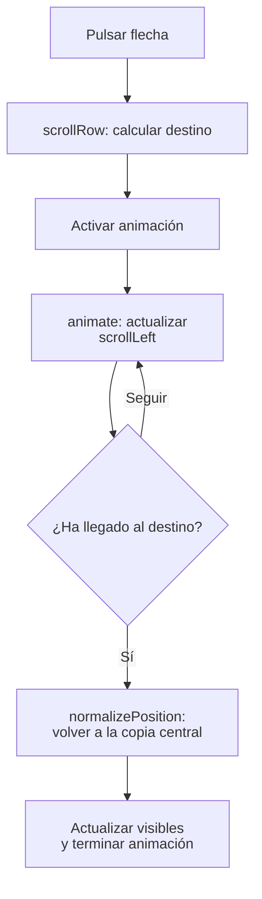
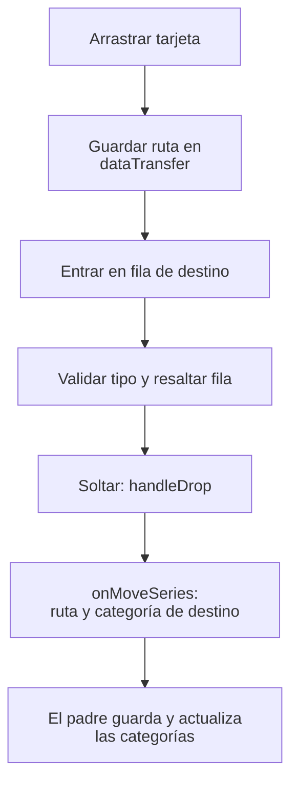

# SeriesCategoryRow

[Frontend](../README.md) · [Código TSX](../../codigo/SeriesCategoryRow.md) · [HuexCard](huex-card.md) · [HuexCardMenu](huex-card-menu.md)

Representa una fila de la biblioteca con título, contador y tarjetas. Se utiliza para las categorías, «Sin categoría» y «Continuar viendo». Cuando hay más elementos que columnas visibles, presenta un carrusel circular que avanza por tandas.

La explicación sigue los cinco grupos del código: medición, animación, drag and drop, acciones de las tarjetas y menú de categoría.

## Propiedades

| Propiedad | Tipo | Valor inicial | Uso |
| --- | --- | --- | --- |
| `title` | Texto | Recibido del padre | Título y nombre accesible de la sección. |
| `series` | Lista de elementos | Recibida del padre | Tarjetas que se representan y cantidad mostrada en el contador. |
| `onSelectSeries` | Función | Recibida del padre | Recibe el elemento pulsado; el padre decide cómo abrirlo. |
| `categoryId` | Texto | `''` | Categoría representada por la fila y destino del arrastre. Vacío representa «Sin categoría». |
| `categories` | Lista de categorías | `[]` | Categorías con `id` y `name` para el submenú de destinos. |
| `onMoveSeries` | Función opcional | `undefined` | Recibe la ruta de una serie y la categoría de destino. Habilita el arrastre y la opción de mover. |
| `onResetSeries` | Función opcional | `undefined` | Recibe la serie para abrir su confirmación de reinicio. |
| `onDeleteCategory` | Función opcional | `undefined` | Recibe `{ id, name }` para abrir la confirmación de eliminación. |
| `cardVariant` | Texto | `vertical` | Formato enviado a HuexCard; `horizontal` activa también su icono de reproducción. |
| `showHeader` | Booleano | `true` | Permite ocultar la cabecera del carrusel cuando el contenedor padre ya muestra el título, como en películas sin subcategorías. |

### Datos de cada elemento

`CategoryRowItem` documenta las propiedades utilizadas: `rutaCompleta`, `nombre`, `urlImagen`, `playbackProgress` y `nextEpisode`.

La ruta identifica la tarjeta y viaja en el arrastre. La fila envía a HuexCard la imagen, el título y el progreso del elemento. Si `nextEpisode` es verdadero, envía `progress=null`: la tarjeta ofrece el siguiente episodio. El padre recibe el objeto completo al pulsarla.

## Constantes y función auxiliar

| Nombre | Valor | Uso |
| --- | --- | --- |
| `ANIMATION_DURATION` | `1500` | Duración de una tanda animada, en milisegundos. |
| `CENTER_COPY` | `2` | Índice de la tercera de las cinco copias, contando desde cero. |
| `SERIES_DRAG_TYPE` | `application/x-huex-series` | Identifica el dato de arrastre de una serie de la aplicación. |

### modulo

Recibe un valor y la longitud de la lista. Devuelve una posición dentro de esa longitud, también cuando el valor es negativo. Por ejemplo, `modulo(-1, 8)` devuelve `7`: retroceder desde la primera serie conduce a la última.

## Estado y referencias

| Variable | Contenido y propósito |
| --- | --- |
| `layout` | Estado con `step` —ancho de tarjeta más separación— y `columns` —cantidad visible—. Activa el renderizado de las copias y la disponibilidad de las flechas. |
| `visibleStart` | Índice de la primera tarjeta visible entre las copias renderizadas. |
| `isAnimating` | Estado visual que deshabilita flechas y tarjetas durante el avance automático. |
| `metricsRef` | Medidas vigentes `{ step, columns, loop }` para las funciones de desplazamiento. |
| `seriesPositionRef` | Posición dentro de la lista original, que se conserva al medir o reajustar. |
| `animationFrameRef` | Identificador del fotograma pendiente, necesario para cancelarlo. |
| `animationActiveRef` | Bandera inmediata que evita solapar animaciones y distinguir su scroll del manual. |
| `scrollSettleTimerRef` | Temporizador del reajuste tras detener el desplazamiento manual. |
| `isDropTarget` | Activa el resaltado de la fila al aceptar un arrastre. |
| `suppressClickUntilRef` | Instante hasta el que se ignora el clic para evitar abrir una tarjeta recién arrastrada. |
| `rowRef` | Elemento desplazable, cuyo `scrollLeft` mueve las tarjetas. |
| `sectionRef` | Sección completa, utilizada también como destino alternativo del foco. |
| `rowId` | Identificador generado con `useId` que vincula las flechas con la fila. |

`canLoop` compara el número de elementos con `layout.columns`, usando provisionalmente una columna hasta medir. `copies` contiene `[0, 1, 2, 3, 4]` en modo circular y `[0]` cuando toda la lista cabe en una tanda.

## Medición del carrusel

### Efecto de medición

Depende de `series` y `canLoop`. Programa `measure` con `requestAnimationFrame` y conecta un `ResizeObserver` a la fila. Así calcula los tamaños tras el renderizado y cuando cambia el tamaño del contenedor.

Su limpieza cancela la medición inicial pendiente, la animación y el temporizador de scroll; restablece la bandera de animación y desconecta el observador.

### measure

1. Lee `--series-columns` y `columnGap` del CSS y mide el ancho de una tarjeta.
2. Calcula `step` y decide si la lista necesita modo circular.
3. Compara columnas, modo y ancho con la medición anterior. Una diferencia de ancho inferior a 0,1 px se considera igual.
4. Cuando cambian las medidas, cancela el movimiento pendiente. Si faltan las copias adecuadas, actualiza `layout` para renderizarlas antes de volver a medir.
5. Guarda las medidas y sitúa la fila en la copia central, conservando su posición relativa dentro de la lista.
6. Actualiza `visibleStart` y `layout`.

Esto permite que cambios de altura por hover o carga de imágenes conserven un desplazamiento que sigue teniendo las mismas medidas horizontales.

## Animación y desplazamiento

### Cómo funciona el recorrido circular

El JSX repite la lista cinco veces. La fila empieza en la copia central para disponer de tarjetas por ambos lados. Cada tarjeta tiene un índice global:

```typescript
const slot = copy * series.length + index;
```

Por ejemplo, para una lista de ocho series:

```text
Copia 0:  0–7
Copia 1:  8–15
Copia 2: 16–23  ← copia central
Copia 3: 24–31
Copia 4: 32–39
```

Si un avance termina en el índice 25, `normalizePosition` lo recoloca en el 17. Ambos representan la segunda serie de la lista. Este reajuste directo permite seguir avanzando desde la zona central mostrando las mismas tarjetas.

### scrollRow

Recibe `direction=-1` para retroceder y `direction=1` para avanzar. Con las medidas disponibles y el modo circular activo:

1. Cancela el reajuste manual pendiente y llama a `normalizePosition`.
2. Calcula el destino sumando o restando `columns` tarjetas a la posición actual.
3. Activa las banderas de animación y programa `animate`.

Las flechas llaman a esta función y se deshabilitan mientras hay movimiento o faltan medidas.

### animate

Es una función interna de `scrollRow`. Recibe del navegador la marca de tiempo del fotograma y calcula la fracción transcurrida de los 1500 ms. Aplica una curva cúbica que acelera al principio y frena al final, y asigna la posición resultante a `row.scrollLeft`.

Mientras falta recorrido, solicita el siguiente fotograma. Al alcanzar el destino, llama a `normalizePosition` y desactiva las banderas de animación.



### normalizePosition

Convierte `scrollLeft` en una posición de tarjeta dividiéndolo por `step`. Corrige redondeos inferiores a un píxel y obtiene el índice relativo con `modulo`. Si la posición queda fuera de la copia central, cambia `scrollLeft` a su equivalente central. Guarda el índice relativo y actualiza `visibleStart`.

### interruptAnimation

Se llama desde `onPointerDown` y `onWheel` de la fila. Cancela el fotograma pendiente, desactiva las banderas y normaliza la posición para ceder el desplazamiento a la interacción del usuario.

### handleScroll

Atiende el scroll manual cuando hay medidas y la animación automática está inactiva. Actualiza `visibleStart` y programa `normalizePosition` para dentro de 150 ms. Cada nuevo evento reinicia ese plazo.

### handleRowKeyDown

Con el foco en la propia fila, `ArrowLeft` y `ArrowRight` llaman a `scrollRow`. El evento de teclado debe proceder de la fila para aplicar esta acción: los botones y menús interiores conservan sus propios manejadores.

### Visibilidad e interacción de las copias

Se consideran visibles los índices desde `visibleStart` hasta `visibleStart + layout.columns`, incluyendo la tarjeta parcial del extremo. El resto recibe `inert` y `aria-hidden`. Durante la animación también se aplican a las tarjetas visibles.

El arrastre se habilita para tarjetas visibles cuando existe `onMoveSeries` y la animación está detenida. Las claves combinan copia y ruta para identificar cada instancia renderizada.

## Drag and drop

### acceptsDrag

Devuelve verdadero cuando existe `onMoveSeries` y `event.dataTransfer.types` contiene `application/x-huex-series`.

### handleSeriesDragStart

Recibe el evento y la serie. Establece `effectAllowed='move'` y guarda `serie.rutaCompleta` en `dataTransfer` con el tipo propio. Asigna `Infinity` a `suppressClickUntilRef` para bloquear la apertura de la tarjeta durante el arrastre.

### handleDragOver

Si acepta el arrastre, llama a `preventDefault()` para permitir soltar, establece `dropEffect='move'` y activa el resaltado del destino.

### handleDragLeave

Consulta `relatedTarget` para comprobar si el puntero pasa a otro elemento de la misma sección. Retira el resaltado cuando el puntero sale de ella.

### handleDrop

Retira el resaltado, comprueba el tipo de arrastre y lee la ruta de la serie. Con una ruta informada, llama a `onMoveSeries(seriesPath, categoryId)`. El padre realiza el guardado y entrega las listas actualizadas.

### handleSeriesDragEnd

Retira el resaltado y mantiene el bloqueo del clic hasta `Date.now() + 300`. Este margen evita interpretar el final del arrastre como una selección de tarjeta.



## Acciones de las tarjetas

### handleSelectSeries

Recibe el elemento y la hora del clic. Cuando esa hora alcanza el final del bloqueo de arrastre, llama a `onSelectSeries(serie)`. La navegación se decide en el componente padre.

### getSeriesMenuItems

Construye la lista enviada a [HuexCardMenu](huex-card-menu.md), a través de HuexCard:

- Con `onMoveSeries`, añade «Mover a categoría». Sus hijos incluyen «Sin categoría» y las categorías recibidas. `checked` marca la actual y cada destino distinto llama a `onMoveSeries`.
- Con `onResetSeries`, añade «Reiniciar serie». Su acción entrega el elemento al padre y utiliza `restoreFocus=false` para que la confirmación controle el foco.

## Eliminación de categoría

La cabecera muestra una papelera roja junto al contador cuando `categoryId` está informado y existe `onDeleteCategory`. Aparece al pasar el ratón por la fila o usar el teclado.

### handleDeleteCategory

Llama a `onDeleteCategory({ id: categoryId, name: title })`. La página abre la confirmación y controla el borrado.
## Estilos y resoluciones

Las reglas de la fila están en `HuexStyles.css`; las tarjetas utilizan [HuexCard.css](../../codigo/HuexCardStyles.md).

| Ancho de ventana | Columnas |
| --- | --- |
| Hasta 600 px | 2 |
| De 601 a 900 px | 3 |
| De 901 a 1440 px | 5 |
| Desde 1441 px | 6 |

El CSS define `--series-columns`, `--series-gap` y `--series-peek`. En el modo circular reserva una franja para la siguiente tarjeta; hover o foco visible muestran esa franja, las sombras laterales y las flechas. En dispositivos sin hover estos controles también se muestran mediante su regla específica.

## Ejemplo de uso

```tsx
<SeriesCategoryRow
    title={category.name}
    series={categorySeries}
    categoryId={category.id}
    categories={categories}
    onSelectSeries={openSeries}
    onMoveSeries={handleMoveSeries}
    onResetSeries={requestResetSeries}
    onDeleteCategory={requestDeleteCategory}
/>
```

Las listas y los manejadores del ejemplo se proporcionan desde la página de series. Para «Continuar viendo», la página utiliza `cardVariant="horizontal"` y un manejador de selección que abre el reproductor.
