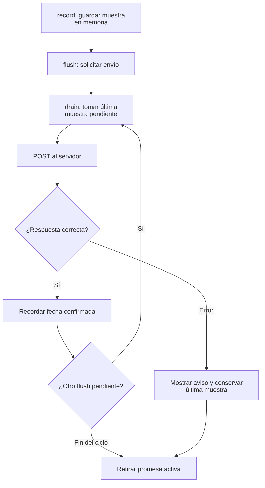

# playbackProgress

[Frontend](../README.md) · [Sistema de progreso](../../sistemas/progreso-reproduccion/README.md) · [Código JavaScript](../../codigo/PlaybackProgressClient.md)

`src/playbackProgress.js` prepara los episodios de «Continuar viendo» y coordina las muestras de reproducción que se envían al servidor. Sus funciones se utilizan desde [Series](../paginas/series.md), [SeriesDetail](../paginas/series-detail.md) y [VideoPlayer](../paginas/video-player.md).

## Organización

| Bloque | Funciones | Propósito |
| --- | --- | --- |
| Coordinación de guardados | `waitForProgressSaves` | Esperar envíos activos antes de consultar o modificar el progreso. |
| Funciones auxiliares | `pathKey`, `formatProgressTime`, `readProgressResponse` | Comparar rutas, presentar tiempos y leer respuestas. |
| Continuar viendo | `loadContinueWatching`, `loadSeriesEpisode`, `compareNames` | Elegir y preparar una tarjeta por serie con un episodio para continuar. |
| Guardador de progreso | `createProgressSaver`, `drain`, `record`, `flush` | Registrar muestras y enviarlas de forma coordinada. |

## Coordinación de guardados

`pendingSaves` es un `Set` compartido por el módulo. Contiene las promesas de los ciclos de envío activos. Cada `flush` que inicia un ciclo registra su promesa; al terminar, la retira con `finally`.

### waitForProgressSaves()

Espera con `Promise.allSettled` una copia de las promesas registradas al llamar a la función. La espera termina cuando todas se han resuelto o rechazado. Esto permite que las páginas consulten el progreso después de los intentos de guardado activos.

## Funciones auxiliares

### pathKey(path)

Recibe una ruta y devuelve una clave para compararla: sustituye `/` por `\`, elimina barras finales y convierte el texto a mayúsculas. Se usa al relacionar el historial con las series y los episodios encontrados en disco.

### formatProgressTime(seconds)

Redondea hacia abajo los segundos, con un mínimo de cero. Devuelve `minutos:segundos` o `horas:minutos:segundos`, con dos cifras para segundos y para los minutos cuando hay horas. Por ejemplo, `75` produce `1:15` y `3675` produce `1:01:15`.

### readProgressResponse(response)

Intenta leer el JSON de una respuesta `fetch`. Si falla la lectura, trata el contenido como nulo. Si el estado HTTP indica un fallo o el contenido es nulo, lanza un error con el mensaje `error` del servidor cuando está disponible. En una respuesta correcta devuelve el objeto leído.

## Continuar viendo

### loadContinueWatching(libraryPath, series, signal)

Recibe la ruta de biblioteca, las series disponibles y una señal opcional de cancelación. Devuelve una promesa con las tarjetas de continuación.

1. Espera los guardados activos. Si la señal está cancelada, devuelve una lista vacía.
2. Consulta `GET /api/playbackprogress?libraryPath=...` con esa señal.
3. Relaciona las series disponibles por su ruta normalizada y filtra el historial que tiene un episodio en curso o referencias a episodios vistos.
4. Ordena las series por `lastRecordedAtUtc`, de más reciente a más antigua.
5. Consulta los episodios de cada serie en paralelo mediante `loadSeriesEpisode`.
6. Conserva las tarjetas con un episodio localizado. `Promise.all` mantiene el orden de las series aunque las consultas terminen en otro orden.

Los errores de las consultas se propagan a la página que llamó a la función.

### loadSeriesEpisode(entry)

Es una función interna de `loadContinueWatching`. Consulta `GET /api/series/scan-episodes?path=...` para la serie y ordena copias de las temporadas y los episodios por nombre.

Si existe `inProgress`, busca ese episodio por su ruta. En otro caso, localiza `lastWatchedEpisodePath` y busca el primer episodio pendiente situado después de él. Para historiales anteriores utiliza como alternativa la última ruta de `watchedEpisodePaths`.

Devuelve `null` cuando la búsqueda termina sin un episodio. Cuando lo encuentra, conserva sus propiedades y añade:

| Propiedad | Contenido |
| --- | --- |
| `nombre` | Nombre de serie y episodio, separados por `·`. |
| `seriesPath` | Ruta de la serie. |
| `nextEpisode` | `true` cuando la tarjeta representa el siguiente pendiente. |
| `playbackProgress` | Muestra en curso con el texto «Continuar desde…», o posición y duración cero para el siguiente episodio. |

### compareNames(left, right)

Es una función interna de `loadSeriesEpisode`. Compara nombres con `localeCompare` en español, con comparación numérica e ignorando diferencias de mayúsculas y acentos. Así, los números de temporada o episodio siguen el orden natural.

## Guardador de progreso

### createProgressSaver(identity, onError)

Recibe la identidad del episodio (`libraryPath`, `seriesPath` y `episodePath`) y una función para actualizar el aviso de guardado. Devuelve `{ record, flush }`. Cada guardador conserva estas variables en su cierre:

| Variable | Contenido |
| --- | --- |
| `latest` | Última muestra registrada. |
| `savedAt` | Fecha de la última muestra confirmada por el servidor. |
| `running` | Promesa del ciclo activo, o `null`. |
| `pending` | Indica que el ciclo debe revisar la última muestra. |
| `lastTimestamp` | Marca temporal utilizada para generar fechas crecientes. |

### record(positionSeconds, durationSeconds)

Registra en memoria valores finitos con posición y duración positivas. Limita la posición a la duración. Añade la identidad y `recordedAtUtc` a la muestra.

La fecha se obtiene con `Math.max(Date.now(), lastTimestamp + 1)`: si dos muestras se registran en el mismo milisegundo, la segunda recibe una fecha un milisegundo posterior. La muestra más reciente sustituye a la anterior en `latest`.

### flush()

Marca `pending` para solicitar una revisión. Si ya hay un ciclo activo, devuelve su promesa. Si está libre, inicia `drain`, registra su promesa en `pendingSaves` y prepara la limpieza con `finally`.

### drain()

Mientras hay trabajo pendiente, retira la marca y toma una referencia a `latest`. Si la muestra existe y su fecha es distinta de `savedAt`, envía `POST /api/playbackprogress` con JSON y `keepalive: true`.

Al confirmar el envío, actualiza `savedAt` y llama a `onError('')`. Si durante la espera se ha llamado otra vez a `flush`, el bucle revisa la última muestra disponible. Las muestras intermedias quedan agrupadas en la más reciente.

Si falla el envío, comunica el error mediante `onError`, termina el ciclo y conserva `latest`. Una llamada posterior a `flush` vuelve a intentar enviarla.

En `VideoPlayer`, los eventos de reproducción actualizan la muestra y solicitan su envío periódicamente, al pausar, terminar u ocultar la página y al salir del reproductor. Los detalles de esa integración están en [VideoPlayer](../paginas/video-player.md).
