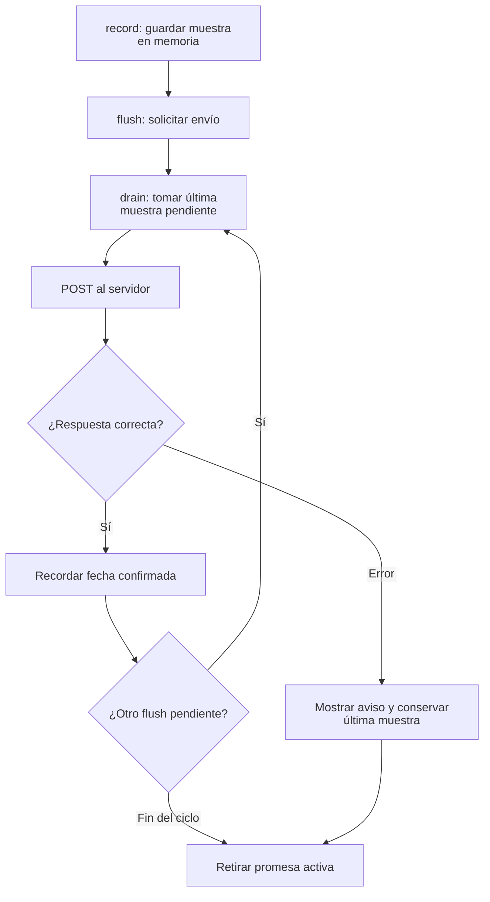

# playbackProgress

[Frontend](../README.md) · [Sistema de progreso](../../sistemas/progreso-reproduccion/README.md) · [Código TypeScript](../../codigo/PlaybackProgressClient.md)

`src/utils/playbackProgress.ts` prepara las tarjetas de películas y episodios de «Continuar viendo» y coordina las muestras de reproducción que se envían al servidor. Sus funciones se utilizan desde [Movies](../paginas/movies.md), [Series](../paginas/series.md), [SeriesDetail](../paginas/series-detail.md) y [VideoPlayer](../paginas/video-player.md).

## Organización

El archivo agrupa las funciones con separadores de guiones y títulos centrados. Las funciones interiores del guardador tienen también sus propios bloques.

| Bloque | Funciones | Propósito |
| --- | --- | --- |
| Coordinación de guardados | `waitForProgressSaves` | Esperar los envíos activos antes de leer o modificar el progreso. |
| Consultas al servidor | `getLibraryProgress`, `getSeriesEpisodes` | Obtener el documento común y los episodios disponibles. |
| Acciones sobre el progreso | `hideMovieFromContinueWatching`, `updateSeriesProgress`, `resetSeriesProgress`, `hideSeriesFromContinueWatching`, `setVideoWatched` | Ocultar tarjetas, reiniciar series y cambiar marcas de visto. |
| Tarjetas de continuar viendo | `buildContinueWatchingMovies`, `buildContinueWatchingSeries` | Relacionar las rutas del progreso con los elementos disponibles y preparar las tarjetas. |
| Guardador de progreso | `createProgressSaver` | Conservar el estado de las muestras y devolver `record` y `flush`. |

Dentro de `createProgressSaver`, los separadores distinguen **Estado de las muestras**, **Envío de muestras**, **Registro de posición** y **Solicitud de guardado**. Los comentarios interiores anteriores se conservan.

## Datos de entrada y salida

Las firmas TypeScript tipan los parámetros y resultados; los comentarios documentan su propósito, incluidas `loadSeriesEpisode`, `compareNames`, `drain`, `record` y `flush`. Los parámetros `[signal]` son opcionales y reciben un `AbortSignal`.

El bloque **Tipos de progreso** describe los objetos utilizados por las funciones y permite consultar sus campos desde el editor:

| Tipo | Datos |
| --- | --- |
| `MediaItem` | Reutiliza `CategoryRowItem`: ruta, nombre, imagen y progreso visual de la tarjeta. |
| `EpisodePlaybackProgress` | Posición, duración, etiqueta opcional y ruta del episodio. |
| `SeriesPlaybackProgress` | Carpeta de serie, vistos, episodio en curso, último visto, fecha y ocultación. |
| `MoviePlaybackProgress` | Ruta de película, posición, duración, visto, fecha y ocultación. |
| `LibraryPlaybackProgress` | Versión, identificador de biblioteca y listas de series y películas. |
| `SeriesEpisodes` | Temporadas con su nombre y episodios. |
| `SeriesContinuationItem` | Tarjeta que incluye la carpeta de su serie. |
| `ProgressIdentity` | Identificador de biblioteca, ruta de vídeo y carpeta de serie opcional. |
| `ProgressSaver` | Métodos `record(positionSeconds, durationSeconds)` y `flush()`. |

Las consultas y acciones devuelven promesas de sus modelos. `loadSeriesEpisode` devuelve una tarjeta o `null`; `compareNames`, un número de ordenación. `record` registra la posición en memoria y devuelve `void`; `flush` y `drain` devuelven `Promise<void>`.

## Coordinación de guardados

`pendingSaves` es un `Set` compartido por el módulo. Contiene las promesas de los ciclos de envío activos. Cada `flush` que inicia un ciclo registra su promesa; al terminar, la retira con `finally`.

### waitForProgressSaves()

Espera con `Promise.allSettled` una copia de las promesas registradas al llamar a la función. La espera termina cuando todas se han resuelto o rechazado. Esto permite que las páginas consulten el progreso después de los intentos de guardado activos.

## Utilidades compartidas

El módulo importa estas funciones de [generalUtils.ts](general-utils.md).

### normalizePathForComparison(path) — generalUtils.ts

Recibe una ruta y devuelve una clave para compararla: sustituye `/` por `\`, elimina barras finales y convierte el texto a mayúsculas. Se usa al relacionar el historial con las series y los episodios encontrados en disco.

### formatProgressTime(seconds) — generalUtils.ts

Redondea hacia abajo los segundos, con un mínimo de cero. Para valores no finitos devuelve `0:00`. Devuelve `minutos:segundos` o `horas:minutos:segundos`, con dos cifras para segundos y para los minutos cuando hay horas. Por ejemplo, `75` produce `1:15` y `3675` produce `1:01:15`.

### readJson(response) — generalUtils.ts

Intenta leer el JSON de una respuesta `fetch`. Si falla la lectura, trata el contenido como nulo. Si el estado HTTP indica un fallo o el contenido es nulo, lanza un error con el campo `error` o `message` del servidor cuando está disponible. En una respuesta correcta devuelve el objeto leído.

## Consultas al servidor

### getLibraryProgress(libraryId, signal)

Espera `waitForProgressSaves`, comprueba la cancelación y solicita `GET /api/playbackprogress?libraryId=…`. Verifica que el documento corresponda al identificador elegido y que incluya los arrays `movies` y `series`. Devuelve el documento completo.

### getSeriesEpisodes(libraryId, seriesPath, signal)

Solicita `GET /api/series/scan-episodes?libraryId=…&path=…` con la señal de cancelación. Devuelve el objeto con sus temporadas y episodios, leído mediante `readJson`.

## Acciones sobre el progreso

### hideMovieFromContinueWatching(libraryId, videoPath, signal)

Espera los envíos activos y comprueba la cancelación. Envía `POST /api/playbackprogress/hide?libraryId=…` con `{ videoPath }`. Comprueba el identificador y la lista de películas de la respuesta y devuelve el documento confirmado. El servidor conserva el minuto y la marca de visto.

### updateSeriesProgress(libraryId, action, body, signal)

Es el auxiliar utilizado por las acciones de Series. Espera los guardados activos, comprueba la cancelación y envía `body` como JSON a `POST /api/playbackprogress/{action}?libraryId=…`. Verifica el identificador y el array `series` del resultado y devuelve el documento actualizado.

### resetSeriesProgress(libraryId, seriesPath, signal)

Llama a `updateSeriesProgress` con la acción `reset` y `{ seriesPath }`. El servidor reinicia los episodios vistos y el episodio en curso de esa serie.

### hideSeriesFromContinueWatching(libraryId, seriesPath, signal)

Llama al mismo auxiliar con `hide-series` y `{ seriesPath }`. El servidor oculta la tarjeta y conserva el progreso.

### setVideoWatched(libraryId, videoPath, seriesPath, watched, signal)

Utiliza la acción `watched` y envía `{ videoPath, seriesPath, watched }`. La página recibe el documento común y aplica la entrada de la serie actualizada.

## Tarjetas de continuar viendo

### buildContinueWatchingMovies(movies, progress)

Construye un `Map` de las películas disponibles con sus rutas normalizadas. Filtra las entradas pendientes, visibles, con posición positiva y menor que la duración, y con una película presente en ese mapa. Las ordena por `lastRecordedAtUtc`, de más reciente a más antigua.

Devuelve copias de las películas con `playbackProgress`, que contiene posición, duración y la etiqueta `Continuar desde …`.

### buildContinueWatchingSeries(libraryId, series, progress, signal)

Espera los guardados activos. Si la señal ya está cancelada, devuelve una lista vacía. Relaciona las series disponibles con las entradas visibles que tienen un episodio en curso o historial de vistos y las ordena por su última reproducción.

`loadSeriesEpisode(entry)` consulta los episodios mediante `getSeriesEpisodes`. Su función interior `compareNames` utiliza comparación en español con orden numérico para ordenar temporadas y episodios.

Si hay `inProgress`, busca ese episodio. En el resto de casos, localiza el último visto y busca después de él el primer episodio pendiente. El nombre mostrado combina serie y episodio; `nextEpisode` distingue una continuación con minuto de un siguiente episodio que empieza desde cero.

`Promise.all` reúne las tarjetas conservando el orden de las entradas. `filter(Boolean)` retira los resultados `null` de las series que carecen de un episodio candidato.

## Guardador de progreso

### createProgressSaver(identity, onError)

Recibe la identidad del vídeo (`libraryId`, `videoPath` y `seriesPath` opcional) y una función para actualizar el aviso de guardado. Devuelve `{ record, flush }`. Cada guardador conserva estas variables en su cierre:

| Variable | Contenido |
| --- | --- |
| `latest` | Última muestra registrada. |
| `savedAt` | Fecha de la última muestra confirmada por el servidor. |
| `running` | Promesa del ciclo activo, o `null`. |
| `pending` | Indica que el ciclo debe revisar la última muestra. |
| `lastTimestamp` | Marca temporal utilizada para generar fechas crecientes. |

### record(positionSeconds, durationSeconds)

Registra en memoria valores finitos con posición y duración positivas. Limita la posición a la duración. Añade la identidad y `recordedAtUtc` a la muestra.

La fecha se obtiene con `Math.max(Date.now(), lastTimestamp + 1)`: si dos muestras se registran en el mismo milisegundo, la segunda recibe una fecha un milisegundo posterior. La muestra más reciente sustituye a la anterior en `latest`.

### flush()

Marca `pending` para solicitar una revisión. Si ya hay un ciclo activo, devuelve su promesa. Si está libre, inicia `drain`, registra su promesa en `pendingSaves` y prepara la limpieza con `finally`.

### drain()

Mientras hay trabajo pendiente, retira la marca y toma una referencia a `latest`. Si la muestra existe y su fecha es distinta de `savedAt`, envía `POST /api/playbackprogress?libraryId=…` con JSON y `keepalive: true`.

Al confirmar el envío, actualiza `savedAt` y llama a `onError('')`. Si durante la espera se ha llamado otra vez a `flush`, el bucle revisa la última muestra disponible. Las muestras intermedias quedan agrupadas en la más reciente.

Si falla el envío, comunica el error mediante `onError`, termina el ciclo y conserva `latest`. Una llamada posterior a `flush` vuelve a intentar enviarla.

En `VideoPlayer`, los eventos de reproducción actualizan la muestra y solicitan su envío periódicamente, al pausar, terminar u ocultar la página y al salir del reproductor. Los detalles de esa integración están en [VideoPlayer](../paginas/video-player.md).
