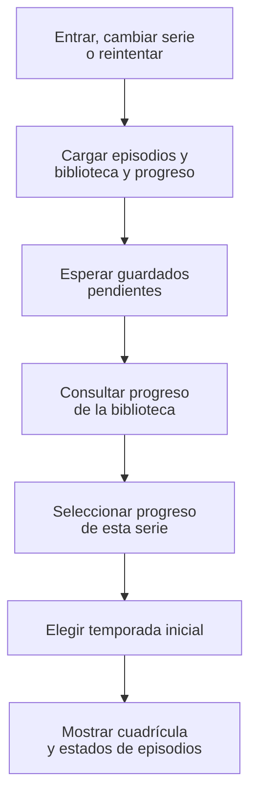
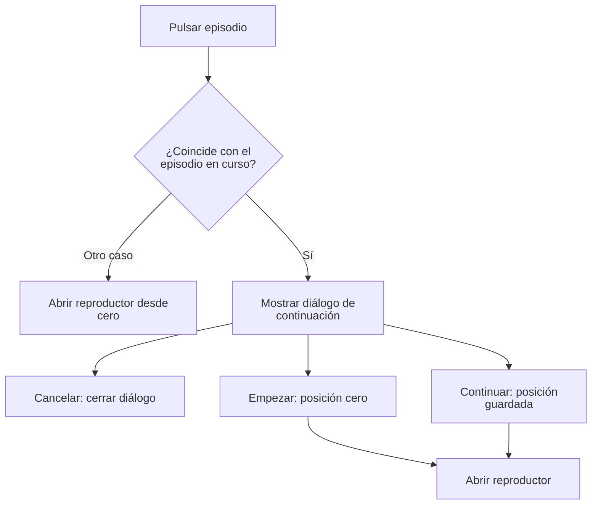

# SeriesDetail

[Frontend](../README.md) · [Código TSX](../../codigo/SeriesDetail.md) · [Página de series](series.md) · [HuexCard](../componentes/huex-card.md)

`SeriesDetail.tsx` representa las temporadas y episodios de una serie. Carga sus vídeos y progreso, selecciona una temporada inicial y permite reproducir, continuar o cambiar el estado visto de cada episodio.

Los grupos de esta página siguen los separadores del código: carga, temporada, reproducción, diálogo de continuación, actualización del progreso, navegación y datos de tarjetas.

## Datos de entrada

La página obtiene los datos de `useLocation().state` al navegar a `/series/episodes`:

| Campo | Uso |
| --- | --- |
| `folderPath` | Ruta de la serie que se explora y se asocia al progreso. |
| `seriesName` | Título que muestra la cabecera. |
| `libraryId` | Identificador de la biblioteca que contiene la serie. |

Estos datos se envían desde la página de series o desde el regreso del reproductor. Si falta `folderPath` o `libraryId`, la página muestra un aviso con un botón para volver a `/series`.

## Estado y referencias

| Variable | Uso |
| --- | --- |
| `temporadas` | Lista recibida de la exploración; cada temporada incluye `nombreTemporada` y `episodios`. |
| `temporadaActiva` | Temporada cuyos episodios se muestran en la cuadrícula. |
| `isLoading` | Activa el mensaje de búsqueda mientras se reúnen los datos. |
| `progress` | Progreso de esta serie: vistos y episodio en curso. |
| `loadAttempt` | Contador que provoca un reintento de carga. |
| `updatingRef` | Bloqueo inmediato frente a cambios de estado simultáneos o apertura de episodios durante una actualización. |
| `isUpdating` | Deshabilita los menús de episodios durante el guardado. |
| `resumeEpisode` | Episodio elegido en el diálogo de continuación. |
| `resumeDialogRef` | Acceso al elemento HTML `dialog` para abrirlo y cerrarlo. |
| `loadError` y `updateError` | Mensajes de errores de carga y actualización. |

`watchedPaths` es un conjunto derivado de `progress.watchedEpisodePaths`, con rutas normalizadas mediante `normalizePathForComparison`. `inProgressEpisode` toma `progress.inProgress` y permite consultar su ruta y minuto guardado.

## Carga de episodios

### useEffect de carga

Depende de `folderPath`, `libraryId` y `loadAttempt`. Al montar, cambiar de serie o reintentar, crea un `AbortController` y ejecuta `loadEpisodes`.

La limpieza llama a `abort()` antes de repetir el efecto o al desmontar la página. Las peticiones reciben su señal y se comprueba si la ejecución está cancelada antes de aplicar el progreso o mostrar un error.

### loadEpisodes

Función interna del efecto. Su recorrido es:

1. Activa la carga y limpia `loadError`.
2. Solicita en paralelo los episodios y su progreso mediante `libraryId`.
3. Espera `waitForProgressSaves()` para coordinar la lectura con los guardados pendientes del reproductor.
4. Busca la entrada de esta serie en el progreso recibido comparando rutas con `normalizePathForComparison`.
5. Busca la temporada que contiene el episodio de `inProgress`. Esa temporada tiene prioridad; después se utiliza la primera recibida y, si la lista está vacía, `null`.
6. Actualiza progreso, temporadas y selección inicial.

Un fallo se muestra en `loadError`. El bloque `finally` termina el indicador de carga si la ejecución sigue activa. Las respuestas se procesan mediante `readJson`, de `generalUtils.ts`.

### retryLoad

Incrementa `loadAttempt`; el efecto detecta el cambio y repite la carga de la serie.



## Selección de temporada

### selectSeason

Recibe el objeto de temporada y lo asigna a `temporadaActiva`. El panel lateral marca el botón activo comparando `nombreTemporada`; la cuadrícula se vuelve a renderizar con sus episodios.

## Selección y reproducción

### selectEpisode

Recibe el episodio pulsado. Si hay una actualización de estado en curso, espera una nueva interacción posterior al guardado. Cuando el episodio coincide con `progress.inProgress.episodePath`, guarda la selección en `resumeEpisode` y abre el diálogo con `showModal()`. En el resto de casos llama a `playEpisode` desde cero.

### playEpisode

Recibe un episodio y `startSeconds`, cuyo valor predeterminado es `0`. Cierra el diálogo de continuación y navega a `/player` con:

```typescript
{
    episode,
    libraryPath,
    seriesPath: folderPath,
    startSeconds
}
```

La página [VideoPlayer](video-player.md) utiliza estos datos para iniciar la reproducción y registrar el progreso en la serie y biblioteca correspondientes.

## Diálogo de continuación

Presenta el nombre del episodio y las opciones cancelar, empezar de nuevo o continuar desde el minuto formateado con `formatProgressTime`. La opción de continuar recibe el foco inicial mediante `autoFocus`.

### closeResumeDialog

Cierra el diálogo y mantiene la página de episodios.

### restartSelectedEpisode

Llama a `playEpisode(resumeEpisode)` utilizando la posición inicial predeterminada de cero.

### resumeSelectedEpisode

Llama a `playEpisode` con el episodio seleccionado y `progress.inProgress.positionSeconds`, utilizando cero si falta ese valor.



## Actualización del progreso

### setEpisodeWatched

Recibe el episodio y el nuevo booleano `watched`. Activa `updatingRef`, `isUpdating` y limpia `updateError`. Espera los guardados pendientes y envía:

```typescript
{
    seriesPath: folderPath,
    videoPath: episode.rutaCompleta,
    watched
}
```

La petición incluye `libraryId` en la URL. La respuesta contiene el documento común; se busca la entrada de esta serie y se asigna a `progress`. Esto vuelve a calcular los vistos y el episodio en curso, actualizando las imágenes, barras y acciones de las tarjetas.

Si falla, muestra `updateError`. El bloque `finally` libera el bloqueo y vuelve a habilitar los menús.

## Navegación

### goBack

Abre `/series` desde la cabecera o desde el aviso de ruta ausente.

## Datos para las tarjetas

### isEpisodeWatched

Normaliza la ruta del episodio con `normalizePathForComparison` y consulta su presencia en `watchedPaths`.

### getEpisodeMenuItems

Construye la opción de [HuexCardMenu](../componentes/huex-card-menu.md). Utiliza «Marcar como no visto» si el episodio está visto, y «Marcar como visto» en el resto. Su `onSelect` llama a `setEpisodeWatched` con el estado contrario.

### getEpisodeProgress

Cuando la ruta coincide con la del episodio en curso, devuelve una copia de su progreso añadiendo `label: Continuar desde …`, con la posición formateada. En los demás casos devuelve `null`.

## Renderizado

La página presenta la cabecera y los errores de actualización, junto con el diálogo de continuación. El contenido principal muestra el estado de carga, un error con reintento, la biblioteca vacía o el panel de temporadas y episodios.

Cada episodio utiliza [HuexCard](../componentes/huex-card.md) con variante horizontal, icono de reproducción, estado visto, progreso y opciones del menú. `menuDisabled={isUpdating}` impide nuevas acciones de menú durante el guardado.

## Peticiones

| Operación | Petición |
| --- | --- |
| Explorar temporadas y episodios | `GET /api/series/scan-episodes?libraryId=...&path=...` |
| Consultar progreso de biblioteca | `GET /api/playbackprogress?libraryId=...` |
| Marcar visto/no visto | `POST /api/playbackprogress/watched?libraryId=…` |

El guardado de muestras y la coordinación con el reproductor se explican en [Cliente y continuar viendo](../../sistemas/progreso-reproduccion/cliente.md).
