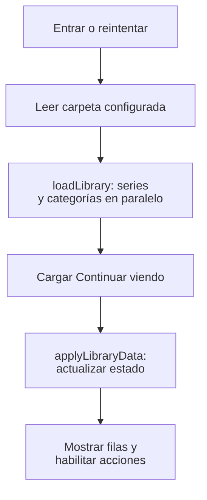

# Series

[Frontend](../README.md) · [Código JSX](../../codigo/SeriesPage.md) · [SeriesCategoryRow](../componentes/series-category-row.md)

`Series.jsx` representa «Mis series». Carga la biblioteca configurada y organiza su presentación en «Continuar viendo», categorías y «Sin categoría». Coordina la selección de carpeta, los cambios de categorías y la confirmación del reinicio de progreso.

Las funciones se agrupan con los mismos separadores del archivo: auxiliares, carga, selección de carpeta, creación, movimiento, eliminación, reinicio, diálogos, navegación y datos para la vista.

## Propiedades y componentes

| Propiedad | Uso |
| --- | --- |
| `seriesList` | Lista de elementos de la biblioteca, compartida desde `App`. |
| `setSeriesList` | Actualiza esa lista cuando se carga una biblioteca. |

`SeriesProps` documenta ambas propiedades con JSDoc. La página utiliza `HuexPageHeader` para la cabecera y [SeriesCategoryRow](../componentes/series-category-row.md) para cada fila. Los diálogos de crear categoría, eliminar categoría y reiniciar serie están definidos en el mismo JSX.

## Estado y referencias

| Grupo | Variables | Propósito |
| --- | --- | --- |
| Biblioteca | `libraryPath`, `categories`, `continuingEpisodes` | Datos de la carpeta que se muestra. |
| Carga | `isLoading`, `isReady`, `loadAttempt` | Indican si se está cargando, si los datos están listos y cuándo repetir la carga. |
| Guardado | `isSaving`, `busyRef` | Actualizan el estado visual y bloquean operaciones simultáneas inmediatamente. |
| Crear categoría | `categoryName`, `categoryDialogRef` | Nombre escrito y acceso al diálogo. |
| Eliminar categoría | `categoryToDelete`, `deleteCategoryDialogRef` | Categoría elegida y confirmación. |
| Reiniciar serie | `seriesToReset`, `resetDialogRef` | Serie elegida y confirmación. |
| Errores | `loadError`, `saveError`, `categoryError`, `deleteCategoryError`, `resetError` | Mensajes de carga, edición y formularios. |

`busyRef.current` cambia inmediatamente sin provocar un renderizado y protege las operaciones. `isSaving` e `isLoading` provocan la actualización de los botones y mensajes de la página. Los bloques `finally` liberan las banderas tras completar o interrumpir una operación.

## Funciones auxiliares

### readJson

Recibe una respuesta `fetch` y trata de leer su JSON. Si el estado HTTP representa un error, lanza un `Error` con `error`, `message` o el código HTTP. Si el cuerpo es nulo o ilegible, informa de una respuesta inválida. Devuelve el objeto para que el manejador aplique sus datos.

### loadLibrary

Recibe una ruta y una señal opcional de cancelación. Solicita en paralelo las series y sus categorías mediante `Promise.all`. Comprueba que ambas respuestas sean listas y después llama a `loadContinueWatching` para obtener los episodios de continuación.

Devuelve `{ series, categories, continuingEpisodes }`. La señal se transmite a las peticiones de carga.

### normalizePathForComparison

Convierte `/` a `\`, elimina las barras finales y pasa el texto a mayúsculas. Se utiliza al comparar asignaciones, comprobar el origen de un movimiento y retirar una serie de «Continuar viendo».

## Carga de la biblioteca

### applyLibraryData

Recibe la ruta y el resultado de `loadLibrary`. Actualiza la lista compartida, las categorías, la continuación y la carpeta visible. Limpia `categoryError` y `saveError` y activa `isReady`.

Está declarada con `useCallback`, dependiente de `setSeriesList`, para conservar su referencia cuando el componente se vuelve a renderizar. El efecto de carga utiliza esa referencia como dependencia.

### useEffect de carga

Se ejecuta al montar y cuando cambia `loadAttempt` o la referencia de `applyLibraryData`. Crea un `AbortController`, ejecuta `loadConfiguredLibrary` y devuelve una limpieza que llama a `controller.abort()`.

Esa limpieza cancela la espera de las peticiones del efecto antes de repetirlo o cuando la página se desmonta. Las comprobaciones de `signal.aborted` evitan aplicar datos, errores o cambios de carga procedentes de una ejecución cancelada.

El botón «Reintentar carga» incrementa `loadAttempt` para volver a ejecutar este recorrido.

### loadConfiguredLibrary

Función interna del efecto. Activa `isLoading`, desactiva `isReady` y limpia el error de carga. Lee `SeriesLibraryPath` mediante la API de configuración, carga esa carpeta y aplica el resultado con `applyLibraryData` si sigue vigente.

Los errores se muestran en `loadError`; `finally` desactiva la carga cuando la ejecución sigue activa.

## Selección de carpeta

### handleSelectFolder

1. Comprueba que la página pueda iniciar una carga y activa el bloqueo de operación.
2. Solicita al servidor el selector de carpetas. Si se cancela y la ruta llega vacía, termina la operación.
3. Carga la biblioteca seleccionada mediante `loadLibrary`.
4. Guarda la nueva ruta en configuración.
5. Aplica la biblioteca a la página.

El orden conserva el cambio visible para después de cargar correctamente y guardar la ruta. Si falla la carga o el guardado, muestra `loadError`; `finally` libera el bloqueo y el indicador de carga.

## Creación de categorías

### openCreateCategoryDialog

Vacía `categoryName`, limpia su error y abre el diálogo con `showModal()`.

### handleCategoryNameChange

Recibe el evento del campo de nombre, actualiza su valor y retira el error del formulario mientras el usuario escribe.

### handleCreateCategory

Cancela el envío HTML del formulario y comprueba la disponibilidad de la biblioteca. Recorta el nombre y exige entre 1 y 80 caracteres. También comprueba duplicados y el nombre reservado «Sin categoría», comparando con `toLocaleLowerCase('es')`.

Solicita la creación al servidor, sustituye `categories` por la lista devuelta, limpia el nombre y cierra el diálogo. Si falla, conserva el formulario abierto y muestra `categoryError`.

## Movimiento de series

### handleMoveSeries

Recibe la ruta de la serie y el identificador de destino. Comprueba que la serie esté en `seriesList` y, si hay identificador, que la categoría exista entre las recibidas.

Envía la solicitud con `categoryId: targetCategoryId || null`: el destino vacío representa «Sin categoría». Al recibir la confirmación sustituye las categorías por la lista devuelta. Un fallo se muestra en `saveError`.

La función se entrega a los carruseles. [SeriesCategoryRow](../componentes/series-category-row.md) la utiliza tanto en drag and drop como en el submenú de destinos de [HuexCardMenu](../componentes/huex-card-menu.md).

## Eliminación de categorías

### requestDeleteCategory

Guarda la categoría seleccionada, limpia `deleteCategoryError` y abre el diálogo de confirmación.

### handleDeleteCategory

Cancela el envío del formulario y comprueba que exista una categoría seleccionada y que la biblioteca esté lista. Envía su identificador y la ruta de biblioteca al servidor.

Al completarse, sustituye las categorías, cierra el diálogo y limpia la selección. Las series de la categoría eliminada aparecen en «Sin categoría» al recalcular las asignaciones. Los errores se muestran en el propio diálogo.

## Reinicio del progreso

### requestResetSeries

Guarda la serie seleccionada, limpia `resetError` y abre el diálogo de confirmación.

### handleResetSeries

Cancela el envío del formulario y espera `waitForProgressSaves()` antes de solicitar el reinicio. Esto coordina la acción con los guardados pendientes del reproductor.

Tras la confirmación del servidor, retira los episodios de esa serie de `continuingEpisodes`, cierra el diálogo y limpia `seriesToReset`. Los errores se muestran en `resetError`.

## Eventos de los diálogos

### handleDialogCancel

Recibe el evento `cancel` de los tres diálogos. Mientras `busyRef.current` está activo, utiliza `preventDefault()` para impedir que Escape cierre una confirmación durante la operación. Los botones de cancelar también se deshabilitan mientras se guarda.

## Navegación

### openSeries

Abre `/series/episodes`, la página [SeriesDetail](series-detail.md), enviando en el estado de navegación `folderPath` y `seriesName`, obtenidos de la tarjeta seleccionada.

### continueEpisode

Abre `/player` enviando el episodio, la biblioteca, la ruta de serie y `startSeconds`, tomado de `episode.playbackProgress.positionSeconds`.

## Datos para la vista

### getCategorySeries

Filtra `seriesList` y devuelve los elementos cuya ruta coincide con alguna de `category.seriesPaths`, utilizando `normalizePathForComparison`.

### Valores derivados

| Valor | Cálculo y uso |
| --- | --- |
| `canEditLibrary` | `isReady && !isLoading && !isSaving`; habilita la creación y la entrega de callbacks de edición a las filas. |
| `assignedPaths` | Conjunto de rutas normalizadas asignadas a alguna categoría. |
| `uncategorizedSeries` | Elementos de `seriesList` cuya ruta está fuera de ese conjunto. |

Estos valores se recalculan en el renderizado a partir del estado actual.

## Renderizado de la página

La cabecera contiene «Nueva Categoria» y «Seleccionar Carpeta». Después se presentan los estados de carga, guardado y errores, junto con el reintento de carga.

El JSX incluye los tres diálogos y las filas de contenido:

- **Continuar viendo:** tarjetas horizontales, cuando la carga ha terminado y hay episodios de continuación.
- **Categorías:** una fila por cada categoría con las series que devuelve `getCategorySeries`.
- **Sin categoría:** series con ruta fuera de `assignedPaths`.
- **Biblioteca vacía:** mensaje para seleccionar una carpeta cuando `seriesList` está vacía.

Las filas reciben las acciones de edición cuando `canEditLibrary` es verdadero; las acciones de navegación se proporcionan mediante `openSeries` y `continueEpisode`.

## Peticiones coordinadas desde la página

| Operación | Petición |
| --- | --- |
| Leer biblioteca configurada | `GET /api/configuration/get?key=SeriesLibraryPath` |
| Seleccionar carpeta | `GET /api/series/select-folder` |
| Explorar series | `GET /api/series/scan?path=...` |
| Leer categorías | `GET /api/seriescategories?libraryPath=...` |
| Guardar carpeta | `POST /api/configuration/update` |
| Crear categoría | `POST /api/seriescategories` |
| Mover serie | `POST /api/seriescategories/move` |
| Eliminar categoría | `DELETE /api/seriescategories/{id}?libraryPath=...` |
| Reiniciar progreso | `POST /api/playbackprogress/reset` |

La continuación se obtiene mediante `loadContinueWatching`, del módulo `playbackProgress`. El detalle del envío y guardado de progreso se explica en [Cliente y continuar viendo](../../sistemas/progreso-reproduccion/cliente.md).
