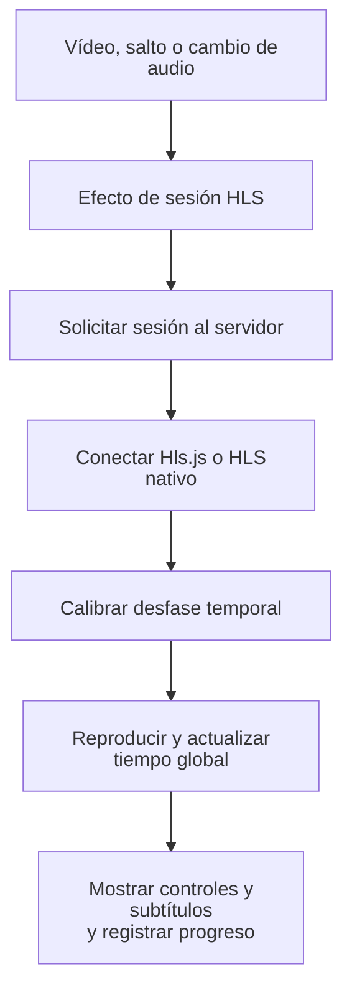

# VideoPlayer

[Frontend](../README.md) · [Código JSX](../../codigo/VideoPlayer.md) · [Estilos CSS](../../codigo/VideoPlayerStyles.md) · [Sistema de vídeo](../../sistemas/reproduccion-video/README.md)

`VideoPlayer.jsx` representa `/player`. Conecta el elemento HTML `video` con una sesión HLS del servidor y coordina los controles, el audio, los subtítulos y el guardado del progreso.

Las funciones están agrupadas por los separadores del código: volumen, progreso, controles, información, subtítulos, sesión HLS, reproducción, búsqueda, audio y navegación.

## Datos de entrada

La página lee el estado de navegación mediante `useLocation`:

| Dato | Uso |
| --- | --- |
| `episode` | Elemento con `rutaCompleta` y `nombre`. |
| `libraryPath` | Biblioteca asociada al progreso. |
| `seriesPath` | Serie asociada al progreso y destino del botón de volver. |
| `startSeconds` | Posición inicial solicitada; se utiliza cero si falta y se limita a un valor no negativo. |

`videoPath` toma `episode.rutaCompleta`. Cuando falta, la página presenta un aviso y permite volver.

## Estado y referencias

| Grupo | Variables | Uso |
| --- | --- | --- |
| Elementos HTML | `videoRef`, `playerRef` | Vídeo y contenedor que recibe rueda, interacción y pantalla completa. |
| Sesión | `hlsRef`, `sessionRef`, `requestRef` | Instancia Hls.js, identificador del servidor y número de petición vigente. |
| Tiempos | `duration`, `currentTime`, `startOffset`, `startOffsetRef`, `seekTarget` | Duración total, posición global, desfase respecto al vídeo local e inicio solicitado. |
| Reproducción | `isPlaying`, `playAfterSeekRef` | Estado visual y decisión de reproducir o conservar la pausa tras crear una sesión. |
| Volumen | `volume`, `muted`, `volumeRef`, `audioGraphRef` | Nivel entre 0 y 2, silencio y grafo de amplificación. |
| Aviso de volumen | `volumeNotice`, `volumeNoticeTimerRef` | Porcentaje mostrado temporalmente y su temporizador. |
| Pistas | `audioTracks`, `subtitleTracks`, `selectedAudio`, `selectedSubtitle` | Pistas disponibles y selección actual. |
| Resultado de subtítulos | `subtitleData`, `subtitleAttempt` | Intervenciones y error asociados a vídeo, pista e intento. |
| Barra de tiempo | `isDragging`, `dragTime` | Posición previsualizada durante un ajuste. |
| Carga | `loading`, `buffering`, `error` | Preparación de la sesión, espera de datos y mensaje de fallo. |
| Controles | `controlsIdle`, `lastInteraction` | Inactividad y última interacción para la ocultación automática. |
| Progreso | `progressSaverRef`, `progressError` | Guardador del episodio y mensaje de guardado. |

## Funciones auxiliares

### formatTime y pad

`formatTime` convierte segundos finitos a `mm:ss` o `hh:mm:ss`, redondeando hacia abajo y limitando los negativos a cero. Para un valor no finito devuelve `00:00`. Su función interna `pad` completa cada parte del reloj con dos dígitos.

### stopSession

Recibe el identificador y solicita `POST /api/video/stop/{sessionId}` con `keepalive: true`, para permitir el envío durante la salida de página. Registra los fallos de conexión en la consola. El servidor atiende la detención y limpieza de esa sesión.

## Volumen y silencio

### changeVolume

Recibe un nivel entre 0 y 2, lo limita a ese rango y redondea a centésimas. Si supera 1 y todavía falta el grafo de audio, crea:

```text
Elemento video → MediaElementAudioSourceNode → GainNode → salida de audio
```

Para niveles hasta el 100 %, usa `video.volume`. Para superar ese valor, mantiene el volumen nativo en 1 y aplica la amplificación con `gain.gain.value`. Un fallo al crear el grafo limita ese ajuste al 100 %.

Reanuda el `AudioContext` si está suspendido, desactiva el silencio y actualiza las referencias y el estado. Muestra el porcentaje durante 1200 ms.

### Eventos de volumen

| Función | Evento o acción |
| --- | --- |
| `handleVolumeChange` | Atiende `volumechange` del vídeo; calcula volumen nativo por ganancia y sincroniza el estado de silencio. |
| `toggleMute` | Alterna `video.muted` desde el botón de sonido. |
| `handleVolumeInput` | Convierte el valor de la barra en número y llama a `changeVolume`. |
| `handleWheel` | Manejador interno del efecto; ajusta un 5 % por evento de rueda. Respeta Ctrl, los eventos sin movimiento vertical y los selectores de pistas. |

### Efecto de rueda

Se ejecuta tras cada renderizado y conecta el manejador vigente al contenedor del vídeo. Usa `{ passive: false }` para poder cancelar el desplazamiento de la página mientras se ajusta volumen. Su limpieza retira el manejador antes de instalar el siguiente y al desmontar.

### Efecto de limpieza de audio

Utiliza dependencias vacías. Su limpieza al desmontar cancela el aviso temporal, desconecta los nodos y cierra el contexto de audio que se haya creado.

## Guardado del progreso

### Efecto del guardador

Depende de `libraryPath`, `seriesPath` y `videoPath`. Con esa identidad completa crea un guardador mediante `createProgressSaver`, lo conserva en `progressSaverRef` y programa un envío cada 10 segundos.

Sus funciones internas son:

| Función | Uso |
| --- | --- |
| `save` | Solicita `saver.flush()` para enviar la última muestra pendiente. |
| `onVisibility` | Llama a `save` cuando el documento pasa a `hidden`. |

También conecta `pagehide`. La limpieza retira eventos e intervalo, solicita el último envío y libera la referencia si todavía corresponde a ese guardador. La bandera local `active` evita que sus mensajes actualicen el estado de una ejecución ya retirada.

Las muestras se registran desde `handleTimeUpdate`; pausa, final y regreso solicitan envíos adicionales. La coordinación de peticiones se explica en [Cliente y continuar viendo](../../sistemas/progreso-reproduccion/cliente.md).

## Visibilidad de los controles

### showControls

Desactiva la inactividad y guarda `Date.now()` en `lastInteraction`. El contenedor la utiliza con movimiento y pulsación del puntero, teclado y foco.

### Efecto de ocultación

Depende de reproducción, carga, espera, arrastre, error y última interacción. Mientras reproduce con normalidad programa la inactividad tras 3000 ms. Cada cambio limpia el temporizador anterior.

`hideControls` combina esa inactividad con el resto de estados para aplicar la clase `controls-hidden`. Los subtítulos cambian de posición cuando los controles están visibles.

## Información del vídeo

### Efecto de información y loadVideoInfo

Al cambiar `videoPath`, crea un `AbortController` y consulta `/api/video/info`. `loadVideoInfo` aplica la duración y las listas de pistas si la petición sigue activa. El error se muestra en el reproductor. La limpieza cancela la consulta anterior.

## Subtítulos

### Efecto de carga

Depende del vídeo, pista seleccionada e intento. Con una pista elegida, difiere la carga mediante un temporizador de cero milisegundos y aplica un límite de 20 segundos. La limpieza cancela los temporizadores y la petición.

| Función interna | Uso |
| --- | --- |
| `saveResult` | Asocia las intervenciones o el error con `path`, `track` y `attempt`. |
| `handleSubtitleTimeout` | Publica el mensaje de tiempo agotado y aborta la petición. |
| `loadSubtitles` | Descarga el texto, procesa los errores de la API, comprueba la cabecera `WEBVTT` y llama a `parseSubtitles`. |

### changeSubtitle y retrySubtitles

`changeSubtitle` actualiza la pista y renueva los controles. La cadena vacía representa subtítulos desactivados. `retrySubtitles` incrementa el intento para volver a ejecutar el efecto de la pista actual.

`activeSubtitles` selecciona el resultado que coincide con el vídeo, pista e intento vigentes. `caption` obtiene la intervención correspondiente a `currentTime` mediante `subtitleAt`, durante la reproducción preparada y con la barra fuera de ajuste.

## Sesiones HLS y sincronización

### Efecto de sesión

Depende de `videoPath`, `seekTarget` y `selectedAudio`. Cada ejecución incrementa `requestRef`, conserva su número como `requestId` y prepara su cancelación y recursos locales.

`startCurrentRequest` inicia el trabajo desde un temporizador de cero milisegundos si el efecto sigue vigente. La limpieza marca la ejecución como cancelada, cancela ese temporizador, aborta su petición, retira los eventos nativos, destruye Hls.js y solicita detener la sesión local.

Esto permite descartar un inicio cancelado antes de que se ejecute y distinguir una respuesta antigua de la solicitud actual.

### startPlayback

1. Activa carga y espera y limpia el error.
2. Destruye Hls.js anterior y reinicia el elemento de vídeo.
3. Solicita detener la sesión anterior y pide una nueva con ruta, inicio y pista de audio opcional.
4. Si la respuesta ya pertenece a una ejecución descartada, solicita detener esa sesión recibida.
5. Guarda la sesión vigente y su referencia de tiempo inicial.
6. Conecta Hls.js cuando está disponible o utiliza el HLS nativo del navegador.

La solicitud de parada anterior se inicia sin bloquear la petición de la nueva sesión. Las verificaciones de cancelación y `requestId` protegen las actualizaciones de interfaz.

### Eventos de Hls.js

| Función | Evento | Resultado |
| --- | --- | --- |
| `handleInitialPts` | `INIT_PTS_FOUND` | Recupera el desfase real a partir de `initPTS / timescale`, descontando el margen de transporte del servidor. |
| `handleHlsError` | `ERROR` | Registra el error vigente; los fallos fatales muestran el mensaje y terminan la carga inicial. |
| `handleManifestParsed` | `MANIFEST_PARSED` | Termina la carga inicial y llama a `playWhenReady`. |

Hls.js utiliza búferes configurados de 30 y 60 segundos, referencias de sincronización de 15 y 20 segmentos y `startPosition: 0`.

### Reproducción HLS nativa

`calibrateTimeline` atiende `loadedmetadata` y `canplay`. Una vez que existe una zona reproducible, calcula el desfase como `timelineStartSeconds - video.seekable.start(0)` y actualiza el tiempo global. `detachNativeTimelineListeners` retira esos manejadores durante la limpieza.

### playWhenReady

Solo reproduce si la ejecución sigue vigente y `playAfterSeekRef` solicita reproducción. Si el navegador bloquea el inicio con sonido, prueba silenciado. Si tampoco puede comenzar, muestra un mensaje para iniciar manualmente.

### Conversión de tiempos

La posición local del vídeo se transforma en la posición del episodio:

```javascript
const globalTime = startOffsetRef.current + video.currentTime;
```

Por ejemplo, si el desfase calibrado es 739 segundos y el vídeo marca 6, la interfaz y el progreso utilizan el segundo 745. Los subtítulos se seleccionan con ese tiempo global. El detalle del margen de transporte está en [Sincronización de tiempos](../../sistemas/reproduccion-video/sincronizacion.md).



## Eventos de reproducción

| Función | Evento o uso |
| --- | --- |
| `togglePlayback` | Clic en vídeo o botón: alterna pausa y reproducción y muestra controles. |
| `handleVideoPlay` | `play`: activa reproducción visual, limpia error y muestra controles. |
| `handleVideoWaiting` | `waiting`: activa la espera de datos. |
| `handleVideoReady` | `canplay` y `playing`: desactiva la espera. |
| `handleVideoPause` | `pause`: desactiva reproducción y espera y solicita guardar. |
| `handleVideoEnded` | `ended`: registra duración como posición final y solicita guardar. |

## Posición y búsqueda

### handleTimeUpdate

Atiende `timeupdate` cuando la barra está fuera de ajuste. Calcula el tiempo global y registra muestras si la sesión está preparada, con datos, reproduciendo y fuera de una búsqueda nativa. Limita el tiempo mostrado a la duración total cuando está disponible.

### handleSeek

Recibe segundos del episodio y limita el destino entre cero y `duration - 0.1`. Conserva en `playAfterSeekRef` si el vídeo estaba reproduciendo.

Si el destino coincide con el inicio solicitado dentro de 0,1 segundos, ajusta el tiempo local de la sesión actual respetando el primer instante disponible. En otro caso actualiza `seekTarget`, lo que ejecuta el efecto de sesión desde esa posición.

### Eventos de la barra

| Función | Uso |
| --- | --- |
| `handleSeekInput` | Activa la previsualización y actualiza `dragTime`. |
| `handleSeekPointerDown` | Captura el puntero durante el arrastre. |
| `handleSeekPointerUp` | Confirma el salto con el valor de la barra. |
| `handleSeekPointerCancel` | Termina el estado de ajuste cuando se cancela el puntero. |
| `handleSeekKeyUp` | Confirma el valor ajustado con el teclado. |
| `handleSeekBlur` | Confirma un ajuste pendiente cuando la barra pierde foco. |

Los botones de diez segundos llaman a `handleSeek` con `currentTime - 10` o `currentTime + 10`. `displayedTime` utiliza `dragTime` durante el ajuste y `currentTime` en el resto de casos.

## Cambio de audio

### changeAudio

Recibe el evento del selector, conserva el estado de reproducción y calcula la posición global actual. Actualiza inicio solicitado y pista, activando la carga. El efecto HLS crea una nueva sesión con esa selección.

## Pantalla completa y navegación

### toggleFullscreen

Alterna pantalla completa del contenedor `playerRef` con `requestFullscreen()` y `exitFullscreen()`. Muestra un error si el navegador rechaza el cambio.

### handleBack

Pausa y espera el envío del progreso. Con `seriesPath`, vuelve a [SeriesDetail](series-detail.md) mediante `/series/episodes`, enviando la ruta y el nombre obtenido de la carpeta. Si falta la serie, vuelve a `/series`. Ambas navegaciones sustituyen la entrada actual mediante `replace: true`.

## Renderizado y estilos

La cabecera utiliza el nombre del episodio. El contenedor presenta el vídeo, el aviso de volumen, subtítulos, mensajes de carga de pista, indicador de espera y controles propios. Los errores de vídeo y progreso se muestran debajo, junto al tiempo de referencia de la sesión.

[VideoPlayer.css](../../codigo/VideoPlayerStyles.md) define el tamaño inicial, las capas superpuestas, la animación de carga, la barra, los subtítulos y la pantalla completa. Los colores reutilizan las variables compartidas.

## Peticiones

| Operación | Petición |
| --- | --- |
| Información | `GET /api/video/info?path=...` |
| Subtítulos | `GET /api/video/subtitles?path=...&trackIndex=...` |
| Inicio o cambio de sesión | `POST /api/video/start?path=...&startSeconds=...&audioTrackIndex=...` |
| Segmentos y manifiesto | URL de lista devuelta por el servidor y sus archivos HLS. |
| Parada | `POST /api/video/stop/{sessionId}` |
| Progreso | Envíos coordinados por `createProgressSaver`. |

El índice de pista de audio se incluye cuando existe una selección explícita.
