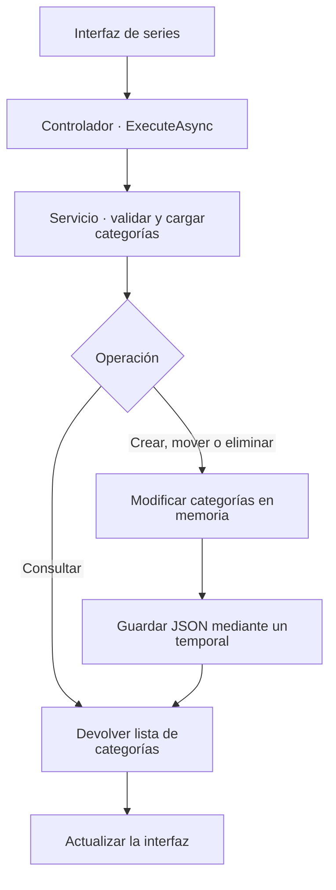

# Categorías de series

[Todos los sistemas](../../README.md)

Este sistema permite crear categorías, asignar una serie a una de ellas y eliminarlas. La organización se conserva en un archivo JSON por biblioteca.

## Esquema de funcionamiento

Cada operación carga las categorías de su biblioteca. Las operaciones que cambian la organización guardan el JSON antes de devolver la lista actualizada.

## Componentes

| Componente | Acceso | Estado de la documentación |
| --- | --- | --- |
| Servicio | [SeriesCategoryService](servicio.md) | Funciones documentadas y código reestructurado |
| Modelos | [Clases y propiedades](modelos.md) | Modelos comentados y documentados |
| Controlador | [Operaciones y respuestas](controlador.md) | Funciones comentadas y documentadas |

## Recorrido de una operación

La interfaz solicita una operación a `SeriesCategoriesController`. El controlador llama al método público correspondiente de `SeriesCategoryService`. El servicio valida las entradas, carga el archivo de la biblioteca y, si hay cambios, publica el JSON actualizado. El controlador convierte el resultado o el error en una respuesta HTTP.

El servicio trabaja con `SeriesCategoryLibrary`, que contiene la ruta de la biblioteca, la versión del formato y sus categorías. Cada `SeriesCategory` guarda un identificador, un nombre y las rutas de sus series.

## Reglas del sistema

- Una serie puede pertenecer a una sola categoría.
- El cliente calcula «Sin categoría» a partir de las series que carecen de asignación.
- Eliminar una categoría deja sus series sin asignación.
- Las comparaciones de rutas y nombres no distinguen mayúsculas.
- Al mover una serie se comprueba la existencia de su carpeta. Al leer el JSON se compara su ruta con la biblioteca para validar su pertenencia.
- Un archivo dañado provoca un error de lectura o validación.

## Persistencia

En desarrollo los archivos se guardan en `HuexMediaApp.Server/App_Data/SeriesCategories/`. En producción se guardan en `%LOCALAPPDATA%\HuexMediaApp\App_Data\SeriesCategories`. La ruta se obtiene de `AppStoragePaths`. El nombre combina la carpeta de la biblioteca y ocho caracteres del hash SHA256 de su ruta completa, por ejemplo `Series-32F8A3FC.json`.

El servicio lee y escribe únicamente el archivo con este nombre legible.
