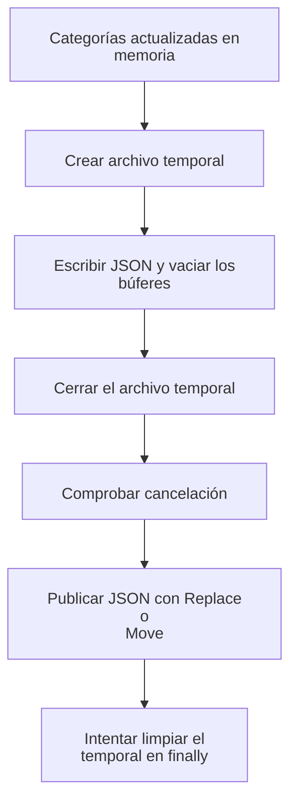

# SeriesCategoryService

[Sistema de categorías](README.md) · [Código del servicio](../../codigo/SeriesCategoryService.md)

## Responsabilidad

Gestiona las categorías y sus asignaciones mediante un JSON por biblioteca. El controlador utiliza sus cuatro operaciones públicas: consultar, crear, mover y eliminar.

El servicio se registra como **singleton** en `Program.cs`. Su `SemaphoreSlim` protege toda la secuencia de carga, modificación y guardado, no solo la escritura final. El bloqueo se comparte entre todas las bibliotecas de esta instancia y se libera con `finally` incluso si ocurre un error.

<a id="indice-de-funciones"></a>
## Índice de funciones

### Construcción y operaciones públicas

- [Constructor](#constructor)
- [GetAsync](#getasync)
- [CreateAsync](#createasync)
- [MoveAsync](#moveasync)
- [DeleteAsync](#deleteasync)

### Validación y rutas

- [NormalizePath](#normalizepath)
- [NormalizeLibrary](#normalizelibrary)
- [IsChild](#ischild)
- [ValidateName](#validatename)
- [GetLibraryHash](#getlibraryhash)
- [GetFilePath](#getfilepath)

### Lectura y escritura

- [LoadAsync](#loadasync)
- [ReadLibraryAsync](#readlibraryasync)
- [ValidateLibraryData](#validatelibrarydata)
- [SaveAsync](#saveasync)
- [WriteTemporaryFileAsync](#writetemporaryfileasync)
- [TryDeleteTemporaryFile](#trydeletetemporaryfile)

## Construcción y operaciones públicas

<a id="constructor"></a>
### Constructor

**Recibe:** `AppStoragePaths storagePaths`, con las rutas de almacenamiento activas.

**Resultado:** configura `_dataDirectory` como `SeriesCategories` dentro de `storagePaths.DataDirectory`.

**Uso:** la inyección de dependencias crea la instancia singleton.

<a id="getasync"></a>
### GetAsync

**Recibe:** `libraryPath` y un `CancellationToken` opcional.

**Devuelve:** `Task<List<SeriesCategory>>` con las categorías de la biblioteca.

**Recorrido:** [NormalizeLibrary](#normalizelibrary) → adquirir `_gate` → [LoadAsync](#loadasync) → devolver `Categories` → liberar `_gate`.

**Efectos:** si falta el archivo, devuelve una lista vacía en memoria.

**Errores:** biblioteca inválida o inexistente; JSON inválido; cancelación; fallos de acceso o lectura. Comparte los errores de persistencia descritos al final de esta página.

<a id="createasync"></a>
### CreateAsync

**Recibe:** `libraryPath`, `name` y un `CancellationToken` opcional.

**Devuelve:** todas las categorías tras guardar, incluida la nueva.

**Recorrido:** [NormalizeLibrary](#normalizelibrary) → recortar espacios del nombre → [ValidateName](#validatename) → adquirir `_gate` → [LoadAsync](#loadasync) → comprobar unicidad → crear `SeriesCategory` con un GUID nuevo → [SaveAsync](#saveasync) → liberar `_gate`.

**Errores propios:** `ArgumentException` si ya existe un nombre equivalente sin distinguir mayúsculas. Los nombres vacíos, demasiado largos y reservados se rechazan antes de adquirir el bloqueo. También propaga los errores de carga y guardado.

**Ejemplo:** crear `" Comedia "` almacena `"Comedia"`. Crear después `"COMEDIA"` se rechaza en esa biblioteca; otra biblioteca puede tener ese nombre.

<a id="moveasync"></a>
### MoveAsync

**Recibe:** `libraryPath`, `seriesPath`, `Guid? categoryId` y un `CancellationToken` opcional. `categoryId = null` significa dejar la serie sin categoría; `Guid.Empty` se rechaza como destino inválido.

**Devuelve:** todas las categorías tras guardar la asignación.

**Recorrido:** [NormalizeLibrary](#normalizelibrary) → [NormalizePath](#normalizepath) → [IsChild](#ischild) y comprobar existencia de la serie → adquirir `_gate` → [LoadAsync](#loadasync) → localizar destino → retirar la ruta de todas las categorías → añadirla al destino si existe → [SaveAsync](#saveasync) → liberar `_gate`.

**Recorrido de la asignación:** comprueba el destino, retira las asignaciones previas y añade la ruta al destino elegido. Así mantiene una sola asignación por serie.

**Errores propios:** `ArgumentException` para una carpeta fuera de la biblioteca, inexistente o con destino desconocido. Se exige una carpeta hija directa: una subcarpeta de temporada no cuenta como serie.

<a id="deleteasync"></a>
### DeleteAsync

**Recibe:** `libraryPath`, `Guid categoryId` y un `CancellationToken` opcional.

**Devuelve:** la lista restante de categorías después de guardar.

**Recorrido:** [NormalizeLibrary](#normalizelibrary) → adquirir `_gate` → [LoadAsync](#loadasync) → eliminar por identificador → [SaveAsync](#saveasync) → liberar `_gate`.

**Efectos:** desaparece la categoría con sus asignaciones. El cliente reconoce esas series como «Sin categoría». Sus carpetas y el archivo independiente de progreso permanecen intactos.

**Errores propios:** `ArgumentException` para un identificador vacío o inexistente.

## Validación y rutas

<a id="normalizepath"></a>
### NormalizePath

**Recibe:** una ruta de biblioteca o serie, `string path`.

**Devuelve:** la ruta absoluta completa sin separador final sobrante, mediante `Path.GetFullPath` y `Path.TrimEndingDirectorySeparator`.

**Llaman:** [NormalizeLibrary](#normalizelibrary), [MoveAsync](#moveasync) y [ValidateLibraryData](#validatelibrarydata).

**Errores:** `ArgumentException` para una ruta vacía, de espacios o no completamente cualificada. También pueden propagarse errores de las operaciones de `Path`.

<a id="normalizelibrary"></a>
### NormalizeLibrary

**Recibe:** `string path`.

**Devuelve:** la ruta normalizada de una biblioteca existente. Llama a [NormalizePath](#normalizepath) y comprueba `Directory.Exists`.

**Llaman:** las cuatro operaciones públicas. **Errores:** los de normalización y `ArgumentException` si la carpeta no existe.

<a id="ischild"></a>
### IsChild

**Recibe:** `library` y `series`, ambas rutas normalizadas.

**Devuelve:** un `bool` al comparar el directorio padre de la serie con la biblioteca mediante `OrdinalIgnoreCase`.

Primero obtiene el padre en `string directory`. Si `Path.GetDirectoryName` devuelve `null`, usa una cadena vacía mediante `?? ""`; después devuelve el resultado de la comparación.

**Llaman:** [MoveAsync](#moveasync) y [ValidateLibraryData](#validatelibrarydata). La función que la llama interpreta el resultado y comunica el error cuando corresponde.

<a id="validatename"></a>
### ValidateName

**Recibe:** `string name`. **Devuelve:** nada si es válido.

Rechaza nombres vacíos o de espacios, de más de 80 caracteres y el nombre reservado «Sin categoría» sin distinguir mayúsculas. `CreateAsync` recorta los espacios y comprueba los duplicados en su flujo.

**Llaman:** [CreateAsync](#createasync) y [ValidateLibraryData](#validatelibrarydata). **Error:** `ArgumentException`; durante la validación de un archivo se traduce a `InvalidDataException`.

<a id="getlibraryhash"></a>
### GetLibraryHash

**Recibe:** la ruta completa normalizada de la biblioteca, `library`.

**Devuelve:** SHA256 de su representación UTF-8 en mayúsculas, convertido a hexadecimal. Bibliotecas con rutas distintas quedan diferenciadas aunque sus carpetas finales tengan el mismo nombre.

La implementación separa el cálculo en cuatro pasos:

1. `string normalizedLibrary`: convierte la ruta a mayúsculas.
2. `byte[] libraryBytes`: codifica ese texto como UTF-8.
3. `byte[] hash`: calcula el SHA256 de esos bytes.
4. `return Convert.ToHexString(hash)`: devuelve el hash completo en hexadecimal.

**Lo llama:** [GetFilePath](#getfilepath).  El nombre usa solo ocho caracteres; la comprobación de `LibraryPath` impide aceptar silenciosamente un archivo de otra biblioteca si esos prefijos coincidiesen.

<a id="getfilepath"></a>
### GetFilePath

**Recibe:** `library`, ya normalizada. **Devuelve:** la ruta del JSON de categorías bajo `_dataDirectory`.

Limpia los caracteres no válidos del nombre de carpeta, recorta espacios y puntos finales, usa «Biblioteca» si queda vacío y limita ese nombre a 80 caracteres. Añade los ocho primeros caracteres de [GetLibraryHash](#getlibraryhash) y `.json`.

**Llaman:** [LoadAsync](#loadasync) y [SaveAsync](#saveasync). **Ejemplo de formato:** `Series-32F8A3FC.json`.

## Lectura y escritura

<a id="loadasync"></a>
### LoadAsync

**Recibe:** `library` y `cancellationToken`. **Devuelve:** un `SeriesCategoryLibrary` validado, o uno nuevo y vacío si faltan el archivo o su directorio.

1. Calcula el nombre legible con [GetFilePath](#getfilepath).
2. Llama a [ReadLibraryAsync](#readlibraryasync) con esa ruta.
3. Si falta el archivo o directorio devuelve una biblioteca vacía en memoria.
4. Llama a [ValidateLibraryData](#validatelibrarydata) y devuelve los datos.

El caso sin archivo se trata capturando `FileNotFoundException`; si tampoco existe el directorio de datos, se captura `DirectoryNotFoundException`. En ambos casos devuelve `new SeriesCategoryLibrary { LibraryPath = library }` solo en memoria. La lista `Categories` está inicializada vacía en el modelo. El JSON se crea al guardar una operación válida, por ejemplo la primera categoría.

**Llaman:** todas las operaciones públicas, siempre bajo `_gate`. Si el archivo está dañado, comunica el error.

<a id="readlibraryasync"></a>
### ReadLibraryAsync

**Recibe:** `filePath` y `cancellationToken`. **Devuelve:** `SeriesCategoryLibrary?` deserializado con las convenciones web de JSON. Un JSON literal `null` devuelve `null`, que la validación posterior rechazará.

Abre el archivo para lectura con `FileShare.Read` y cierra el stream antes de devolver. Las reglas de categorías se comprueban después en `ValidateLibraryData`.

**La llama:** [LoadAsync](#loadasync). **Errores:** traduce `JsonException` a `InvalidDataException`. Propaga archivo/directorio ausente, cancelación y fallos de acceso; `LoadAsync` trata los dos primeros casos de ausencia como biblioteca nueva.

<a id="validatelibrarydata"></a>
### ValidateLibraryData

**Recibe:** `library` y los datos deserializados, que pueden ser `null`. **Devuelve:** la misma instancia si todas las comprobaciones pasan.

Los comentarios del método identifican estas comprobaciones, en el mismo orden del código:

1. **Objeto y cabecera:** los datos no son `null`, la versión es 1, existe la lista de categorías y `LibraryPath` coincide con la biblioteca solicitada sin distinguir mayúsculas.
2. **Estructura de cada categoría:** la categoría no es `null`, su GUID no está vacío ni repetido, y su nombre y lista de rutas no son `null`.
3. **Validez del nombre:** tiene entre 1 y 80 caracteres, no es solo espacios ni el nombre reservado «Sin categoría».
4. **Unicidad del nombre:** ninguna otra categoría tiene un nombre equivalente sin distinguir mayúsculas.
5. **Validez de cada ruta:** no está vacía, es absoluta y se normaliza antes de compararla.
6. **Pertenencia y asignación única:** la ruta es hija directa de la biblioteca y no aparece repetida dentro de la misma categoría ni de otra.

Para detectar duplicados utiliza `HashSet<Guid>` y `HashSet<string>`. `Add` devuelve `true` cuando incorpora un valor nuevo y `false` si ya existía. Por eso `!ids.Add(category.Id)` es verdadero cuando el identificador está repetido: comprueba y registra el identificador en una sola llamada. La misma regla se aplica a `names` y `assignedPaths`.

**La llama:** [LoadAsync](#loadasync). **Llama internamente:** [ValidateName](#validatename), [NormalizePath](#normalizepath) e [IsChild](#ischild).

**Errores:** `InvalidDataException` para cabecera o contenido inválidos. Las `ArgumentException` del contenido se conservan como excepción interna. La validación de pertenencia compara la ruta de cada serie con la de la biblioteca.

<a id="saveasync"></a>
### SaveAsync

**Recibe:** `library`, `data` y `cancellationToken`. **Devuelve:** una tarea sin resultado.



Crea el directorio de datos si hace falta y prepara un temporal con GUID junto al destino. Llama a [WriteTemporaryFileAsync](#writetemporaryfileasync), comprueba la cancelación y publica con `File.Replace` si el destino existe o `File.Move` si es nuevo. En `finally`, llama a [TryDeleteTemporaryFile](#trydeletetemporaryfile).

**Llaman:** [CreateAsync](#createasync), [MoveAsync](#moveasync) y [DeleteAsync](#deleteasync), dentro del bloqueo. El archivo publicado se sustituye por el temporal completo.

**Errores:** cancelación, serialización y fallos de escritura o reemplazo. Un fallo anterior a la publicación conserva el JSON anterior. La creación del directorio o un temporal puede haber ocurrido antes del fallo.

<a id="writetemporaryfileasync"></a>
### WriteTemporaryFileAsync

**Recibe:** `temporary`, `data` y `cancellationToken`. **Devuelve:** una tarea sin resultado.

Crea un archivo nuevo con `FileMode.CreateNew`, sin compartirlo y con `Asynchronous | WriteThrough`. Serializa el JSON con sangría, ejecuta `FlushAsync` y `Flush(flushToDisk: true)` y cierra el stream antes de que `SaveAsync` publique el resultado.

Al escribir, los datos pueden permanecer en búferes de memoria antes de llegar al disco. Las opciones del stream y los vaciados controlan esas etapas:

| Elemento | Qué hace |
| --- | --- |
| `FileOptions.Asynchronous` | Abre el archivo para operaciones de entrada y salida asíncronas. |
| `FileOptions.WriteThrough` | Solicita que las escrituras atraviesen las cachés intermedias y lleguen al disco. Se establece como opción al abrir el archivo. |
| `await stream.FlushAsync(cancellationToken)` | Vacía los datos pendientes del búfer de .NET hacia el archivo de forma asíncrona. El vaciado de los búferes intermedios se solicita en la siguiente llamada a `Flush(flushToDisk: true)`. |
| `stream.Flush(flushToDisk: true)` | Solicita también el vaciado de los búferes intermedios hacia el disco. Es síncrono: el hilo espera hasta que la llamada termina. |

La secuencia de la función es:

```csharp
// Serializa las categorías en el archivo temporal.
await JsonSerializer.SerializeAsync(stream, data, JsonOptions, cancellationToken);

// Envía los datos pendientes del búfer de .NET hacia el archivo.
await stream.FlushAsync(cancellationToken);

// Solicita también el vaciado de los búferes intermedios hacia el disco.
stream.Flush(flushToDisk: true);
```

`await using` cierra el stream al terminar la función. Solo después, `SaveAsync` reemplaza el JSON definitivo con el temporal completo. Si la escritura o el vaciado fallan antes de ese reemplazo, se propaga el error y se intenta limpiar el temporal.

La función serializa el JSON una vez y utiliza `WriteThrough` y los vaciados para completar la escritura antes de publicar el archivo. El sistema de archivos y el dispositivo procesan estas solicitudes de persistencia.

Referencias: [FileOptions](https://learn.microsoft.com/en-us/dotnet/api/system.io.fileoptions), [FlushAsync](https://learn.microsoft.com/en-us/dotnet/api/system.io.filestream.flushasync) y [Flush con flushToDisk](https://learn.microsoft.com/en-us/dotnet/api/system.io.filestream.flush).

**La llama:** [SaveAsync](#saveasync). **Errores:** propaga cancelación y errores de serialización, creación o escritura. El reemplazo corresponde a `SaveAsync`.

<a id="trydeletetemporaryfile"></a>
### TryDeleteTemporaryFile

**Recibe:** la ruta del temporal generado para esta operación. **Devuelve:** nada.

Ejecuta `File.Delete` sobre el temporal de la operación. Absorbe `IOException` y `UnauthorizedAccessException` y conserva el error original de guardado. Si el temporal ya se ha movido al destino, `File.Delete` termina al encontrarlo ausente.

**La llama:** el `finally` de [SaveAsync](#saveasync). Si un bloqueo o los permisos impiden el borrado, el temporal puede permanecer.

## Errores compartidos y cancelación

Las operaciones públicas reciben un token opcional. Se usa al esperar el semáforo, leer y escribir, y antes de publicar el JSON. Un archivo publicado antes de la cancelación permanece guardado.

El servicio lanza excepciones; el controlador decide la respuesta HTTP. `ArgumentException` señala entradas inválidas; `InvalidDataException`, datos almacenados que no se pueden aceptar. Los fallos de disco o permisos se propagan al controlador.

## Comprobaciones tras esta reestructuración

Se ha comprobado la compilación y se han ejecutado pruebas de creación, movimiento, eliminación, persistencia, bibliotecas separadas, escrituras concurrentes en una misma instancia, cancelación y fallos de reemplazo. También se comprueba que un JSON dañado se conserve sin sobrescribirse y que se use únicamente el nombre legible.

[Volver al índice de funciones](#indice-de-funciones) · [Volver al sistema](README.md)
