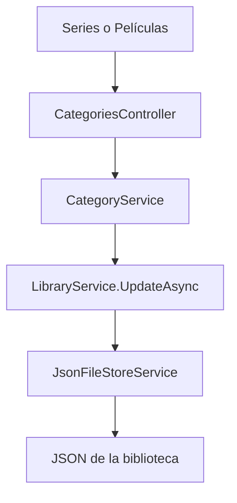

# Categorías de bibliotecas

[Inicio](../../README.md) · [Servicio](servicio.md) · [Modelos](modelos.md) · [Controlador](controlador.md)

Series y Películas utilizan el mismo árbol de categorías. Cada biblioteca guarda sus grupos y asignaciones en su documento `MediaLibrary`, dentro de `App_Data/Libraries`.

Una categoría principal y una subcategoría utilizan `MediaCategory`. Cada grupo contiene sus rutas directas y una lista de hijos del mismo tipo. El padre conserva sus asignaciones cuando se crea una subcategoría.

`LibraryService` protege la lectura, modificación y escritura con su semáforo. `JsonFileStoreService` publica el documento completo mediante un archivo temporal.

## Recorrido para limpiar referencias

[LibraryContentSnapshot](contenido-biblioteca.md) explica los conjuntos de rutas, el recorrido del disco, las consultas y el tratamiento de errores que comparten las limpiezas de categorías y progreso.
