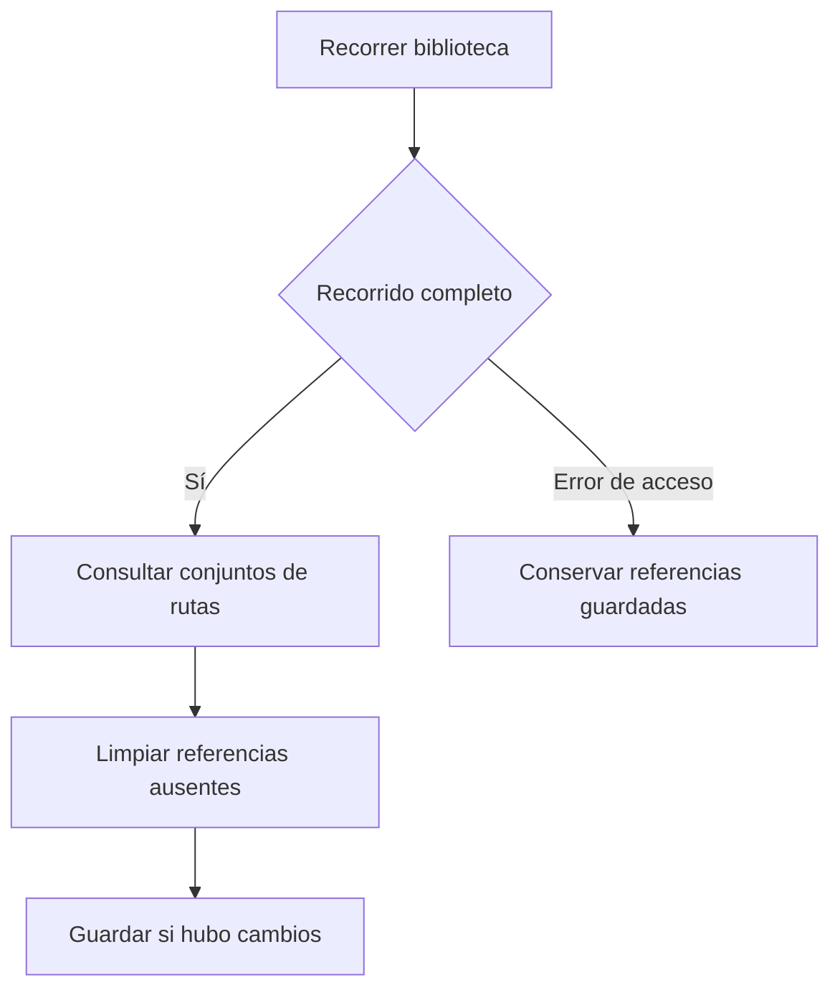

# LibraryContentSnapshot

[Sistema de categorías](README.md) · [Código fuente](../../codigo/LibraryContentSnapshot.md) · [Limpieza de progreso](../progreso-reproduccion/servicio.md#limpieza-de-referencias-al-consultar-progreso)

`LibraryContentSnapshot` reúne en memoria las rutas disponibles en una biblioteca. Los servicios comparan las referencias guardadas con ese resultado para decidir qué asignaciones o entradas de progreso deben retirar.

La clase centraliza el recorrido, las extensiones de vídeo, la normalización y los errores de acceso. `LibraryService` aplica los cambios de categorías; `PlaybackProgressService` aplica los de progreso y ambos utilizan `JsonFileStoreService` para publicar sus JSON.

## Datos del recorrido

| Campo | Series | Películas |
| --- | --- | --- |
| `_items` | Carpetas de series situadas directamente bajo la raíz. | Archivos de películas. |
| `_videos` | Episodios encontrados recursivamente cuando se solicitan. | Archivos de películas. |

Ambos campos son `HashSet<string>`. Cada ruta aparece una sola vez y `Contains` permite comprobar rápidamente su pertenencia. El comparador `StringComparer.OrdinalIgnoreCase` trata como iguales las rutas que solo difieren en mayúsculas y minúsculas.

`VideoExtensions` contiene `.mp4`, `.mkv` y `.avi`, los mismos formatos admitidos por los exploradores de vídeos.

## Lectura del contenido

### TryRead(library, cancellationToken, includeEpisodes = true)

| Parámetro | Función |
| --- | --- |
| `library` | Aporta `MediaType` y `LibraryPath`. |
| `cancellationToken` | Permite interrumpir la carga. |
| `includeEpisodes` | En Series, activa la búsqueda de episodios además de las carpetas de series. |

El recorrido de la función es:

1. Crea una instancia con sus conjuntos vacíos y comprueba la cancelación.
2. En Series, recorre las carpetas hijas directas mediante `Directory.EnumerateDirectories`. Normaliza cada ruta y la incorpora a `_items`.
3. En Películas, o cuando `includeEpisodes` es `true`, utiliza `Directory.EnumerateFiles` con `SearchOption.AllDirectories` para entrar en las subcarpetas.
4. Comprueba la extensión de cada archivo sin distinguir mayúsculas. Añade los vídeos admitidos a `_videos`.
5. En Películas, añade también el vídeo a `_items`, porque ese mismo archivo puede asignarse a una categoría.
6. Devuelve la instancia después de completar el recorrido solicitado.

`LibraryService.CleanupMissingReferencesAsync` utiliza `includeEpisodes: false`. Para limpiar categorías de Series basta con las carpetas de las series; en Películas se buscan sus vídeos. `PlaybackProgressService.CleanupMissingProgress` utiliza el valor predeterminado `true` para disponer también de los episodios.

### Errores de acceso y cancelación

Si falla el recorrido por un error de disco, permisos o seguridad, `TryRead` devuelve `null`. Los servicios conservan las referencias guardadas. Cualquier resultado parcial se descarta: un recorrido interrumpido podría dejar fuera archivos que sí existen.

La cancelación se comprueba antes del recorrido y durante sus bucles. `OperationCanceledException` se propaga para detener la operación solicitada.

## Consultas de referencias

### ContainsItem(path)

Normaliza la ruta y consulta `_items`. Se utiliza para comprobar asignaciones de categorías y para localizar carpetas de series presentes al limpiar progreso.

### ContainsVideo(path)

Normaliza la ruta y consulta `_videos`. El servicio de progreso lo utiliza para comprobar películas, episodios vistos, el último visto y el episodio en curso.

Por ejemplo, si el recorrido encuentra:

```text
Dead Note\Parte 1\Dead Note 1x01.avi
Dead Note\Parte 1\Dead Note 1x02.avi
```

Una referencia guardada a `Dead Note\Parte 1\02 Death Note.avi` produce `false` en `ContainsVideo`. El servicio de progreso retira esa referencia anterior. Las rutas actuales producen `true` y conservan sus datos.

## Normalización de rutas

### NormalizePath(path)

Comprueba que la ruta tenga contenido y sea absoluta mediante `Path.IsPathFullyQualified`. Una referencia vacía o relativa produce `InvalidDataException`.

Después utiliza `Path.GetFullPath` y `Path.TrimEndingDirectorySeparator` para obtener la ruta completa y eliminar el separador final redundante. Se aplica tanto al guardar rutas en los conjuntos como al consultarlas, de modo que las comparaciones utilicen el mismo formato.

## Por qué compartir esta clase

Las categorías y el progreso necesitan conocer qué elementos están disponibles. Compartir esta clase mantiene las reglas del recorrido en un único lugar y permite completar la búsqueda antes de empezar a limpiar los datos guardados.



Las regiones del código corresponden a los bloques de esta página: datos del recorrido, lectura del contenido, consultas de referencias y normalización de rutas.
