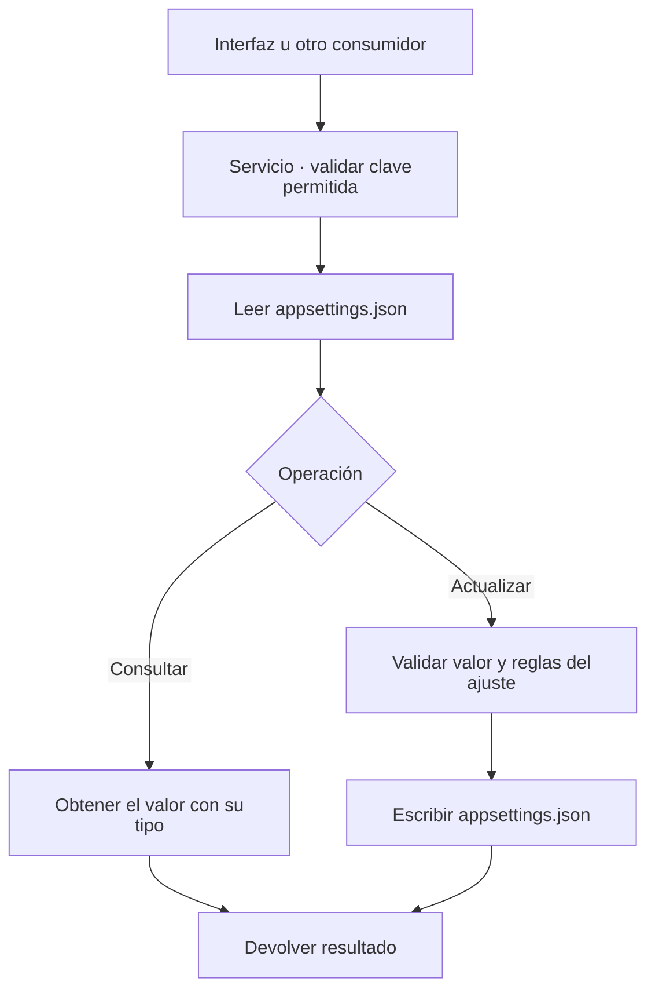

# Configuración

[Todos los sistemas](../../README.md)

Este sistema consulta y actualiza los ajustes de `HuexMediaAppSettings` en el archivo `appsettings.json` del servidor. Conserva el tipo JSON de los valores: un booleano se recibe y devuelve como booleano, no como texto.

## Esquema de funcionamiento

Desde la interfaz, el controlador ejecuta la llamada dentro de `Execute` y construye la respuesta HTTP. Los consumidores internos llaman directamente al servicio y comparten sus validaciones.

## Componentes

| Componente | Documentación | Código |
| --- | --- | --- |
| Servicio | [ConfigurationService](servicio.md) | [Ver código](../../codigo/ConfigurationService.md) |
| Modelo | [ConfigurationRequest](modelos.md) | [Ver código](../../codigo/ConfigurationRequest.md) |
| Controlador | [ConfigurationController](controlador.md) | [Ver código](../../codigo/ConfigurationController.md) |

## Ajustes expuestos por la API

| Clave exacta | Tipo | Uso |
| --- | --- | --- |
| `SeriesLibraryPath` | Texto | Carpeta de la biblioteca de series. Debe existir al actualizarla. |
| `DownloadSeriesPosters` | Booleano | Ajuste que consulta la exploración de series para buscar sus imágenes locales. |
| `DownloadEpisodeThumbnails` | Booleano | Ajuste que consulta la exploración de episodios para buscar sus miniaturas locales. |

El servicio solo admite esas claves y distingue mayúsculas, tanto en llamadas internas como desde la API. Las dos opciones de imágenes controlan la búsqueda de carteles y miniaturas locales.

## Recorrido de una operación

Una consulta llega a `GET /api/configuration/get?key=...`. El controlador ejecuta el servicio dentro de `Execute`. El servicio comprueba que la clave no esté vacía y esté permitida antes de leer el archivo y devuelve un nodo JSON; el controlador responde con `key` y `value`.

Una actualización llega a `POST /api/configuration/update`. El controlador recibe `ConfigurationRequest` y delega sus datos al servicio. Este exige una clave no vacía, permitida y existente, y un valor no nulo de tipo compatible. Después comprueba la carpeta cuando corresponde y escribe el documento completo. La respuesta incluye `success`, `key` y `value`.

## Archivo y alcance

AppStoragePaths obtiene la ruta activa: en desarrollo, el archivo del proyecto; en producción, `%LOCALAPPDATA%\HuexMediaApp\appsettings.json`. El primer arranque crea este archivo a partir de la plantilla instalada, con la biblioteca vacía para seleccionarla. Los arranques posteriores conservan la configuración personal. Program.cs carga este archivo con recarga de cambios, incluidos los márgenes de reproducción. El servicio lee el archivo activo en cada operación.

El archivo debe existir y contener un objeto `HuexMediaAppSettings`. Si falta, está dañado o tiene una estructura incompatible, la API comunica un error; la operación termina con un error.

Las actualizaciones conservan otras secciones del archivo, como `Logging`, `AllowedHosts` y `PlaybackProgress`. Los márgenes de reproducción de `PlaybackProgress` pertenecen al sistema de progreso.

## Escritura actual

El servicio serializa el documento con sangría y lo escribe directamente mediante `File.WriteAllText`. Conserva los valores de otras secciones, pero puede cambiar su presentación textual.
