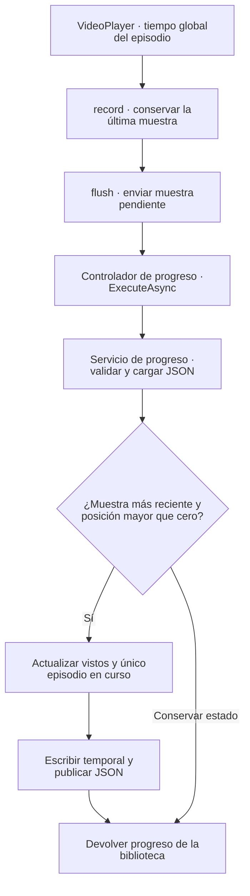

# Progreso de reproducción

[Todos los sistemas](../../README.md)

Este sistema conserva el progreso de las películas, los vídeos vistos, la posición del último episodio en curso de cada serie y la referencia al último episodio visto. También permite marcar episodios manualmente, reiniciar una serie y construir la sección «Continuar viendo».

## Esquema de funcionamiento



## Componentes

| Componente | Documentación | Código |
| --- | --- | --- |
| Servicio | [Funciones y funcionamiento](servicio.md) | [PlaybackProgressService](../../codigo/PlaybackProgressService.md) |
| Modelos | [Clases y propiedades](modelos.md) | [PlaybackProgress](../../codigo/PlaybackProgress.md) |
| Controlador | [Operaciones y respuestas](controlador.md) | [PlaybackProgressController](../../codigo/PlaybackProgressController.md) |
| Cliente | [Muestras, envíos y continuar viendo](cliente.md) | Funciones de `playbackProgress.ts` y su integración con el reproductor y las series. |

## Qué se conserva por serie

- Una lista de rutas de vídeos vistos.
- Un único episodio en curso, con ruta, posición y duración.
- La ruta del último episodio registrado como visto.
- La fecha del último cambio aceptado.

Por ejemplo, ver parcialmente el episodio 1 y después el 2 conserva el episodio 2 como `InProgress`. Los episodios ya vistos se mantienen. Una muestra que llegue tarde se compara con `LastRecordedAtUtc` para conservar el cambio más reciente.

## Progreso de películas

Cada película conserva su posición, duración, marca de visto y fecha. La papelera de «Continuar viendo» activa su ocultación conservando estos datos. Las series también permiten ocultar su tarjeta conservando el historial.

## Cuándo se considera visto

La sección `PlaybackProgress` de `appsettings.json` permite configurar dos criterios alternativos:

```json
{
  "PlaybackProgress": {
    "WatchedThresholdPercent": 95,
    "RemainingSecondsToMarkWatched": 120
  }
}
```

Basta con alcanzar el porcentaje o quedar dentro del margen de segundos finales. Con esos valores, un vídeo se considera visto al alcanzar el 95 % o cuando quedan 120 segundos o menos.

`Program.cs` vincula estas opciones, valida al arrancar que el porcentaje sea finito y esté entre más de cero y cien y que el margen sea finito y mayor o igual que cero. El servicio consulta `IOptionsMonitor.CurrentValue` al comenzar cada guardado.

## Persistencia

En desarrollo los documentos se guardan en `HuexMediaApp.Server/App_Data/PlaybackProgress`. En producción se guardan en `%LOCALAPPDATA%\HuexMediaApp\App_Data\PlaybackProgress`. La ruta se obtiene de `AppStoragePaths`. El nombre es `Progress-{LibraryId:N}.json`, basado en el identificador estable de la biblioteca.

Una consulta de una biblioteca nueva devuelve un documento vacío en memoria. La carpeta y el archivo de progreso se crean al guardar cambios. La publicación utiliza un archivo temporal completo, que se reemplaza o mueve al destino tras vaciar sus búferes.

## Relación con reproducción y biblioteca

El guardado utiliza el tiempo global del episodio, descrito en [sincronización de tiempos](../reproduccion-video/sincronizacion.md). Los [eventos de pausa](../reproduccion-video/eventos/pausar-reanudar.md) y [salida](../reproduccion-video/eventos/salir-limpiar.md) muestran sus solicitudes de guardado.

El cliente construye «Continuar viendo» con `InProgress` o con el siguiente episodio pendiente después del último visto. Las marcas manuales actualizan las tarjetas; reiniciar vacía el historial y la posición de la serie elegida.

## Migrar desde otro dispositivo

En Ajustes, el apartado **Migrar progreso antiguo** busca documentos de versión 1 en `App_Data/PlaybackProgress` del directorio de datos activo. Primero se crea o actualiza la biblioteca de Series; después se busca el progreso y se selecciona la biblioteca de destino.

Al pulsar **Migrar progreso**, se conservan los vistos y minutos y se adaptan las rutas a la raíz del destino. Los nombres de las carpetas de series, temporadas y episodios mantienen su estructura relativa. El original permanece intacto. Una biblioteca con archivo de progreso existente conserva ese archivo y muestra el motivo del rechazo.
