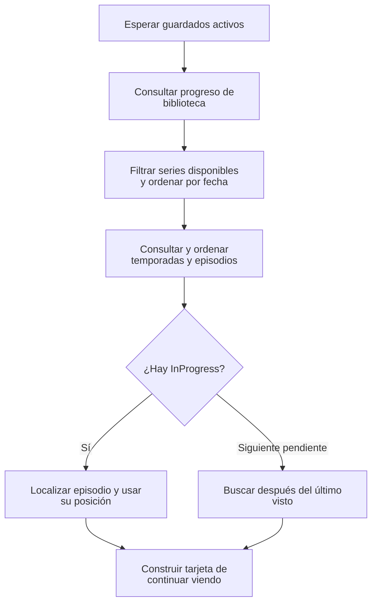

# Cliente: muestras y continuar viendo

[Visión general](README.md) · [Pausa y guardado](../reproduccion-video/eventos/pausar-reanudar.md)

`playbackProgress.js` reúne el guardador de muestras, la interpretación de respuestas y la construcción de «Continuar viendo». `VideoPlayer.jsx`, `Series.jsx` y `SeriesDetail.jsx` utilizan estas funciones.

[Referencia de todas las funciones del módulo](../../frontend/modulos/playback-progress.md) · [Código JavaScript actualizado](../../codigo/PlaybackProgressClient.md)

## Guardar desde el reproductor

### createProgressSaver

Recibe la identidad formada por biblioteca, serie y episodio y una función `onError`. Crea un guardador con la última muestra, la fecha de la última confirmada, la operación de envío activa y una marca de trabajo pendiente.

### record

Recibe posición y duración. Acepta valores finitos con duración y posición positivas, limita la posición a la duración y crea una muestra con fecha UTC.

`lastTimestamp = Math.max(Date.now(), lastTimestamp + 1)` permite que las fechas de las muestras de ese guardador sean crecientes. `record` actualiza la muestra en memoria.

`VideoPlayer.handleTimeUpdate` utiliza el tiempo global del episodio. Registra la muestra cuando hay reproducción activa, datos listos y ausencia de búsqueda y arrastre.

### flush

Marca trabajo pendiente. Si falta una operación de envío activa, inicia `drain` y la registra en `pendingSaves`. Devuelve la promesa del envío activo.

Se solicita cada diez segundos y al pausar, terminar, ocultar o abandonar la página y retirar el componente. `handleBack` espera el intento antes de navegar.

### drain

Mientras hay trabajo pendiente, toma la última muestra disponible. Si hay una muestra distinta de la última confirmada, envía `POST /api/playbackprogress` con JSON y `keepalive: true`.

Tras una respuesta correcta, recuerda su fecha y limpia el aviso. Si falla, conserva la muestra, muestra el error y termina ese ciclo; un `flush` posterior permite reintentarlo. Cuando termina la operación activa, se retira de `pendingSaves`.

### waitForProgressSaves

Espera con `Promise.allSettled` las operaciones de guardado registradas en ese momento. Se utiliza antes de consultar el historial o aplicar cambios manuales para coordinar esas acciones con los envíos activos del cliente.

## Consultar y mostrar

### readProgressResponse

Interpreta JSON. Una respuesta HTTP fallida o un contenido JSON nulo produce un error utilizando el campo `error` disponible o el mensaje general.

### pathKey

Cambia `/` por `\`, retira separadores finales y convierte a mayúsculas para comparar rutas en el cliente.

### formatProgressTime

Convierte segundos a `minutos:segundos` o `horas:minutos:segundos` y mantiene dos cifras para los segundos.

### loadContinueWatching

Espera los guardados activos y consulta la biblioteca. Filtra las series disponibles con historial y las ordena por `LastRecordedAtUtc` descendente. Para cada una consulta sus episodios y ordena temporadas y nombres con comparación española y numérica.

Si hay `InProgress`, localiza ese episodio y utiliza su posición. En otro caso, localiza `LastWatchedEpisodePath` y elige el primer episodio pendiente posterior. Para documentos que carecen de esa referencia, utiliza la última ruta de la lista de vistos como alternativa.

Devuelve tarjetas con nombre de serie y episodio, ruta de serie, indicador `nextEpisode` y `playbackProgress`. El episodio siguiente utiliza posición cero. Las entradas para las que se encuentra un episodio válido se muestran en la sección.

## Marcas manuales y reinicio

`SeriesDetail.setEpisodeWatched` espera guardados activos y llama a `/api/playbackprogress/watched`. Actualiza el progreso utilizado por las tarjetas, sus estados y sus barras.

El reinicio de `Series.jsx` espera guardados y envía biblioteca y serie a `/api/playbackprogress/reset`. Después retira esa serie de las tarjetas de continuar viendo. El servidor conserva la fecha del reinicio para descartar muestras anteriores que puedan llegar después.
