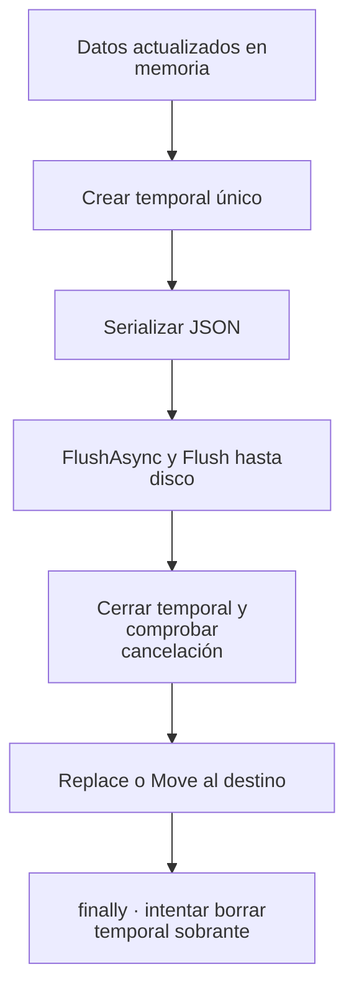

# PlaybackProgressService

[Visión general](README.md) · [Código fuente](../../codigo/PlaybackProgressService.md)

El servicio concentra las validaciones, la clasificación de episodios, el orden de las muestras y el almacenamiento JSON. Sus regiones coinciden con las agrupaciones de esta página.

## Construcción y operaciones públicas

### Constructor

Recibe `AppStoragePaths` para localizar `PlaybackProgress` dentro del directorio de datos activo y un `IOptionsMonitor<PlaybackProgressOptions>` para consultar los márgenes vigentes. Se registra como singleton en `Program.cs`; `_gate`, un `SemaphoreSlim`, serializa las lecturas y modificaciones de esa instancia. `JsonOptions` utiliza nombres web y JSON indentado.

### GetAsync

**Entrada:** ruta de biblioteca y token. **Resultado:** `PlaybackProgressLibrary`.

Normaliza y comprueba la biblioteca, espera `_gate` y llama a `LoadAsync`. Devuelve el documento completo y libera el semáforo en `finally`. Un archivo ausente devuelve una biblioteca vacía en memoria.

### SaveAsync

**Entrada:** `SavePlaybackProgressRequest` y token. **Resultado:** `SeriesPlaybackProgress`.

Este es el recorrido de una muestra enviada por el reproductor:

1. Normaliza biblioteca, serie y episodio y llama a `ValidateEpisode`.
2. Comprueba posición y duración con `ValidateTimes` y fecha con `ValidateRecordedAt`.
3. Captura los ajustes de `_options.CurrentValue`, espera `_gate` y carga el JSON.
4. Obtiene o crea la entrada de la serie mediante `GetOrCreateSeries`.
5. Si la fecha recibida es anterior o igual a `LastRecordedAtUtc`, devuelve el estado conservado.
6. Si la posición es cero, conserva el progreso anterior y devuelve la entrada en memoria.
7. Actualiza la fecha y decide si el episodio cuenta como visto.
8. Si acaba de cumplir los criterios, lo añade a `WatchedEpisodePaths` sin duplicados y actualiza `LastWatchedEpisodePath`.
9. Si el episodio está visto, deja `InProgress` vacío. Si está pendiente, sustituye `InProgress` por ruta, posición y duración de esta muestra.
10. Llama a `WriteAsync`, devuelve el progreso y libera `_gate` en `finally`.

La comparación de fecha se hace por serie: permite mantener el último episodio en curso que se ha reproducido. Reproducir un episodio ya visto conserva su marca y deja el campo de episodio en curso vacío.

El criterio de visto se calcula así:

```csharp
bool watched = request.PositionSeconds / request.DurationSeconds * 100 >= settings.WatchedThresholdPercent ||
    request.DurationSeconds - request.PositionSeconds <= settings.RemainingSecondsToMarkWatched;
```

Por ejemplo, con duración 2000 y posición 1880 quedan 120 segundos: se marca como visto aunque el porcentaje sea 94 %. Con duración 10000 y posición 9500 se alcanza el 95 % aunque queden 500 segundos.

### SetWatchedAsync

**Entrada:** `SetEpisodeWatchedRequest` y token. **Resultado:** progreso de la serie.

Valida las rutas y el episodio, espera el turno y carga su entrada. Si `Watched` es `true`, añade la ruta si falta y la convierte en el último visto. Si es `false`, elimina la ruta; cuando era el último visto, utiliza la última ruta que quede en la lista o `null`.

Si el episodio elegido es el de `InProgress`, vacía su posición parcial. La posición en curso de otro episodio se conserva. `AdvanceRecordedAt` avanza la fecha para proteger la decisión manual frente a muestras antiguas y `WriteAsync` publica el cambio.

### ResetAsync

**Entrada:** `ResetSeriesProgressRequest` y token. **Resultado:** progreso reiniciado de esa serie.

Exige una serie hija directa de la biblioteca y una carpeta existente. Tras esperar el semáforo y cargar la entrada, vacía `WatchedEpisodePaths`, `InProgress` y `LastWatchedEpisodePath`. Avanza la fecha para descartar muestras previas al reinicio y publica el JSON actualizado. Las otras entradas de la biblioteca se conservan.

## Estado de la serie

### GetOrCreateSeries

Busca una entrada por `SeriesPath` sin distinguir mayúsculas. Si falta, añade una `SeriesPlaybackProgress` a los datos cargados en memoria. La publicación corresponde a la operación que llama a este auxiliar.

### AdvanceRecordedAt

Obtiene `DateTimeOffset.UtcNow` y lo asigna cuando supera la fecha conservada. Lo utilizan el reinicio y las marcas manuales para ordenar esas decisiones respecto a muestras de reproducción.

## Validación y rutas

### Same

Compara dos rutas con `StringComparison.OrdinalIgnoreCase`.

### IsDescendant

Comprueba que el hijo empiece por la ruta padre seguida de un separador. Esto permite episodios en subcarpetas de temporada y distingue una carpeta de otra cuyo nombre solo comparte el prefijo.

### NormalizePath

Exige contenido y una ruta plenamente cualificada. Utiliza `Path.GetFullPath` y retira el separador final redundante. Un argumento inválido produce `ArgumentException`.

### NormalizeLibrary

Llama a `NormalizePath` y exige que la carpeta exista.

### ValidateEpisode

Comprueba que la serie sea hija directa de la biblioteca, el episodio esté dentro de la serie, ambas ubicaciones existan y la extensión sea `.mkv`, `.mp4` o `.avi`, sin distinguir mayúsculas. Una comprobación fallida produce `ArgumentException`.

### ValidateTimes

Exige números finitos, duración positiva y posición comprendida entre cero y la duración. Una comprobación fallida produce `ArgumentException`.

### ValidateRecordedAt

Exige una fecha distinta del valor inicial y admite como máximo un minuto de adelanto respecto al reloj UTC del servidor.

### GetFilePath

Convierte la ruta normalizada de biblioteca a mayúsculas, obtiene sus bytes UTF-8 y calcula SHA256. Usa los primeros ocho caracteres hexadecimales del hash.

La parte legible se obtiene del nombre de la carpeta: sustituye caracteres inválidos por `_`, recorta espacios y puntos finales, utiliza `Biblioteca` si queda vacía y limita la longitud a ochenta caracteres. El resultado se combina con `_directory` y la extensión `.json`.

## Lectura y validación del archivo

### LoadAsync

Abre el JSON con acceso de lectura y `FileShare.Read` y lo deserializa como `PlaybackProgressLibrary`. Si el archivo o su directorio faltan, devuelve una biblioteca nueva con la ruta solicitada.

Un JSON ilegible se convierte en `InvalidDataException`. Si la lectura tiene éxito, llama a `ValidateLibraryData`; una incoherencia detectada también se comunica como `InvalidDataException`. Los cambios se publican después de superar esta lectura y validación.

### ValidateLibraryData

Comprueba en orden:

1. Documento presente, versión 1, biblioteca coincidente y lista de series.
2. Entradas de serie presentes, rutas normalizables e hijas directas, rutas únicas, lista de vistos y fecha informada.
3. Rutas de vistos pertenecientes a su serie y únicas, mediante un `HashSet` que compara sin distinguir mayúsculas.
4. `LastWatchedEpisodePath`, cuando existe, incluido entre los vistos.
5. `InProgress`, cuando existe, con tiempos válidos, ruta descendiente y episodio pendiente de ver.

`HashSet.Add` devuelve `false` cuando la ruta ya estaba registrada; la expresión `!set.Add(...)` detecta así un duplicado. La validación de lectura comprueba la coherencia de las rutas almacenadas; las operaciones sobre episodios comprueban además su existencia mediante `ValidateEpisode`.

## Guardado seguro

### WriteAsync



Crea el directorio de almacenamiento, calcula el destino y añade un GUID y `.tmp` para el nombre temporal. Lo abre con `FileMode.CreateNew`, escritura exclusiva, búfer de 4096 bytes y opciones `Asynchronous | WriteThrough`.

| Operación | Función en el guardado |
| --- | --- |
| `WriteThrough` | Solicita escribir a través de los búferes intermedios. |
| `FlushAsync(token)` | Vacía los datos pendientes del flujo de forma asíncrona. |
| `Flush(flushToDisk: true)` | Solicita además el vaciado de los búferes intermedios hacia disco. |
| Cierre de `await using` | Libera el archivo antes de publicarlo. |
| `File.Replace` | Publica el temporal sobre un destino existente. |
| `File.Move` | Publica el temporal cuando el destino es nuevo. |

La cancelación se comprueba después de cerrar el temporal y antes de publicarlo. `finally` llama a `TryDeleteTemporary` tanto ante éxito como ante fallo.

### TryDeleteTemporary

Intenta borrar el temporal sobrante con `File.Delete`. Captura fallos de E/S y permisos para conservar el resultado o la excepción principal del guardado.
