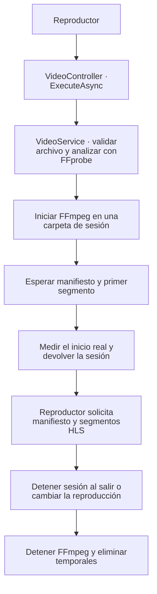
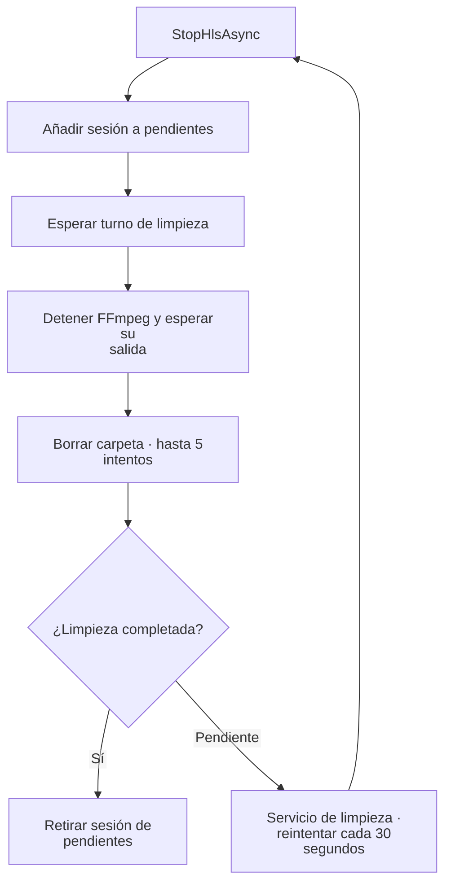

# Reproducción de vídeo

[Todos los sistemas](../../README.md)

Este sistema analiza los archivos de vídeo, prepara su reproducción HLS, permite seleccionar pistas de audio y extrae subtítulos de texto. Administra los procesos de FFmpeg y los archivos temporales de cada sesión.

## Esquema de funcionamiento

## Componentes

Los [eventos del sistema](eventos/README.md) muestran el recorrido entre cliente, controlador, servicios, procesos y modelos mediante esquemas con flechas.

| Componente | Funciones | Código fuente |
| --- | --- | --- |
| Servicio de vídeo | [VideoService](servicio.md) | [Ver código](../../codigo/VideoService.md) |
| Limpieza en segundo plano | [HlsCleanupService](limpieza.md) | [Ver código](../../codigo/HlsCleanupService.md) |
| Modelos | [Información, pistas y sesión](modelos.md) | [VideoInfo](../../codigo/VideoInfo.md) · [PlaybackSession](../../codigo/PlaybackSession.md) |
| Controlador | [Operaciones y respuestas](controlador.md) | [Ver código](../../codigo/VideoController.md) |

## Línea temporal del episodio

La posición solicitada se guarda en `StartSeconds`. Al copiar vídeo H.264, el primer segmento puede comenzar en un fotograma clave anterior. El servicio mide su inicio real con FFprobe y lo devuelve en `TimelineStartSeconds`.

FFmpeg añade un margen de transporte de 10 segundos. El reproductor recibe `TransportTimestampOffsetSeconds` y lo resta a las marcas HLS para relacionarlas con el tiempo del episodio. Los subtítulos WebVTT se extraen con sus tiempos del archivo original.

La [sincronización de tiempos](sincronizacion.md) explica este margen, las referencias del cliente y la selección de subtítulos con ejemplos y un esquema visual.

## Ciclo de los temporales

Cada sesión utiliza `%TEMP%/HuexMedia/Hls/{sessionId}`. El borrado comprueba que la carpeta esté dentro de la raíz HLS. Si falla la detención del proceso, la sesión permanece pendiente para que el siguiente intento vuelva a detenerlo antes de borrar sus archivos. La cola de pendientes se mantiene en memoria durante la ejecución del servidor.

