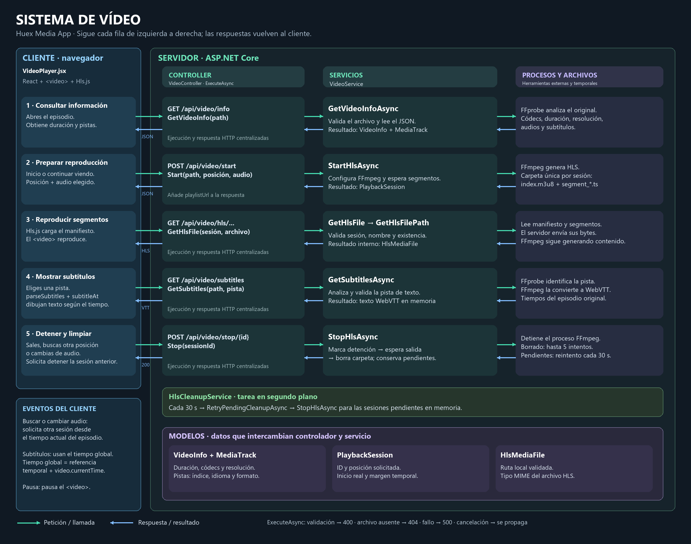

# Eventos de reproducción de vídeo

[Visión general del sistema](../README.md)

Cada evento describe un recorrido entre el cliente y el servidor: petición, funciones llamadas, datos intercambiados y respuesta. Las flechas verdes indican peticiones o llamadas; las azules, respuestas o resultados. Los bloques morados identifican procesos externos y modelos.

## Mapa general

El mapa reúne la consulta de información, el inicio de reproducción, la entrega HLS, los subtítulos y la detención y limpieza de sesiones.

[Abrir SVG ampliable](../../../imagenes/sistema-video-flujo.svg) · [Abrir PNG original](../../../imagenes/sistema-video-flujo.png)

## Eventos detallados

| Evento | Recorrido |
| --- | --- |
| [01 · Consultar información del vídeo](consultar-informacion.md) | Desde `loadVideoInfo` hasta FFprobe, la construcción de `VideoInfo` y la actualización de la interfaz. Incluye errores y cancelación. |
| [02 · Iniciar reproducción](iniciar-reproduccion.md) | Desde `startPlayback` hasta el primer segmento HLS, la medición del inicio real y la respuesta con `PlaybackSession`. Incluye validaciones y limpieza ante fallos. |
| [03 · Reproducir HLS](reproducir-hls.md) | Carga del manifiesto, solicitudes de segmentos, entrega de archivos mediante `HlsMediaFile` y actualización del tiempo global del episodio. |
| [04 · Buscar otra posición](buscar-posicion.md) | Confirmar el destino, liberar el intento anterior, solicitar otra sesión y ajustar la reproducción al tiempo real del episodio. |
| [05 · Cambiar audio](cambiar-audio.md) | Seleccionar una pista por su índice absoluto, conservar posición y pausa y preparar otra sesión con el audio elegido. |
| [06 · Cargar y mostrar subtítulos](subtitulos.md) | Extraer una pista como WebVTT, interpretar sus intervenciones y sincronizar el texto con el tiempo global. Incluye desactivación y reintentos. |
| [07 · Pausar y reanudar](pausar-reanudar.md) | Controlar play y pausa en el navegador, actualizar la interfaz y solicitar el guardado de la última muestra de progreso al pausar. |
| [08 · Salir y limpiar](salir-limpiar.md) | Guardar el progreso, liberar el reproductor, detener FFmpeg y borrar la carpeta de sesión, con reintentos para los fallos pendientes. |
