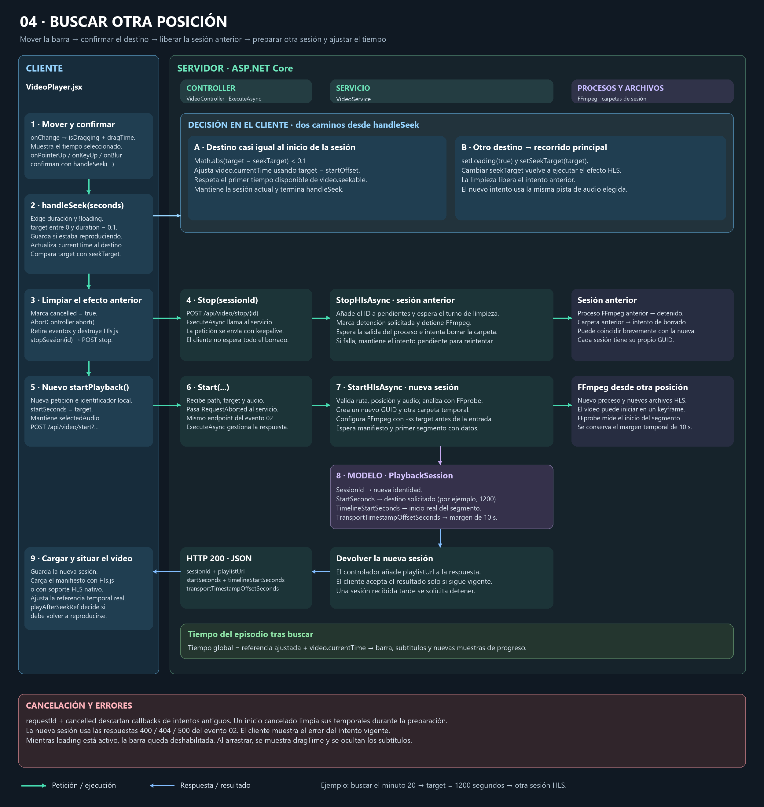

# 04 · Buscar otra posición

[Todos los eventos](README.md) · [Preparación de la sesión](iniciar-reproduccion.md) · [Reproducción HLS](reproducir-hls.md)

La barra representa la duración completa del episodio. Al confirmar una posición diferente del inicio solicitado para la sesión actual, el cliente prepara otra sesión HLS desde ese destino y solicita detener la anterior.

## Esquema del evento

Sigue los pasos **1 → 9**. El recuadro azul explica la decisión que toma `handleSeek` en el cliente. El recorrido principal muestra las peticiones de detención e inicio y el modelo de la nueva sesión.

[](../../../imagenes/video-04-buscar-posicion.svg)

[Abrir SVG ampliable](../../../imagenes/video-04-buscar-posicion.svg) · [Abrir PNG original](../../../imagenes/video-04-buscar-posicion.png)

## 1. Mover la barra y confirmar

El `input` de tipo `range` utiliza la duración del episodio como máximo y avanza en pasos de un segundo. Su `onChange` activa `isDragging` y actualiza `dragTime`. La interfaz muestra esa posición provisional mientras se mueve la barra.

`onPointerUp` confirma el destino mediante `handleSeek`. También se confirma desde `onKeyUp` o `onBlur` cuando hay una selección pendiente. Cancelar el gesto mediante `onPointerCancel` desactiva el arrastre.

Mientras se arrastra, `handleTimeUpdate` deja de actualizar la posición mostrada y el texto de subtítulos queda oculto.

## 2. Calcular el destino

`handleSeek(seconds)` comprueba que exista una duración y que la reproducción no esté cargando. Acota el destino:

```javascript
const target = Math.max(0, Math.min(seconds, duration - 0.1));
```

Por ejemplo, el minuto 20 corresponde a `target = 1200`. El pequeño margen final sitúa el destino dentro del episodio.

Guarda en `playAfterSeekRef.current` si el vídeo estaba reproduciendo y actualiza `currentTime` al destino elegido.

## 3. Elegir entre ajuste local y nueva sesión

La comparación se hace con `seekTarget`, la posición solicitada al iniciar la sesión actual:

```javascript
if (Math.abs(target - seekTarget) < 0.1)
```

Si la diferencia es menor que una décima de segundo, calcula el tiempo local mediante `target - startOffsetRef.current`, lo limita al primer tiempo disponible en `video.seekable` y lo asigna a `video.currentTime`. Este camino conserva la sesión actual.

Para los demás destinos, activa `loading` y llama a `setSeekTarget(target)`. El cambio de estado vuelve a ejecutar el efecto que depende de `videoPath`, `seekTarget` y `selectedAudio`. La barra queda deshabilitada durante la carga.

## 4. Liberar el intento anterior

La función de limpieza del efecto anterior marca `cancelled`, cancela su petición pendiente con `AbortController`, retira los eventos nativos y destruye su instancia de Hls.js.

Si conoce el identificador de esa sesión, llama a `stopSession`, que envía `POST /api/video/stop/{sessionId}` con `keepalive: true`. El controlador delega en `StopHlsAsync`, que intenta detener FFmpeg y borrar la carpeta. Los fallos de limpieza permanecen pendientes para reintentos.

La petición de detención se lanza en segundo plano. La nueva preparación puede coincidir brevemente con la limpieza anterior; cada sesión tiene un GUID y una carpeta independientes.

## 5. Preparar otra sesión desde el destino

El nuevo `startPlayback` crea su identificador local de petición y solicita `POST /api/video/start` con la ruta, `startSeconds = target` y la pista de audio elegida cuando exista.

El controlador llama a `StartHlsAsync`. El servicio valida los datos, analiza el archivo, crea la carpeta y configura FFmpeg con `-ss` antes de la entrada cuando la posición es mayor que cero. Espera el manifiesto y un segmento con datos y mide su inicio real mediante FFprobe.

Este proceso corresponde al [evento 02](iniciar-reproduccion.md).

## 6. Recibir PlaybackSession y continuar

El servicio devuelve `PlaybackSession` con el nuevo identificador, la posición solicitada, el inicio real y el margen de transporte. El controlador añade `playlistUrl` y devuelve HTTP 200.

El cliente acepta la respuesta cuando sigue perteneciendo al intento vigente. Una respuesta obsoleta con una sesión conocida provoca una solicitud de detención de esa sesión.

Guarda la nueva referencia temporal y carga el manifiesto con Hls.js o HLS nativo. `playWhenReady` utiliza `playAfterSeekRef.current` para decidir si debe arrancar: si el vídeo estaba en pausa antes de buscar, se conserva esa intención.

## 7. Ajustar el tiempo del episodio

Al copiar vídeo, el primer segmento puede comenzar en un fotograma clave anterior a la posición solicitada. El cliente utiliza las referencias temporales reales descritas en el [evento 03](reproducir-hls.md) para calcular:

```text
Tiempo global = referencia ajustada + video.currentTime
```

Ese tiempo global actualiza la barra, selecciona las intervenciones de subtítulos y permite registrar nuevas muestras de progreso cuando se cumplen las condiciones de reproducción. Los subtítulos mantienen los tiempos del episodio completo y continúan utilizándose tras el salto.

## Errores y cancelación

La nueva sesión utiliza las validaciones y respuestas 400, 404 y 500 del evento de inicio. Si falla el intento vigente, el reproductor muestra el error y desactiva `loading`.

`requestId` y `cancelled` permiten descartar respuestas y callbacks antiguos. Si se cancela una preparación dentro del bloque de creación de carpeta y proceso, el servidor intenta detener y limpiar esa sesión antes de propagar la cancelación.

[Evento anterior: reproducir HLS](reproducir-hls.md)

[Siguiente evento: cambiar audio](cambiar-audio.md)
