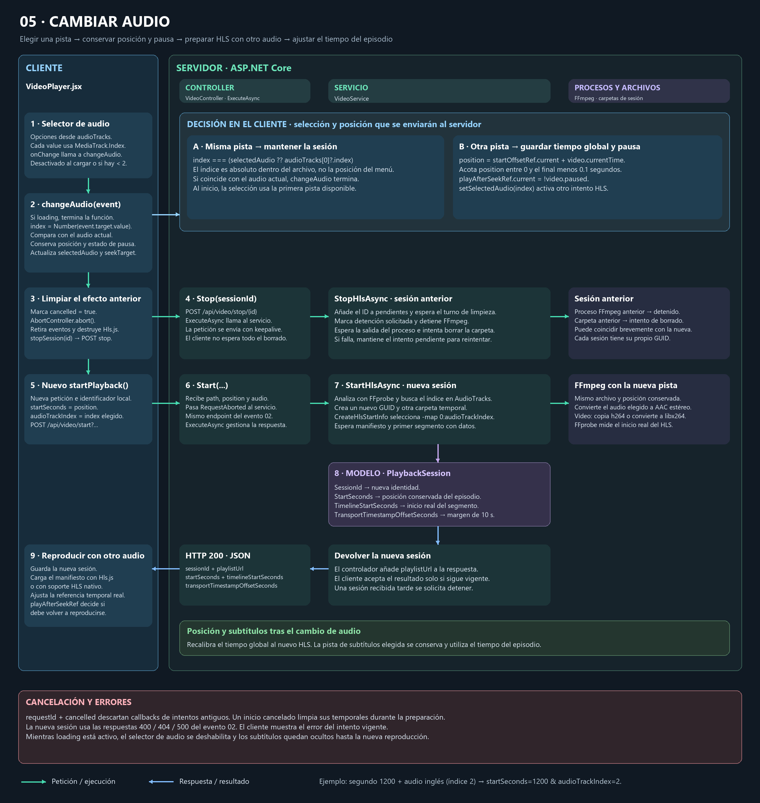

# 05 · Cambiar audio

[Todos los eventos](README.md) · [Preparación de la sesión](iniciar-reproduccion.md) · [Reproducción HLS](reproducir-hls.md)

El selector permite elegir una de las pistas de audio del archivo. El cliente conserva la posición del episodio y la intención de reproducir o permanecer en pausa y prepara otra sesión HLS con el índice elegido.

## Esquema del evento

Sigue los pasos **1 → 9**. El recuadro azul describe la decisión en el cliente; las flechas muestran las peticiones de detención e inicio, las llamadas al servicio y la respuesta con la nueva sesión.

[](../../../imagenes/video-05-cambiar-audio.svg)

[Abrir SVG ampliable](../../../imagenes/video-05-cambiar-audio.svg) · [Abrir PNG original](../../../imagenes/video-05-cambiar-audio.png)

## 1. Elegir una pista

El selector se construye a partir de `audioTracks`, obtenido en la consulta de información. Cada opción utiliza `track.index` como valor y `trackLabel` para mostrar idioma, título y la marca de pista forzada cuando corresponda.

`MediaTrack.Index` es el índice absoluto del stream dentro del archivo. Por ejemplo, el índice 0 puede ser el vídeo, el 1 el audio español y el 2 el inglés. El selector envía ese índice absoluto.

El control está deshabilitado durante la carga o cuando hay menos de dos pistas. Su selección inicial utiliza `selectedAudio` si existe y, en caso contrario, el índice de la primera pista de audio.

## 2. Conservar la posición y la intención de reproducción

`changeAudio(event)` convierte el valor a número. Si está cargando o el índice coincide con la pista actual, termina la función.

Para otra pista, guarda si el vídeo estaba reproduciendo:

```javascript
playAfterSeekRef.current = !videoRef.current.paused;
```

Después calcula el tiempo global del episodio y lo acota:

```javascript
const position = Math.max(0, Math.min(
    startOffsetRef.current + videoRef.current.currentTime,
    Math.max(0, duration - 0.1)));
```

Actualiza `currentTime`, `seekTarget`, `selectedAudio` y `loading`. Por ejemplo, elegir la pista 2 en el segundo 1200 prepara una petición con `startSeconds=1200` y `audioTrackIndex=2`.

## 3. Retirar la reproducción anterior

El efecto HLS depende de `videoPath`, `seekTarget` y `selectedAudio`. Al cambiar la selección, su limpieza cancela el intento anterior, retira los eventos y destruye la instancia Hls.js. Si conoce la sesión anterior, solicita `POST /api/video/stop/{sessionId}`.

`StopHlsAsync` intenta detener el proceso anterior y borrar su carpeta, conservando los intentos pendientes para reintentos. La petición de detención se lanza en segundo plano, de modo que ambas carpetas pueden coincidir brevemente durante la transición.

## 4. Solicitar la sesión con otro audio

El nuevo `startPlayback` envía `POST /api/video/start` con el mismo archivo, la posición conservada y el índice de audio elegido. `VideoController.Start` llama a `StartHlsAsync` dentro de `ExecuteAsync`.

El servicio analiza el archivo con FFprobe y exige que el índice solicitado exista en `videoInfo.AudioTracks`. Un índice inexistente provoca `ArgumentException`, que el controlador convierte en HTTP 400.

## 5. Seleccionar la pista en FFmpeg

`CreateHlsStartInfo` añade la selección mediante argumentos separados:

```csharp
startInfo.ArgumentList.Add("-map");
startInfo.ArgumentList.Add(audioTrackIndex.HasValue
    ? $"0:{audioTrackIndex.Value}"
    : "0:a:0?");
```

Con el índice 2, `-map 0:2` selecciona el stream 2 del primer archivo de entrada. Cuando la petición omite un índice, `0:a:0?` selecciona el primer audio si está disponible.

FFmpeg convierte el audio seleccionado a AAC estéreo, 48 kHz y 192 kbit/s. Para el vídeo conserva H.264 o convierte mediante `libx264`. La nueva sesión genera su propio manifiesto y segmentos desde la posición solicitada.

## 6. Recibir y reproducir la nueva sesión

Tras esperar un primer segmento con datos y medir su inicio real, el servicio devuelve `PlaybackSession`. El controlador añade `playlistUrl` y devuelve HTTP 200.

El cliente comprueba la vigencia del intento, conserva el nuevo identificador y carga el manifiesto. Una sesión que llega como respuesta obsoleta se solicita detener.

La referencia temporal se ajusta al contenido real como en el [evento 03](reproducir-hls.md). `playWhenReady` utiliza `playAfterSeekRef.current`: si estaba reproduciendo, intenta continuar; si estaba en pausa, mantiene esa intención.

## 7. Mantener los subtítulos y el tiempo del episodio

La selección de subtítulos se conserva al cambiar el audio. Sus intervenciones siguen referidas al episodio completo y se muestran según el tiempo global recalibrado de la nueva sesión. Durante `loading` el texto queda oculto.

La barra y las muestras de progreso también utilizan ese tiempo global, calculado como referencia temporal ajustada más `video.currentTime`.

## Errores y cancelación

El cambio utiliza las respuestas y la limpieza del evento de inicio: argumentos inválidos generan 400, archivo ausente genera 404 y otros fallos capturados producen 500. Una preparación fallida dentro del bloque de carpeta y proceso solicita su limpieza antes de propagar el fallo o la cancelación.

El cliente descarta callbacks y respuestas antiguos mediante `requestId` y `cancelled`. Un fallo del intento vigente muestra el error y desactiva `loading`.

[Evento anterior: buscar otra posición](buscar-posicion.md)

[Siguiente evento: cargar y mostrar subtítulos](subtitulos.md)
