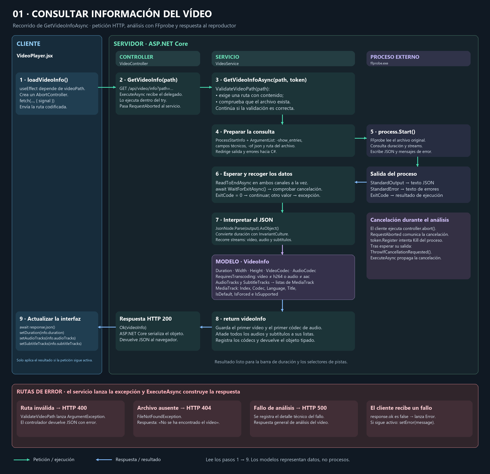

# 01 · Consultar información del vídeo

[Todos los eventos](README.md) · [Explicación de GetVideoInfoAsync](../servicio.md#getvideoinfoasync) · [Código del servicio](../../../codigo/VideoService.md)

El cliente consulta la información técnica del episodio mediante `GET /api/video/info`. El controlador ejecuta la llamada al servicio dentro de `ExecuteAsync`; el servicio valida el archivo, ejecuta FFprobe y transforma su respuesta JSON en `VideoInfo` y sus listas de `MediaTrack`.

## Esquema del evento

Sigue los pasos **1 → 9**. A la derecha se describe la cancelación y en la parte inferior aparecen las respuestas de error. Pulsa la imagen para abrir la versión SVG y ampliarla.

[Abrir SVG ampliable](../../../imagenes/video-01-consultar-informacion.svg) · [Abrir PNG original](../../../imagenes/video-01-consultar-informacion.png)

## Resultado

El controlador devuelve HTTP 200 con la información serializada como JSON. El reproductor actualiza la duración y las listas de audio y subtítulos si la petición sigue activa.

Las validaciones generan 400 para argumentos inválidos y 404 para un archivo ausente. Los fallos de análisis se registran y se convierten en 500; la cancelación se propaga a ASP.NET Core.

[Siguiente evento: iniciar reproducción](iniciar-reproduccion.md)
