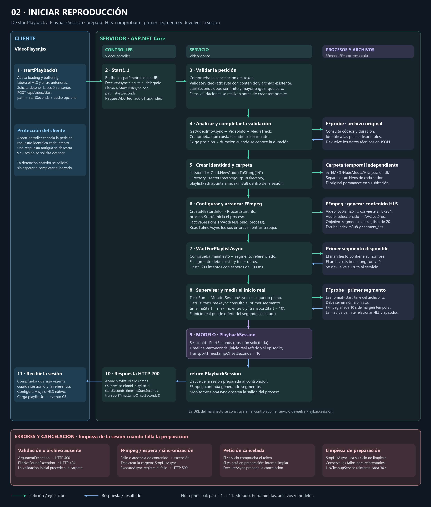

# 02 · Iniciar reproducción

[Todos los eventos](README.md) · [StartHlsAsync](../servicio.md#starthlsasync) · [Código del servicio](../../../codigo/VideoService.md)

Este evento prepara una sesión HLS desde una posición del episodio. Empieza con `startPlayback` en el cliente y termina cuando el servidor devuelve el identificador, la URL del manifiesto y las referencias temporales de la sesión.

## Esquema del evento

Sigue los pasos **1 → 11**. La parte inferior muestra los errores, la cancelación y la limpieza de una preparación fallida. Pulsa la imagen para abrir el SVG ampliable.

[](../../../imagenes/video-02-iniciar-reproduccion.svg)

[Abrir SVG ampliable](../../../imagenes/video-02-iniciar-reproduccion.svg) · [Abrir PNG original](../../../imagenes/video-02-iniciar-reproduccion.png)

## 1. El cliente solicita la reproducción

El efecto de reproducción de `VideoPlayer.tsx` depende de `videoPath`, `seekTarget` y `selectedAudio`. `startPlayback` activa los estados de carga, libera la instancia HLS anterior y limpia el origen del elemento de vídeo. Si conserva una sesión anterior, solicita detenerla en segundo plano.

Envía `POST /api/video/start` con estos parámetros:

| Parámetro | Contenido |
| --- | --- |
| `path` | Ruta del archivo original. |
| `startSeconds` | Posición solicitada; cero al comenzar desde el principio. |
| `audioTrackIndex` | Índice absoluto de audio cuando se ha seleccionado una pista concreta. |

Un `AbortController` permite cancelar la petición. Cada ejecución tiene un `requestId` para reconocer respuestas antiguas. Si recibe una sesión que ya quedó obsoleta, solicita detenerla y descarta esa respuesta.

## 2. El controlador delega la preparación

`VideoController.Start` ejecuta su delegado dentro de `ExecuteAsync` y llama a `StartHlsAsync` con la ruta, posición, token `HttpContext.RequestAborted` y audio opcional.

## 3. El servicio valida y analiza

Primero comprueba la cancelación, la ruta del archivo y que la posición sea un número finito mayor o igual que cero. Después llama a `GetVideoInfoAsync`, que obtiene `VideoInfo` y sus listas de `MediaTrack` mediante FFprobe.

Con esa información comprueba que la pista solicitada pertenezca a los audios disponibles y que la posición sea menor que la duración cuando se conoce la duración. Estas comprobaciones preceden a la creación de la carpeta temporal.

## 4. Crea y registra la sesión

Genera un GUID sin separadores como `sessionId` y crea `%TEMP%/HuexMedia/Hls/{sessionId}`. Dentro de esa carpeta se escribirán el manifiesto y los segmentos.

`CreateHlsStartInfo` construye los argumentos de FFmpeg. La configuración selecciona el primer vídeo, copia H.264 o convierte a `libx264` y transforma el audio elegido a AAC estéreo. Los segmentos tienen una duración objetivo de cuatro segundos y el manifiesto mantiene una ventana de veinte segmentos.

El servicio arranca el proceso, lo registra en `_activeSessions` asociado al identificador y empieza a leer sus errores en segundo plano.

## 5. Espera el primer segmento

`WaitForPlaylistAsync` comprueba el manifiesto, busca un segmento referenciado y exige que el archivo exista y tenga datos. Realiza hasta 300 intentos separados por 100 ms de espera; termina antes si FFmpeg sale.

Una vez disponible el segmento, el servicio inicia `MonitorSessionAsync` en segundo plano para observar la terminación de FFmpeg.

## 6. Obtiene el inicio real

`GetHlsStartTimeAsync` ejecuta FFprobe sobre el primer segmento y consulta `format=start_time`. El valor debe ser un número finito.

La posición solicitada y el inicio real pueden diferir al copiar vídeo desde un fotograma clave. Para expresar el inicio real en la línea temporal del episodio, el servicio descuenta los diez segundos añadidos como margen de transporte:

```csharp
TimelineStartSeconds = Math.Max(0, transportStart - TransportTimestampOffsetSeconds);
```

Por ejemplo, si se solicitan 600 segundos y el primer segmento tiene una marca inicial de 608 segundos, la referencia del episodio será 598 segundos tras descontar el margen de 10.

## 7. Devuelve la sesión al cliente

El servicio devuelve el modelo `PlaybackSession`:

| Propiedad | Contenido |
| --- | --- |
| `SessionId` | Identificador del proceso y la carpeta. |
| `StartSeconds` | Posición solicitada. |
| `TimelineStartSeconds` | Inicio real referido al episodio. |
| `TransportTimestampOffsetSeconds` | Margen de transporte: diez segundos. |

El controlador añade `playlistUrl` con la ruta `/api/video/hls/{sessionId}/index.m3u8` y devuelve HTTP 200. El cliente comprueba que la respuesta siga vigente, guarda la sesión y la referencia temporal y conecta el manifiesto a Hls.js o al soporte HLS nativo del navegador. La entrega de manifiesto y segmentos corresponde al siguiente evento.

## Errores y cancelación

Los argumentos inválidos generan HTTP 400 y un archivo ausente genera HTTP 404. Otros fallos de preparación se registran y producen HTTP 500 mediante `ExecuteAsync`.

Si ocurre un fallo o una cancelación dentro del bloque de preparación de la carpeta y el proceso, el servicio llama a `StopHlsAsync` antes de propagar la excepción. La limpieza utiliza su propio ciclo de detención y borrado; los intentos pendientes quedan disponibles para `HlsCleanupService`.

La cancelación se propaga a ASP.NET Core. En el cliente, el intento cancelado deja de actualizar la interfaz. La solicitud de detener una sesión anterior se lanza sin esperar a que finalice todo su borrado.

[Evento anterior: consultar información](consultar-informacion.md)

[Siguiente evento: reproducir HLS](reproducir-hls.md)
