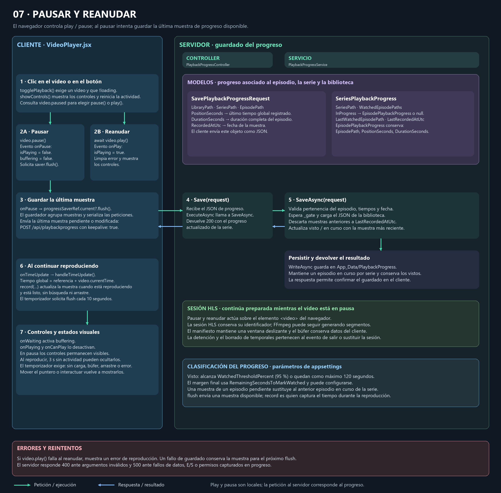

# 07 · Pausar y reanudar

[Todos los eventos](README.md) · [Reproducción HLS](reproducir-hls.md)

Pausar y reanudar actúa sobre el elemento de vídeo del navegador. Sus eventos actualizan la interfaz y, al pausar, solicitan guardar la última muestra de progreso disponible. La sesión HLS mantiene su identidad durante estas operaciones.

## Esquema del evento

El esquema separa las dos acciones locales y el recorrido de guardado que llega a `PlaybackProgressController` y `PlaybackProgressService`. Los modelos morados corresponden al progreso del episodio y de la serie.

[Abrir SVG ampliable](../../../imagenes/video-07-pausar-reanudar.svg) · [Abrir PNG original](../../../imagenes/video-07-pausar-reanudar.png)

## 1. Pulsar el vídeo o el botón

Ambas interacciones llaman a `togglePlayback`. La función exige que exista el elemento de vídeo y que `loading` esté desactivado. Llama a `showControls`, que muestra los controles y actualiza el instante de última interacción.

Si `video.paused` es falso, ejecuta `video.pause()`. Si es verdadero, espera `video.play()` y muestra un mensaje si ese intento falla.

## 2. Pausar y solicitar guardado

El evento `onPause` actualiza `isPlaying = false` y `buffering = false` y llama a `progressSaverRef.current?.flush()`.

`flush` intenta enviar la última muestra registrada por el guardador. La captura de posición ocurre en `record`, llamado durante las actualizaciones válidas de reproducción. Si todavía carece de muestra o ya confirmó esa misma muestra, el guardador omite el envío correspondiente.

## 3. Enviar la muestra al servidor

`createProgressSaver` agrupa los cambios y mantiene una sola operación de envío en curso. Envía `POST /api/playbackprogress` con JSON y `keepalive: true`.

El JSON se recibe como `SavePlaybackProgressRequest`:

| Propiedad | Contenido |
| --- | --- |
| `LibraryPath` | Biblioteca de la serie. |
| `SeriesPath` | Serie del episodio. |
| `EpisodePath` | Archivo reproducido. |
| `PositionSeconds` | Último tiempo global registrado. |
| `DurationSeconds` | Duración del episodio. |
| `RecordedAtUtc` | Fecha de la muestra para ordenar los guardados. |

`PlaybackProgressController.Save` ejecuta el guardado mediante su `ExecuteAsync` y llama a `PlaybackProgressService.SaveAsync`.

## 4. Actualizar el progreso de la serie

El servicio valida rutas, pertenencia del episodio, tiempos y fecha. Espera el semáforo de guardado y carga el progreso de la biblioteca. Descarta muestras anteriores o iguales a `LastRecordedAtUtc` y conserva la organización de episodios vistos y en curso.

Con los ajustes actuales de `appsettings.json`, considera visto un episodio cuando alcanza `WatchedThresholdPercent`, configurado en 95, o cuando quedan como máximo `RemainingSecondsToMarkWatched`, configurado en 120 segundos.

`SeriesPlaybackProgress` conserva los episodios vistos y un único `InProgress` por serie. Ese dato utiliza `EpisodePlaybackProgress`, con ruta, posición y duración. También conserva `LastWatchedEpisodePath` y `LastRecordedAtUtc`.

`WriteAsync` guarda el JSON bajo `App_Data/PlaybackProgress`. El controlador responde HTTP 200 con el progreso de la serie y el cliente confirma la muestra enviada.

## 5. Reanudar y registrar nuevas posiciones

Cuando `video.play()` consigue iniciar la reproducción, `onPlay` activa `isPlaying`, limpia el error y muestra los controles. `onWaiting` activa `buffering`; `onPlaying` y `onCanPlay` lo desactivan.

`onTimeUpdate` llama a `handleTimeUpdate`. Calcula el tiempo global sumando la referencia temporal a `video.currentTime`. Cuando el vídeo está reproduciendo, con datos listos y sin búsqueda ni arrastre, `record(globalTime, duration)` actualiza la muestra disponible.

El temporizador del guardador solicita `flush` cada diez segundos. También hay solicitudes de guardado al ocultar la página, abandonarla, finalizar o retirar el componente.

## 6. Actualizar los controles

En pausa, los controles permanecen visibles. Al reproducir, un temporizador de tres segundos puede ocultarlos si no hay carga, espera de datos, arrastre ni error.

Mover el puntero, pulsar, utilizar el teclado o enfocar el contenedor llama a `showControls`, que vuelve a mostrarlos y actualiza la actividad.

## 7. Relación con la sesión HLS

La pausa y la reanudación conservan el identificador de sesión y actúan sobre el `<video>`. FFmpeg puede seguir añadiendo segmentos al manifiesto HLS durante la pausa. Los segmentos previos siguen disponibles, incluso si el navegador necesita descargarlos otra vez al reanudar.

La detención del proceso y el borrado de su carpeta se solicitan al salir o sustituir la sesión, como ocurre al buscar o cambiar de audio.

## Errores y reintentos

Un fallo de `video.play()` al reanudar muestra un error de reproducción. Si falla el guardado de progreso, el cliente conserva la muestra para intentarlo en una solicitud posterior y muestra el aviso de guardado correspondiente.

El controlador de progreso responde 400 ante argumentos inválidos y 500 ante errores de datos, E/S o permisos capturados. La respuesta permite al guardador distinguir el fallo de una confirmación correcta.

[Evento anterior: cargar y mostrar subtítulos](subtitulos.md)

[Siguiente evento: salir y limpiar](salir-limpiar.md)
