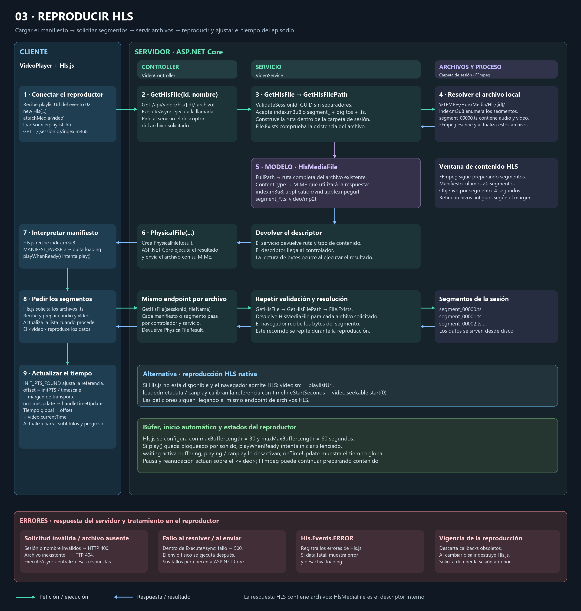

# 03 · Reproducir HLS

[Todos los eventos](README.md) · [GetHlsFile](../servicio.md#gethlsfile) · [Código del controlador](../../../codigo/VideoController.md) · [Código del servicio](../../../codigo/VideoService.md)

Una vez preparada la sesión, el navegador carga el manifiesto y solicita los segmentos que contienen audio y vídeo. Cada archivo pasa por el controlador y el servicio antes de enviarse al cliente.

## Esquema del evento

Sigue los pasos **1 → 9**. Las flechas de ida muestran peticiones y llamadas; las de vuelta, resultados y archivos enviados. Pulsa la imagen para abrir el SVG ampliable.

[](../../../imagenes/video-03-reproducir-hls.svg)

[Abrir SVG ampliable](../../../imagenes/video-03-reproducir-hls.svg) · [Abrir PNG original](../../../imagenes/video-03-reproducir-hls.png)

## 1. Conectar Hls.js al vídeo

El cliente recibe `playlistUrl` en la respuesta de inicio. Si `Hls.isSupported()` devuelve `true`, crea una instancia de Hls.js, registra sus eventos y ejecuta:

```javascript
localHls.attachMedia(video);
localHls.loadSource(data.playlistUrl);
```

`attachMedia` conecta la biblioteca con el elemento `<video>`. `loadSource` le entrega la URL del manifiesto. Hls.js solicita `GET /api/video/hls/{sessionId}/index.m3u8`.

## 2. Resolver la petición en el servidor

`VideoController.GetHlsFile` ejecuta la operación mediante `ExecuteAsync`. Llama a `VideoService.GetHlsFile`, que utiliza `GetHlsFilePath` para resolver la ruta.

El servicio comprueba que el identificador sea un GUID en formato `N` y que el nombre sea `index.m3u8` o un segmento con formato `segment_` seguido de al menos cinco dígitos y la extensión `.ts`. Construye la ruta dentro de `%TEMP%/HuexMedia/Hls/{sessionId}` y comprueba la existencia del archivo.

## 3. Devolver el descriptor y enviar el archivo

El servicio devuelve un `HlsMediaFile` con dos propiedades:

| Propiedad | Contenido |
| --- | --- |
| `FullPath` | Ruta completa del archivo local validado. |
| `ContentType` | `application/vnd.apple.mpegurl` para el manifiesto o `video/mp2t` para los segmentos. |

El controlador utiliza `PhysicalFile(file.FullPath, file.ContentType)` para crear un `PhysicalFileResult`. ASP.NET Core ejecuta ese resultado y envía los bytes del archivo. `HlsMediaFile` es el descriptor interno utilizado para preparar la respuesta.

## 4. Interpretar el manifiesto y pedir segmentos

El manifiesto contiene referencias a los archivos `.ts`. Hls.js interpreta la lista, solicita los segmentos y prepara sus datos para que el elemento de vídeo los reproduzca. Durante la reproducción actualiza la lista cuando corresponde y repite el recorrido del servidor para cada archivo.

FFmpeg sigue generando segmentos de aproximadamente cuatro segundos en la carpeta de sesión. El manifiesto anuncia todos los segmentos generados y marca el final cuando FFmpeg completa el vídeo. Los segmentos se eliminan al limpiar la sesión.

Al recibirse `MANIFEST_PARSED`, el cliente desactiva `loading` y llama a `playWhenReady`. Si el intento de reproducción queda bloqueado por sonido con `NotAllowedError`, prueba de nuevo con el vídeo silenciado.

## 5. Ajustar el tiempo al episodio original

La [explicación de sincronización](../sincronizacion.md) muestra visualmente cómo se relacionan el tiempo del episodio, las marcas HLS y el contador del reproductor.

El evento `INIT_PTS_FOUND` permite ajustar la referencia temporal a partir de las marcas interpretadas por Hls.js:

```javascript
const offset = timing.initPTS / timing.timescale
    - data.transportTimestampOffsetSeconds;
```

El cliente conserva ese valor en `startOffsetRef.current`. Después, `handleTimeUpdate` calcula:

```javascript
const globalTime = Math.max(0,
    startOffsetRef.current + video.currentTime);
```

Por ejemplo, una referencia de 598 segundos y un `video.currentTime` de 12 segundos sitúan la reproducción en el segundo 610 del episodio. Ese tiempo global actualiza la barra y sirve para seleccionar subtítulos y registrar el progreso. Las muestras de progreso se registran cuando el vídeo está reproduciendo y se cumplen las condiciones de carga, búfer y búsqueda.

## 6. Búfer y estados del vídeo

Hls.js se configura con `maxBufferLength: 30` y `maxMaxBufferLength: 60`, expresados en segundos. El búfer permite mantener datos preparados para la reproducción.

`onWaiting` activa `buffering`. `onPlaying` y `onCanPlay` lo desactivan. `onTimeUpdate` actualiza la posición del episodio. Pausar y reanudar actúa sobre el elemento `<video>`; el proceso FFmpeg puede continuar preparando segmentos.

## 7. Alternativa HLS nativa

Si Hls.js no está soportado y el elemento de vídeo admite `application/vnd.apple.mpegurl`, el cliente asigna `video.src = data.playlistUrl`. El navegador solicita el contenido al mismo endpoint.

Los eventos `loadedmetadata` y `canplay` permiten calibrar una vez la referencia mediante `data.timelineStartSeconds - video.seekable.start(0)`, cuando existe un rango disponible.

## Errores y fin de esta reproducción

Una sesión o nombre inválidos generan HTTP 400; un archivo ausente genera HTTP 404. Los demás fallos capturados durante la resolución se registran y producen 500. La ejecución del `PhysicalFileResult` ocurre después del delegado del controlador; los fallos durante el envío son gestionados por ASP.NET Core.

El manejador `Hls.Events.ERROR` registra los errores de la biblioteca. Si `data.fatal` está activo, muestra un mensaje de error y desactiva `loading`. Los callbacks comprueban la vigencia de la reproducción para descartar eventos antiguos.

Al abandonar o sustituir la reproducción se destruye Hls.js, se retiran los eventos nativos si existen y se solicita detener la sesión correspondiente.

[Evento anterior: iniciar reproducción](iniciar-reproduccion.md)

[Siguiente evento: buscar otra posición](buscar-posicion.md)
