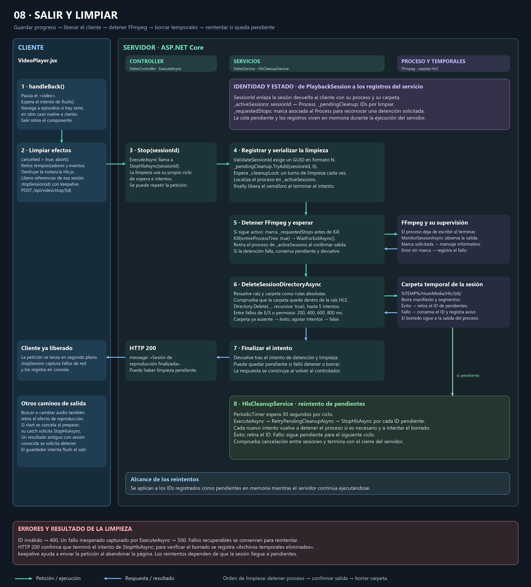

# 08 · Salir y limpiar

[Todos los eventos](README.md) · [StopHlsAsync](../servicio.md#stophlsasync) · [Servicio de limpieza periódica](../limpieza.md) · [Código del servicio](../../../codigo/VideoService.md)

Al abandonar el reproductor se solicita guardar el progreso, se liberan los recursos del cliente y se pide detener la sesión. El servidor detiene FFmpeg, espera su salida y trata de borrar la carpeta temporal. Los fallos recuperables permanecen pendientes para reintentarlos.

## Esquema del evento

Sigue los pasos **1 → 8**. La flecha hacia `HlsCleanupService` muestra el recorrido de las sesiones pendientes. El esquema distingue la respuesta al intento de detención del resultado del borrado.

[](../../../imagenes/video-08-salir-limpiar.svg)

[Abrir SVG ampliable](../../../imagenes/video-08-salir-limpiar.svg) · [Abrir PNG original](../../../imagenes/video-08-salir-limpiar.png)

## 1. Volver y guardar el progreso

El botón de volver llama a `handleBack`. Pausa el elemento de vídeo y espera el intento de `flush` del guardador de progreso. Después navega a `/series/episodes` con los datos de la serie cuando están disponibles; en caso contrario, vuelve a `/series`.

El guardado también se solicita al retirar el efecto del progreso. Sus eventos `pagehide` y `visibilitychange` intentan guardar cuando se abandona u oculta la página. Estos envíos utilizan la última muestra disponible, como se describe en el [evento 07](pausar-reanudar.md).

## 2. Retirar los recursos del cliente

La limpieza del efecto de reproducción realiza estas operaciones:

1. Marca su ejecución como `cancelled`.
2. Retira el temporizador de arranque y cancela la petición pendiente con `AbortController`.
3. Retira los eventos de calibración HLS nativa si estaban registrados.
4. Destruye su instancia de Hls.js y libera la referencia compartida si sigue siendo la misma.
5. Si conoce el identificador de sesión, libera la referencia correspondiente y llama a `stopSession`.

La retirada del efecto también ocurre al sustituir la sesión por una búsqueda o un cambio de audio. Si una respuesta antigua devuelve una sesión conocida, el cliente solicita detener esa sesión.

## 3. Solicitar la detención

`stopSession` envía `POST /api/video/stop/{sessionId}` con `keepalive: true`. Esta opción ayuda a mantener la petición al abandonar la página. La llamada se lanza en segundo plano desde la limpieza y captura los fallos de red para registrarlos en consola.

`VideoController.Stop` llama a `StopHlsAsync` dentro de `ExecuteAsync`. El servicio utiliza su propio ciclo de espera y limpieza, independiente del token de cancelación de la petición de inicio.

## 4. Registrar la sesión pendiente y esperar turno

`StopHlsAsync` valida el identificador GUID en formato `N`, lo añade a `_pendingCleanup` y espera `_cleanupLock`.

El semáforo permite una operación de limpieza cada vez. Se libera en `finally`, también cuando el intento sale antes de completar el borrado.

| Estado del servicio | Contenido |
| --- | --- |
| `_activeSessions` | Relación entre `sessionId` y el objeto `Process`. |
| `_pendingCleanup` | Identificadores cuyos intentos de limpieza siguen pendientes. |
| `_requestedStops` | Marca asociada al proceso para reconocer una detención solicitada. |

El `SessionId` recibido inicialmente en `PlaybackSession` conecta estos registros con la carpeta temporal de esa sesión. Los registros y la cola de pendientes se mantienen en memoria durante la ejecución del servidor.

## 5. Detener el proceso antes del borrado

Si el proceso está registrado y sigue activo, el servicio marca la detención en `_requestedStops` antes de llamar a `Kill(entireProcessTree: true)`. Después espera `WaitForExitAsync` y retira el proceso de `_activeSessions`.

La marca se coloca antes de detenerlo porque `MonitorSessionAsync` puede observar su salida inmediatamente. Con ella registra una detención solicitada como información; una salida fallida sin esa marca se registra como error de FFmpeg.

Si falla la detención, el servicio registra un aviso y conserva el proceso y la sesión pendiente para volver a intentarlo. El borrado se realiza después de confirmar la salida del proceso o cuando la sesión carece de proceso registrado.

## 6. Validar y borrar la carpeta

`DeleteSessionDirectoryAsync` vuelve a validar el identificador y resuelve las rutas absolutas de la raíz temporal y de la carpeta de sesión:

```text
%TEMP%/HuexMedia/Hls/{sessionId}
```

Comprueba que la ruta de sesión comience por la raíz HLS seguida de un separador. Después intenta `Directory.Delete(sessionDirectory, recursive: true)` hasta cinco veces.

Si encuentra fallos de E/S o permisos, espera 200, 400, 600 y 800 milisegundos entre los intentos. Una carpeta ya ausente cuenta como éxito. Si agota los intentos, registra un aviso y devuelve `false`.

Cuando devuelve `true`, `StopHlsAsync` retira el identificador de `_pendingCleanup`. Si devuelve `false`, el identificador queda disponible para otro ciclo.

## 7. Responder al intento

Al regresar del servicio, el controlador devuelve HTTP 200 con `message: "Sesión de reproducción finalizada."`. Ese resultado confirma que terminó el intento de `StopHlsAsync`; puede quedar trabajo pendiente si falló detener el proceso o borrar la carpeta.

Un borrado efectivo se registra con «Archivos temporales eliminados». Si la carpeta ya estaba ausente, el servicio también considera completada su limpieza. La operación admite peticiones repetidas para un identificador válido.

## 8. Reintentar en segundo plano

`HlsCleanupService.ExecuteAsync` espera ciclos de treinta segundos con `PeriodicTimer` y llama a `RetryPendingCleanupAsync`.

Ese método recorre los identificadores pendientes, comprueba la cancelación antes de cada sesión y llama a `StopHlsAsync`. Cada intento vuelve a detener el proceso cuando es necesario y a intentar borrar la carpeta. Las sesiones completadas se retiran de pendientes; las demás quedan para otro ciclo.

Los fallos de un ciclo se registran y el servicio continúa en el siguiente. Al cerrarse el servidor, el token de cierre finaliza la espera periódica. Los reintentos actúan sobre los identificadores registrados como pendientes mientras el servidor continúa ejecutándose.

## Preparaciones canceladas y errores

Cuando una preparación de reproducción falla o se cancela dentro del bloque de carpeta y proceso, `StartHlsAsync` llama a `StopHlsAsync` antes de propagar la excepción. Así utiliza el mismo mecanismo de detención, borrado e intentos pendientes.

Un identificador inválido produce HTTP 400. Un fallo inesperado que llegue al controlador se registra y se convierte en 500. Los problemas recuperables de detención y borrado se conservan en la cola de reintentos y pueden permitir una respuesta 200 al intento actual.

[Evento anterior: pausar y reanudar](pausar-reanudar.md) · [Volver al mapa de eventos](README.md)
