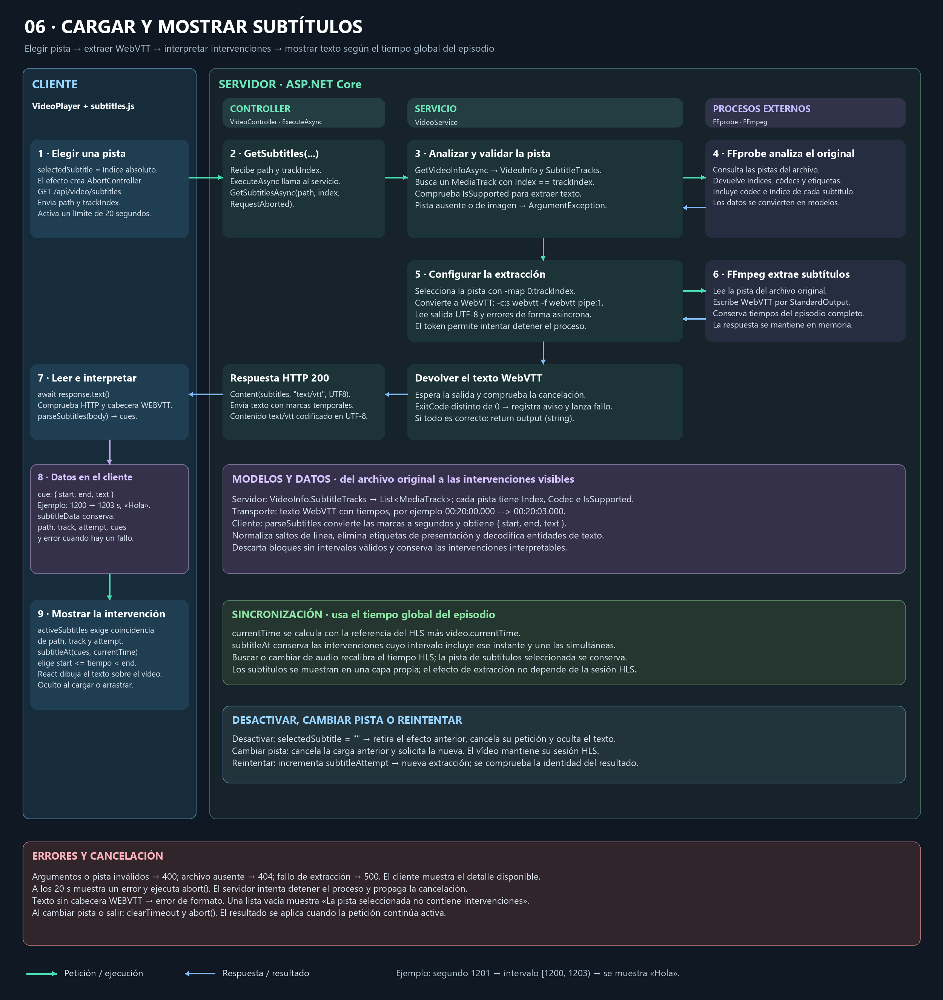

# 06 · Cargar y mostrar subtítulos

[Todos los eventos](README.md) · [GetSubtitlesAsync](../servicio.md#getsubtitlesasync) · [Modelos](../modelos.md)

Al seleccionar subtítulos, el cliente solicita una pista del archivo original. El servidor la convierte a WebVTT y el cliente interpreta sus intervenciones para dibujar el texto según el tiempo global del episodio.

## Esquema del evento

Sigue los pasos **1 → 9**. Los recuadros inferiores describen la sincronización, la desactivación, los cambios de pista, los errores y los reintentos.

[](../../../imagenes/video-06-subtitulos.svg)

[Abrir SVG ampliable](../../../imagenes/video-06-subtitulos.svg) · [Abrir PNG original](../../../imagenes/video-06-subtitulos.png)

## 1. Seleccionar una pista

El selector se construye con `subtitleTracks`, procedente de `VideoInfo`. Cada opción utiliza el índice absoluto de su `MediaTrack`. La opción de desactivación utiliza el texto vacío como valor.

Cambiar la selección actualiza `selectedSubtitle`. El efecto depende de `videoPath`, `selectedSubtitle` y `subtitleAttempt`. Cuando hay archivo y pista seleccionada, crea un `AbortController`, programa la solicitud y establece un límite de veinte segundos.

La petición es `GET /api/video/subtitles?path=...&trackIndex=...`. Mientras el resultado correspondiente está pendiente, la interfaz muestra «Cargando subtítulos…».

## 2. Analizar y validar en el servicio

`VideoController.GetSubtitles` llama a `GetSubtitlesAsync` dentro de `ExecuteAsync`, pasando el token `RequestAborted`.

El servicio llama a `GetVideoInfoAsync` y busca el índice solicitado dentro de `SubtitleTracks`. Cada pista tiene un indicador `IsSupported`, calculado a partir de su códec con `IsTextSubtitle`. Se aceptan los formatos de texto `subrip`, `ass`, `ssa`, `webvtt`, `mov_text` y `text`.

Si la pista está ausente o tiene un formato incompatible, lanza `ArgumentException` y el controlador responde HTTP 400.

## 3. Extraer WebVTT con FFmpeg

FFmpeg selecciona el stream con `-map 0:trackIndex` y convierte la pista con `-c:s webvtt -f webvtt pipe:1`. `pipe:1` dirige el resultado a la salida estándar del proceso.

El servicio lee el resultado como UTF-8 y los errores en paralelo. El token registra una acción para intentar detener el proceso si se cancela la petición. Después de esperar su salida, comprueba la cancelación y el código de salida.

Una extracción correcta devuelve un `string` con el texto completo y los tiempos del episodio original. El controlador lo envía con `Content(..., "text/vtt", Encoding.UTF8)`. El contenido se conserva en memoria durante este recorrido.

## 4. Interpretar las intervenciones en el cliente

El cliente lee `response.text()`, comprueba el estado HTTP y verifica que el contenido comience por `WEBVTT`, tolerando una marca BOM y espacios iniciales.

`parseSubtitles` normaliza saltos de línea, divide el contenido en bloques y localiza sus intervalos. Convierte las marcas temporales a segundos y genera objetos con `start`, `end` y `text`. También elimina etiquetas de presentación y decodifica entidades de texto. Descarta bloques sin intervalos válidos.

Por ejemplo:

```text
00:20:00.000 --> 00:20:03.000
Hola
```

Se convierte en:

```javascript
{ start: 1200, end: 1203, text: "Hola" }
```

El estado `subtitleData` conserva la ruta, pista, intento y lista de intervenciones; si ocurre un fallo, conserva su mensaje de error.

## 5. Sincronizar y mostrar el texto

Consulta la [sincronización de tiempos](../sincronizacion.md) para seguir el ejemplo del margen de diez segundos y el cálculo del tiempo del episodio.

`activeSubtitles` exige que la ruta, pista e intento del resultado coincidan con los valores actuales. Después, `subtitleAt(cues, currentTime)` obtiene las intervenciones cuyo intervalo contiene el tiempo global:

```javascript
time >= cue.start && time < cue.end
```

Las intervenciones simultáneas se unen con saltos de línea. React muestra el texto dentro de una capa propia sobre el vídeo. Durante la carga de reproducción o el arrastre de la barra, el texto queda oculto.

`currentTime` corresponde al episodio completo: referencia temporal ajustada más `video.currentTime`. Buscar otra posición o cambiar de audio recalibra la referencia HLS y conserva la selección de subtítulos. El efecto de extracción utiliza la identidad del archivo y pista y el intento de carga.

## 6. Desactivar, cambiar y reintentar

Desactivar asigna `selectedSubtitle = ""`, retira el efecto anterior, cancela su petición pendiente y oculta el texto.

Cambiar de pista cancela la carga anterior y solicita la nueva manteniendo la reproducción HLS. Pulsar «Reintentar subtítulos» incrementa `subtitleAttempt`, lo que provoca otra carga y permite identificar el resultado de ese intento.

## Errores y cancelación

El servidor devuelve 400 para argumentos o pistas inválidos, 404 para archivo ausente y 500 para otros fallos de extracción capturados. El cliente intenta mostrar el campo `error`, `message` o `detail` de la respuesta y utiliza un mensaje HTTP general cuando corresponde.

Si supera veinte segundos, el cliente conserva un mensaje de tiempo agotado y cancela la petición. La cancelación intenta detener el proceso y se propaga a ASP.NET Core. Al cambiar pista o salir se retiran los temporizadores y se ejecuta `abort()`.

Una respuesta sin cabecera WebVTT genera un error de formato. Si se interpreta una lista vacía, la interfaz muestra «La pista seleccionada no contiene intervenciones». El resultado se aplica cuando la petición continúa activa.

[Evento anterior: cambiar audio](cambiar-audio.md)

[Siguiente evento: pausar y reanudar](pausar-reanudar.md)
