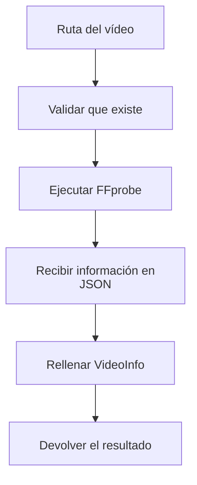

# VideoService

[Visión general](README.md) · [Código fuente](../../codigo/VideoService.md)

Administra FFprobe, FFmpeg y las sesiones HLS. Las agrupaciones de esta página coinciden con las regiones del servicio.

## Construcción

El constructor localiza `Tools/FFmpeg/ffprobe.exe` y `Tools/FFmpeg/ffmpeg.exe` bajo el directorio de contenido del servidor. Recibe un `ILogger<VideoService>`.

Mantiene los procesos en `_activeSessions`, las detenciones solicitadas en `_requestedStops` y las sesiones pendientes de limpieza en `_pendingCleanup`. `_cleanupLock` da un único turno de limpieza para detener procesos y borrar carpetas. El margen `TransportTimestampOffsetSeconds` vale 10 segundos.

## Análisis y subtítulos

### GetVideoInfoAsync

**Ejecuta FFprobe para consultar qué contiene un archivo de vídeo y devuelve los datos en un `VideoInfo`.** El resultado permite conocer la duración, preparar la reproducción y mostrar las pistas disponibles.

**Entrada:** `path`, la ruta del archivo, y `cancellationToken`, que permite cancelar el análisis. **Resultado:** `Task<VideoInfo>`, una operación asíncrona cuyo resultado es la información técnica.



#### 1. Comprobar la ruta

```csharp
ValidateVideoPath(path);
```

Exige una ruta con contenido y un archivo existente. Una ruta vacía produce `ArgumentException`; un archivo ausente produce `FileNotFoundException`. Estas excepciones llegan al controlador cuando la función se llama desde una petición HTTP.

#### 2. Preparar FFprobe

```csharp
ProcessStartInfo startInfo = new()
{
    FileName = _ffprobePath,
    RedirectStandardOutput = true,
    RedirectStandardError = true,
    UseShellExecute = false,
    CreateNoWindow = true
};
```

`ProcessStartInfo` describe cómo ejecutar el programa externo:

| Propiedad | Para qué se utiliza |
| --- | --- |
| `FileName` | Ubicación de `ffprobe.exe` dentro del proyecto. |
| `RedirectStandardOutput` | Recoger su respuesta desde C#. |
| `RedirectStandardError` | Recoger sus mensajes de error desde C#. |
| `UseShellExecute = false` | Ejecutar directamente el programa. |
| `CreateNoWindow` | Ejecutarlo sin abrir una ventana de consola. |

`ArgumentList.Add(...)` entrega cada argumento por separado. `-v error` solicita mensajes de error; `-show_entries` selecciona los campos que queremos consultar y `-of json` pide una respuesta JSON. La ruta del vídeo se añade como otro argumento.

Los campos solicitados son duración, índice y tipo de pista, códec, resolución, idioma, título y marcas de pista predeterminada o forzada.

#### 3. Arrancar el programa y preparar la cancelación

```csharp
using Process process = new()
{
    StartInfo = startInfo
};

process.Start();
```

`Process` representa el programa externo. `Start()` arranca FFprobe con la configuración anterior. `using` libera los recursos del objeto al salir de la función.

Después, `cancellationToken.Register(...)` registra una acción para intentar detener FFprobe con `Kill(entireProcessTree: true)` cuando se cancele la operación. Por ejemplo, la petición puede cancelarse al abandonar el reproductor. La declaración `using CancellationTokenRegistration` retira ese registro cuando termina la función.

El bloque de cancelación contempla que el proceso ya haya terminado o que el sistema operativo rechace la detención. Tras esperar su salida, `ThrowIfCancellationRequested()` propaga la cancelación al llamador.

#### 4. Recoger la respuesta y esperar a que termine

```csharp
Task<string> outputTask = process.StandardOutput.ReadToEndAsync();
Task<string> errorTask = process.StandardError.ReadToEndAsync();

await process.WaitForExitAsync();
cancellationToken.ThrowIfCancellationRequested();

string output = await outputTask;
string error = await errorTask;
```

La lectura de los dos canales empieza mientras FFprobe trabaja. Así sus búferes se van vaciando durante la ejecución. `outputTask` recogerá el JSON y `errorTask` recogerá los mensajes de error.

`await` espera la finalización sin mantener un hilo bloqueado durante toda la espera. Después obtenemos los dos textos.

Si `process.ExitCode` es distinto de cero, el servicio registra el detalle de `error` y lanza `InvalidOperationException`. Si ha terminado correctamente, continúa interpretando la respuesta.

#### 5. Interpretar el JSON y obtener la duración

```csharp
JsonObject root = JsonNode.Parse(output)!.AsObject();
VideoInfo videoInfo = new();
```

`JsonNode.Parse` convierte el texto recibido en una estructura consultable desde C#. `AsObject()` obtiene el objeto JSON principal. `!` expresa que el código espera un resultado no nulo. `videoInfo` es el objeto que vamos a rellenar y devolver.

```csharp
string? duration = root["format"]?["duration"]?.GetValue<string>();
```

FFprobe entrega la duración como texto, por ejemplo `"2700.50"`. `?.` permite que una propiedad ausente produzca `null`.

`double.TryParse` intenta convertir el texto a segundos y guarda el número en `seconds`. `NumberStyles.Float` permite el formato numérico de punto flotante y `CultureInfo.InvariantCulture` interpreta el punto decimal independientemente del idioma de Windows. Si la conversión tiene éxito, asigna el resultado a `videoInfo.Duration`; si falla, se conserva su valor inicial, cero.

#### 6. Recorrer las pistas del archivo

```csharp
if (root["streams"] is JsonArray streams)
{
    foreach (JsonNode? stream in streams)
    {
        // Leer cada pista y añadir sus datos al resultado.
    }
}
```

`streams` es la lista de pistas que devuelve FFprobe. Por ejemplo, un archivo podría contener:

| Índice absoluto | Tipo | Contenido |
| --- | --- | --- |
| 0 | Vídeo | H.264, 1920 × 1080. |
| 1 | Audio | Español, AC3. |
| 2 | Audio | Inglés, AAC. |
| 3 | Subtítulos | Español, SubRip. |

Para cada pista, `codec_type` indica su tipo y `codec_name` su códec. El servicio guarda el códec y resolución del primer vídeo y el códec del primer audio.

Para cada audio o subtítulo crea un `MediaTrack` con su índice absoluto, idioma, título, códec y marcas de selección. Lo añade a `AudioTracks` o `SubtitleTracks`. El índice permite seleccionar después esa pista mediante `-map 0:Index` en FFmpeg.

En las etiquetas opcionales, `??` aporta un valor cuando falta el dato: `und` para el idioma y texto vacío para el título. Las marcas `default` y `forced` se consideran activas cuando valen `1`.

`IsSupported` queda activado para las pistas de audio. Para subtítulos, `IsTextSubtitle(codecName)` comprueba que el códec sea uno de los formatos de texto que se pueden extraer a WebVTT.

#### 7. Calcular la compatibilidad y devolver el resultado

```csharp
videoInfo.RequiresTranscoding =
    videoInfo.VideoCodec != "h264" ||
    videoInfo.AudioCodec != "aac";
```

Esta propiedad vale `true` cuando el vídeo o el primer audio detectados difieren de la combinación H.264 y AAC. `||` significa que basta con que una de las dos condiciones se cumpla. Por ejemplo, H.264 con audio AC3 produce `true`.

Finalmente registra los códecs detectados y devuelve `videoInfo`. Para el archivo del ejemplo, el resultado sería:

```text
VideoCodec: h264
AudioCodec: ac3
Duration: 2700.5 segundos
Width: 1920
Height: 1080
RequiresTranscoding: true
AudioTracks: español e inglés
SubtitleTracks: español
```

#### Quién utiliza el resultado

`VideoController.GetVideoInfo` devuelve esta información al reproductor. `StartHlsAsync` la utiliza para validar la posición y la pista de audio y preparar FFmpeg. `GetSubtitlesAsync` la utiliza para localizar y validar la pista de subtítulos solicitada.

### GetSubtitlesAsync

**Entrada:** ruta, índice absoluto de pista y token. **Resultado:** texto WebVTT.

Llama a `GetVideoInfoAsync`, busca la pista en `SubtitleTracks` y comprueba `IsSupported`. FFmpeg selecciona esa pista con `-map 0:trackIndex` y escribe WebVTT por la salida estándar, que se lee como UTF-8. La cancelación intenta detener el proceso.

Devuelve el texto en memoria con los tiempos del archivo original. Una pista ausente o de formato incompatible provoca `ArgumentException`; un fallo de extracción provoca `InvalidOperationException` y un aviso en el registro.

## Sesiones y archivos HLS

### StartHlsAsync

**Entrada:** ruta, posición inicial, token y pista de audio opcional. **Resultado:** `PlaybackSession`.

1. Comprueba la cancelación, valida la ruta y exige una posición finita mayor o igual que cero.
2. Analiza el archivo con `GetVideoInfoAsync`, comprueba la pista de audio y el límite de duración.
3. Genera un GUID y crea su carpeta temporal independiente.
4. Obtiene la configuración con `CreateHlsStartInfo`, inicia FFmpeg y registra el proceso.
5. Lee los errores en segundo plano y espera el contenido con `WaitForPlaylistAsync`.
6. Inicia `MonitorSessionAsync` en segundo plano.
7. Mide el inicio del primer segmento mediante `GetHlsStartTimeAsync` y devuelve la sesión.

`TimelineStartSeconds` se calcula como `Math.Max(0, transportStart - TransportTimestampOffsetSeconds)`. Si la preparación falla o se cancela después de crear la carpeta, llama a `StopHlsAsync` antes de propagar la excepción. Esa limpieza utiliza su propio ciclo de intentos.

### GetHlsFile

**Entrada:** identificador de sesión y nombre de archivo. **Resultado:** `HlsMediaFile`.

Llama a `GetHlsFilePath`, comprueba que el archivo exista y devuelve su ruta y MIME. Un archivo pendiente o ausente produce `FileNotFoundException`, que el controlador transforma en 404.

### GetHlsFilePath

Valida el identificador con `ValidateSessionId`. Acepta `index.m3u8` o un nombre `segment_` seguido de al menos cinco dígitos y la extensión `.ts`. Construye la ruta dentro de `%TEMP%/HuexMedia/Hls/{sessionId}`. Un identificador o nombre inválido produce `ArgumentException`.

## Preparación y supervisión de FFmpeg

### CreateHlsStartInfo

Construye un `ProcessStartInfo` con argumentos separados en `ArgumentList` y redirección de errores. Recibe la ruta, posición, pista de audio, información técnica, carpeta de salida y ruta del manifiesto.

| Configuración | Valor utilizado |
| --- | --- |
| Velocidad de lectura | `1.5` veces la reproducción. |
| Posición | `-ss` antes de la entrada cuando la posición es mayor que cero. |
| Marcas temporales | `-copyts`, `-start_at_zero`, margen de salida de 10 segundos y `mpegts_copyts=1`. |
| Vídeo | Primera pista; copia H.264 o convierte mediante `libx264`. |
| Audio | Pista solicitada o primera disponible; AAC a 192 kbit/s, 48 kHz y estéreo. |
| Segmentación | Objetivo de 4 segundos por segmento. |
| Manifiesto | Ventana de 20 segmentos. |
| Limpieza de segmentos | `delete_segments+omit_endlist` y umbral de 5 segmentos antiguos. |
| Nombres | `index.m3u8` y `segment_%05d.ts`. |

### WaitForPlaylistAsync

Espera hasta 300 intentos separados por 100 ms. Comprueba la cancelación, lee el manifiesto y localiza el primer segmento referenciado. Devuelve su ruta cuando el archivo tiene datos. Si FFmpeg termina o se agotan los intentos, devuelve `null`; `StartHlsAsync` detiene y limpia la sesión y comunica el fallo.

### MonitorSessionAsync

Espera la salida de FFmpeg y recupera sus errores. Si la detención está marcada en `_requestedStops`, registra una detención solicitada. Si el proceso termina con un código fallido sin esa marca, registra el código y el detalle como error. Los fallos de supervisión también se registran.

### GetHlsStartTimeAsync

Ejecuta FFprobe sobre el primer segmento para consultar `format=start_time`. Lee el número con cultura invariable y exige un valor finito. La cancelación intenta detener FFprobe; una salida fallida o un tiempo inválido produce `InvalidOperationException` y un aviso de sincronización.

## Detención y limpieza

### StopHlsAsync

**Entrada:** identificador de sesión. **Resultado:** tarea completada tras el intento de detención y limpieza.

Valida el identificador, añade la sesión a `_pendingCleanup` y espera `_cleanupLock`. Si encuentra un proceso activo, marca la detención antes de llamar a `Kill`, espera su salida y lo retira del registro. La marca permite que la supervisión reconozca una detención solicitada.

Después llama a `DeleteSessionDirectoryAsync`. Si el borrado se completa, retira la sesión de pendientes. Si falla la detención, registra un aviso y mantiene el proceso y la sesión para un reintento. El bloqueo se libera en `finally`.

### RetryPendingCleanupAsync

Recorre los identificadores de `_pendingCleanup`, comprueba la cancelación antes de cada sesión y llama a `StopHlsAsync`. Lo utiliza [HlsCleanupService](limpieza.md) cada 30 segundos.

### DeleteSessionDirectoryAsync

Valida el identificador y resuelve las rutas absolutas de la raíz y carpeta de sesión. Comprueba que la carpeta comience por la raíz HLS seguida de un separador antes del borrado recursivo.

Intenta eliminarla hasta cinco veces. Entre fallos de E/S o permisos espera 200, 400, 600 y 800 ms. Una carpeta ya eliminada cuenta como éxito. Si agota los intentos, registra un aviso y devuelve `false`, manteniendo la sesión pendiente.

## Validación

### IsTextSubtitle

Identifica `subrip`, `ass`, `ssa`, `webvtt`, `mov_text` y `text` como formatos de subtítulos extraíbles a WebVTT.

### ValidateVideoPath

Exige una ruta con contenido y un archivo existente. Una ruta vacía produce `ArgumentException`; un archivo ausente produce `FileNotFoundException`.

### ValidateSessionId

Exige un GUID en formato `N`: 32 caracteres sin separadores. Un identificador inválido produce `ArgumentException`.
