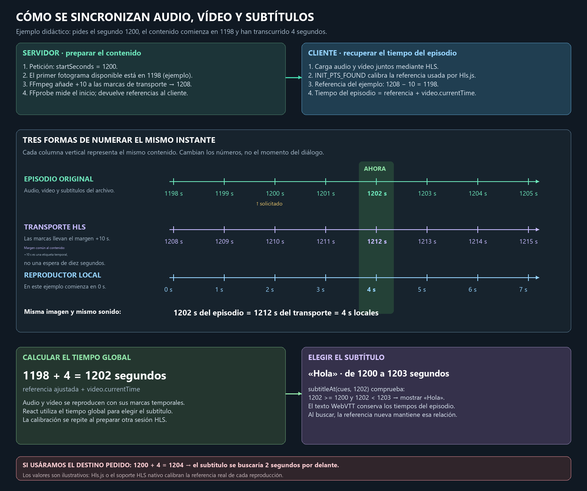

# Sincronización de tiempos

[Visión general](README.md) · [Reproducir HLS](eventos/reproducir-hls.md) · [Subtítulos](eventos/subtitulos.md)

El audio y el vídeo viajan juntos en HLS con sus marcas temporales. Los subtítulos se extraen por separado con los tiempos del episodio original. El cliente relaciona ambas referencias para mostrar el texto correspondiente al contenido que está reproduciendo.

## La idea con un ejemplo sencillo

Una frase del segundo **5 del episodio** recibe la marca **15 en el transporte HLS**, porque FFmpeg añade un margen de diez segundos:

```text
Tiempo del episodio:   0 →  1 →  2 →  3 →  4 →  5
Marcas del HLS:       10 → 11 → 12 → 13 → 14 → 15
```

Son dos maneras de numerar el mismo contenido. Audio y vídeo conservan su relación. El margen desplaza las marcas temporales; la reproducción empieza directamente con el contenido disponible.

El subtítulo de esa frase conserva el segundo **5**. Nuestro cálculo resta el margen para recuperar el tiempo del episodio: **15 − 10 = 5**. Esa resta se utiliza en la referencia de tiempo que maneja la aplicación; las marcas del contenido HLS permanecen desplazadas.

## Esquema visual

En este ejemplo se solicita el segundo 1200, el primer segmento comienza en 1198 y el reproductor lleva cuatro segundos desde ese comienzo. Cada columna vertical representa el mismo instante de contenido con distintas referencias temporales.

[](../../imagenes/video-sincronizacion-tiempos.svg)

[Abrir SVG ampliable](../../imagenes/video-sincronizacion-tiempos.svg) · [Abrir PNG original](../../imagenes/video-sincronizacion-tiempos.png)

Los números del esquema son ilustrativos. Hls.js y la alternativa HLS nativa calibran la referencia real de cada reproducción.

## 1. El servidor conserva y desplaza las marcas

Las marcas temporales indican cuándo presentar los datos multimedia. PTS significa *Presentation Timestamp*: referencia de presentación de una imagen o muestra de audio. DTS expresa su referencia de decodificación.

`CreateHlsStartInfo` configura FFmpeg con `-copyts`, `-start_at_zero`, `-avoid_negative_ts disabled`, `-output_ts_offset 10` y la opción de segmento `mpegts_copyts=1`. En conjunto mantienen la relación temporal que utiliza la aplicación y aplican el margen de transporte.

`TransportTimestampOffsetSeconds` está definido en `VideoService` con valor 10. Es un margen preventivo para dar espacio a marcas iniciales que pueden quedar por debajo de cero por las características de codificación del audio y vídeo. El valor utilizado por la implementación es diez segundos; su necesidad concreta depende del contenido y del comportamiento del transporte y el reproductor.

La suma desplaza las marcas del audio y vídeo en el HLS. El cliente resta ese margen para calcular el tiempo de la aplicación, manteniendo intactas las marcas del contenido recibido. Ambas operaciones tienen destinos distintos: preparar el transporte y consultar el tiempo del episodio.

## 2. Medir el comienzo real de una sesión

Al copiar vídeo H.264, la búsqueda puede comenzar en un fotograma clave anterior. Por eso el servicio distingue la posición solicitada del inicio real:

| Dato del ejemplo | Valor |
| --- | --- |
| Posición solicitada, `StartSeconds` | 1200 segundos. |
| Inicio real referido al episodio | 1198 segundos. |
| Marca inicial del transporte con el margen | 1208 segundos. |

`GetHlsStartTimeAsync` consulta `format=start_time` en el primer segmento mediante FFprobe. El servicio obtiene la referencia inicial:

```csharp
TimelineStartSeconds = Math.Max(0, transportStart - TransportTimestampOffsetSeconds);
```

En el ejemplo: `1208 - 10 = 1198`. `PlaybackSession` devuelve esa referencia junto con `StartSeconds` y `TransportTimestampOffsetSeconds`.

## 3. Calibrar el contador del reproductor

Hls.js interpreta las marcas del transporte y utiliza su propia línea temporal de reproducción. `video.currentTime` expresa el tiempo del elemento de vídeo en esa línea temporal.

El cliente comienza con `TimelineStartSeconds` y escucha `INIT_PTS_FOUND` para ajustar la referencia a la interpretación de Hls.js:

```javascript
const offset = timing.initPTS / timing.timescale
    - data.transportTimestampOffsetSeconds;

startOffsetRef.current = offset;
```

`timing.initPTS / timing.timescale` convierte a segundos la referencia comunicada por la biblioteca. Restar el margen la relaciona con el episodio original. Esta operación ajusta una variable del cliente que representa la referencia temporal.

Después, `handleTimeUpdate` obtiene el tiempo global:

```javascript
const globalTime = Math.max(0,
    startOffsetRef.current + video.currentTime);
```

En el ejemplo, con una referencia ajustada de 1198 y un contador local de 4:

```text
1198 + 4 = 1202 segundos del episodio
```

Si se utiliza HLS nativo, los eventos `loadedmetadata` y `canplay` permiten calibrar una vez la referencia cuando hay contenido disponible:

```javascript
const offset = data.timelineStartSeconds - video.seekable.start(0);
```

## 4. Seleccionar el subtítulo

`GetSubtitlesAsync` extrae la pista WebVTT con los tiempos del archivo original. `parseSubtitles` convierte cada intervención en un objeto como este:

```javascript
{ start: 1200, end: 1203, text: "Hola" }
```

`subtitleAt(cues, currentTime)` utiliza el tiempo global y comprueba `time >= cue.start && time < cue.end`. En el segundo 1202 se muestra «Hola», porque está dentro del intervalo de 1200 a 1203.

El elemento multimedia reproduce el audio y el vídeo siguiendo sus marcas; React selecciona el texto con el tiempo global que se actualiza mediante `onTimeUpdate`. El servidor entrega los datos y referencias necesarios para que el cliente realice este cálculo.

## 5. Buscar o cambiar de audio

Una nueva sesión puede tener otro inicio real. Se vuelve a medir su primer segmento y a calibrar la referencia del cliente. La selección de subtítulos se conserva y sus tiempos continúan referidos al episodio completo.

Si se usara la posición solicitada de 1200 como referencia cuando el contenido comienza realmente en 1198, cuatro segundos después se calcularía 1204 en vez de 1202. Las intervenciones se seleccionarían dos segundos por delante. Medir el inicio real y calibrarlo con el reproductor tiene en cuenta esa diferencia.

La barra y el guardado del progreso utilizan la misma referencia global, de forma que los tres representan el tiempo del episodio original.
