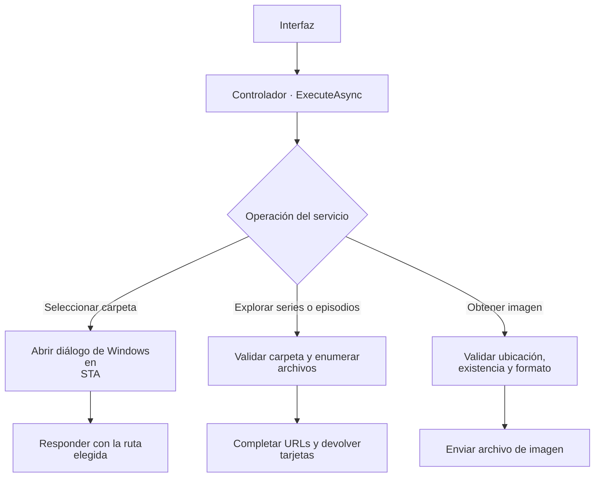

# Exploración de series

[Todos los sistemas](../../README.md)

Este sistema selecciona la carpeta de biblioteca en Windows, enumera sus series, explora sus episodios y sirve imágenes locales.

## Esquema de funcionamiento

El servicio obtiene la raíz desde la biblioteca guardada y consulta las opciones de imágenes de la configuración. El controlador prepara las URLs y el tipo de respuesta que recibe la interfaz. Cuando falta una imagen solicitada devuelve HTTP 404.

## Componentes

| Componente | Documentación | Código |
| --- | --- | --- |
| Servicio | [SeriesService](servicio.md) | [Ver código](../../codigo/SeriesService.md) |
| Modelos | [SeriesLibrary](modelos.md) | [Ver código](../../codigo/MediaItem.md) |
| Controlador | [SeriesController](controlador.md) | [Ver código](../../codigo/SeriesController.md) |

## Recorrido

`SeriesController` recibe la solicitud y llama a `SeriesService`. El servicio valida las rutas y consulta `ConfigurationService` para decidir si busca imágenes locales. Devuelve modelos con sus datos y rutas internas de imagen. El controlador convierte esas rutas en URLs de su acción `GetImage` y devuelve el JSON.

La selección de una carpeta solo devuelve la ruta; registrar la biblioteca elegida corresponde a `LibraryService`. El diálogo se abre en el equipo del servidor.

## Reglas conservadas

- Cada subcarpeta directa de la ruta explorada representa una serie, aunque no tenga vídeos.
- Los episodios se buscan recursivamente con extensiones `.mp4`, `.mkv` y `.avi`, sin distinguir mayúsculas.
- Se agrupan por el nombre de su carpeta contenedora. Carpetas distintas con el mismo nombre forman un mismo grupo.
- Un grupo con el mismo nombre que la serie se llama «Otros».
- Temporadas y episodios se ordenan textualmente por nombre.
- Las opciones de imágenes activan la búsqueda de archivos locales.

## Rutas e imágenes

Los escaneos validan que la ruta corresponda a una carpeta existente. La acción de imágenes exige que la ruta completa se encuentre dentro del `LibraryPath` de la biblioteca identificada por `libraryId`.

La comprobación de pertenencia de imágenes compara rutas normalizadas mediante `Path.GetRelativePath`.

Los valores predeterminados son `/default-episode-vertical.png` para series y `/default-episode-horizontal.png` para episodios. El cliente puede sustituir la imagen predeterminada según el estado de reproducción.
